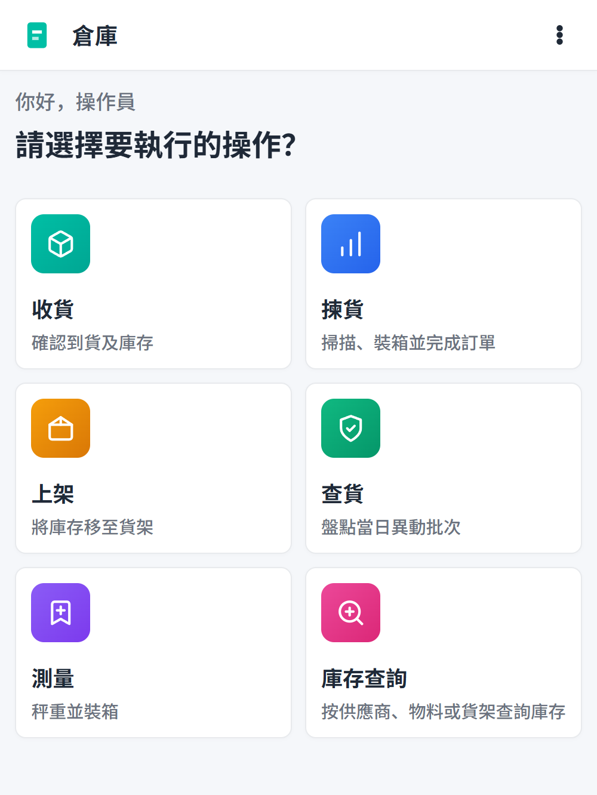

# Navigation

## Home screen

The home screen (`pages/index.vue`) shows the main menu cards (a 2-column grid):

- Receiving
- Manual Receiving — only when CN receiving is enabled
- Receiving Scan — only when CN receiving is enabled
- Put-away
- Put-back
- Picking
- Label Printing
- Print Product Label — always shown
- Labeling
- Measuring
- Verify
- Goods Verify
- Stock Search
- Ad-hoc Put-away
- Shelf Exchange
- Latency Test — always shown

Tap a card to enter that flow. Most cards are gated on the backend flow-step
config via `composables/useFlowSteps.ts`: steps disabled for the warehouse
show no card, and the Manual Receiving / Receiving Scan pair follows the
`receiving-cn` step. Settings and logout live in the app header kebab menu.

## App header

`components/AppHeader.vue` appears on most screens and provides:

- A back button to return to the previous screen.
- On detail pages: the order/task title and status badge in the title bar,
  and a page-action dropdown (horizontal-dots icon) with the page's info rows
  and actions.
- A report-a-bug button (🐞) opening `components/BugReportModal.vue`
  (in-app bug report with photo attachment).
- On the home screen (the only screen without a back button), a ⋯ kebab menu:
  language switcher (`layers/i18n/components/LanguageSwitcher.vue`), Settings
  (`/settings`) and Logout.

There is no reset-database button: the demo reset is the backend `db:seed`
CLI (the `POST /dev/reset` endpoint was removed 2026-11-06).

## Detail pages

Most flows follow a list → detail pattern:

1. A list page shows open orders/tasks.
2. Tapping an item opens a detail page.
3. The detail page's title, status, summary info and actions live in the app
   header (registered via `composables/usePageHeader.ts`); the page body shows
   only task content.
4. A floating action button (`ScanFab`) often opens a scan or action modal.

## Common UI patterns

- **usePageHeader** — detail pages register their title, status badge, info
  rows and actions into the app header.
- **DetailRow** — a labeled value row used throughout detail pages.
- **EmptyState** — shown when a list has no items.
- **ScanFab** — circular floating button that triggers a scan or action.
