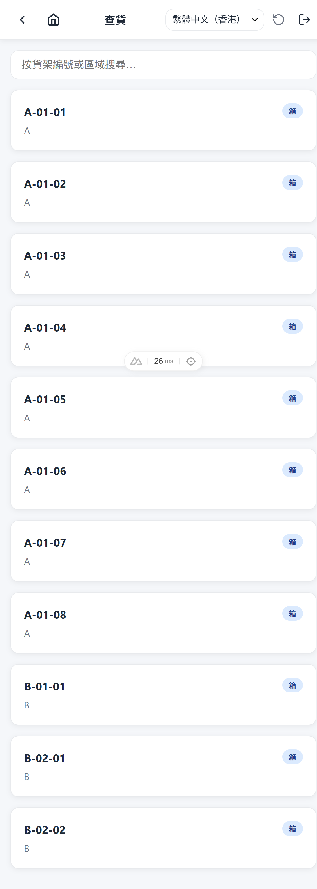
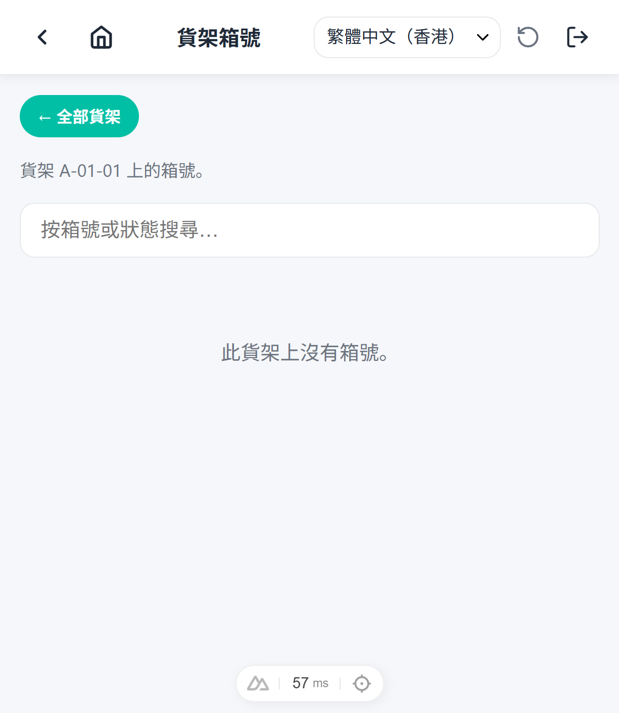

# Goods Verify Overview

Goods Verify is the daily shelf check: at the end of each day, every **shelf** that had a net on-hand movement (received, put away, picked, or adjusted) gets one summary task listing what changed on that shelf, and an operator walks the shelf and confirms it with one tap.

## When to use it

Use the Goods Verify flow once per day to confirm the system's recorded movements actually happened on the floor. It is a **confirmation** step only — if the shelf disagrees with the system, the correction happens outside this flow (stock adjust / re-scan), not here.

## Concept

1. The backend generates the tasks automatically — a nightly day-end job
   (local 00:00, with a catch-up at server start) creates one pending task
   per shelf with a non-zero net movement that day, idempotently.
   
2. The queue lists the tasks — shelf code, number of movement lines, and
   status — filterable by date and status.
3. The operator opens a task: a movement summary card per part (part number,
   description, the day's ±quantity, and the shelf's current total for that
   part) under the shelf's header.
   
4. The operator checks the shelf against the list. When it looks right, they
   tap **Confirm** once — there is nothing to enter.
5. The task flips to `verified`; the queue shows who verified it and when.

## Related guides

- [Step-by-step operator guide](./steps.md)
- [AI scope](./ai-scope.md)
