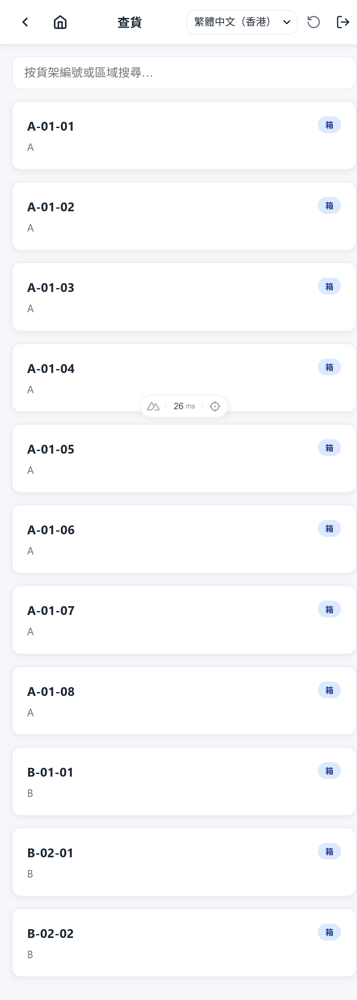
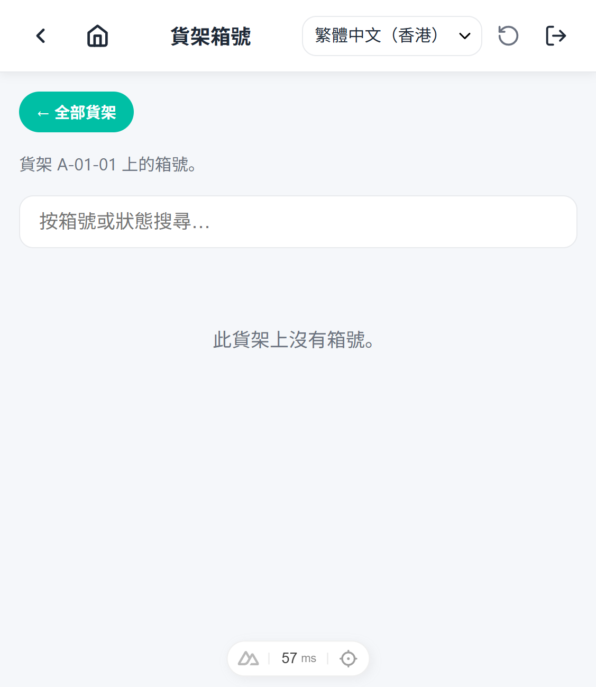

# Goods Verify Steps

## 1. Open the goods verify queue

From the home screen, tap **Goods Verify** (the tile label is 盘点). The queue
shows the tasks for the selected date (today by default) and can be filtered
by status (pending / verified).

Tasks are created automatically by the backend: a nightly day-end job (local
00:00, with a catch-up at server start) generates one summary task for every
shelf that had a net on-hand movement that day — there is nothing to tap to
generate them.

## 2. Select a task

Tap a task row to open its detail page. One task covers **one shelf for one
day** (parts that moved are listed together, not one task per part).

## 3. Review the shelf's movements

The detail shows the shelf code, the task date, and one card per part that
moved: part number / WCL item no, description, that day's net quantity change
(`+` in / `−` out), and the shelf's current total for the part. The snapshot
is taken when the task was generated — later stock moves do not update it.

## 4. Confirm the shelf

Walk to the shelf, check the parts and quantities against the list, then tap
**Verify** (pending tasks only). This is a pure confirmation — it records who
verified and when, and changes no stock.

If the shelf does **not** match the list, do not try to fix it here: correct
the stock through the normal adjust / put-away / re-scan paths for the
discrepancy you found.

The task flips to `verified` and shows who verified it and when.

> Note: the queue's text search is currently broken for typed input
> (BUG-048) — filter by date and status instead until it is fixed.
