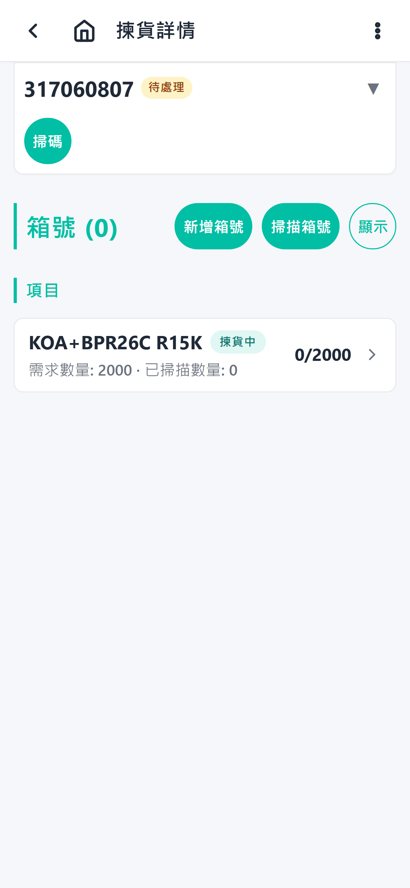

# Picking Overview

Picking is the process of removing items from inventory to fulfill outgoing picking orders.

## When to use it

Use the Picking flow when a picking order is ready and stock has been allocated.

## Concept

1. The operator opens the Picking list. Only confirmed work appears here —
   orders an admin has marked `allocated`, plus orders already `picking`;
   `picking_finished`/`measuring_finished` orders show when ticked in the
   filter (pending/skipped/issue/shipped orders are managed in the admin
   console).

   

2. The operator selects a picking order. The order opens on the **unified
   picking page** — one screen that combines the order detail and the scan
   session. The deprecated separate scan page has been removed.

   
3. The page shows the order's parts as a single list. Each collapsed row
   carries the part name with its progress inline — scanned / required
   quantity, any scans being applied, and where the remaining stock
   is allocated from (lot or receiving area). Tapping a row expands it to
   show the in-flight/failed scans, box assignment for each package, the line
   breakdown and the planned allocations. The order's boxes are listed below
   the item list.
4. The operator picks each line by scanning — every scan is recorded
   immediately (no Confirm step; the sticky footer holds the OCR/camera
   button) — or by expanding a row and assigning packages to boxes by hand.
5. Optional: the operator can scan a supplier label to auto-match and apply a pick (OCR-assisted picking).
6. When all lines are picked and packed, the operator confirms with the **Finish picking** button — only then does the picking order reach `picking_finished` and the packed boxes move on to measuring (whose completion sets `measuring_finished`).

**Outdated date-code warnings:** if a scanned label's date code is older than the supplier's outdated limit (set per supplier in the admin console), the scan still succeeds but the app shows an alert and flags the order with a warning chip. The order cannot finish — the manual **Finish** action is refused — until an admin resolves the order's warnings in the admin console; the operator then presses Finish again.

**Stock-age flags on planned allocations:** separately, a planned allocation whose source date code is older than the warehouse's outdated-stock threshold (flow config, default 2 years) shows a ⚠️ warning on the date/lot row. This is display-only — picking and finishing are not affected (unlike the supplier warnings above).

## Related guides

- [Step-by-step operator guide](./steps.md)
- [Label scan / OCR-assisted picking](./label-scan.md)
- [Issue reporting](./issue-reporting.md)
- [AI scope](./ai-scope.md)
