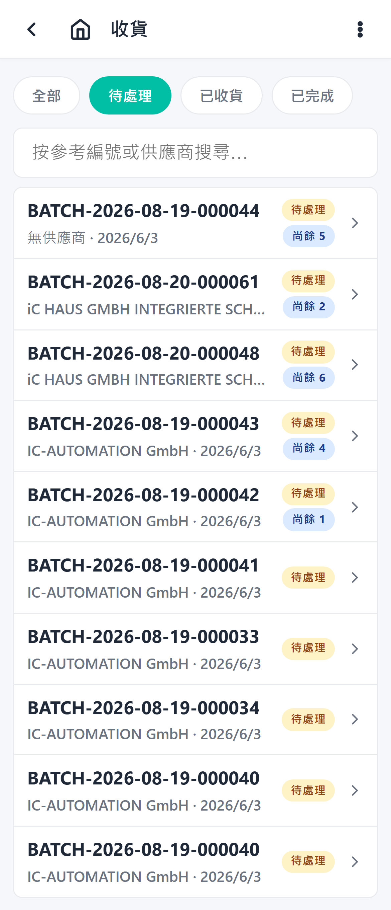

# Receiving Overview

Receiving is the process of confirming incoming shipments and creating receiving-area inventory.

## When to use it

Use the Receiving flow when a supplier shipment arrives at the warehouse.

## Concept

1. The operator opens the Receiving list.

   

2. The operator selects a receiving order.

   

3. The order detail shows invoices and invoice items — compact rows grouped by carton number when the invoice carries carton numbers; tap a row to expand quantities and mismatch actions.
4. The operator confirms quantities and reports any mismatches.
5. Confirmed items create receiving-area inventory lots.
6. The Receiving list can also show how many picking orders still need stock from each receiving order.

## Views on the detail page

- **Receiving view** — invoices and items.
- **Picking view** — linked picking orders (status, allocated lots, boxes, scanned packages) as read-only info; work on them happens on the picking order page.

## Customer receiving (CN warehouses)

CN warehouses (flow-config `cnReceiving`) run a separate world instead of the flow above. Orders arrive two ways: **manual receiving** (the operator scans every item on the PDA and commits — stock work reflects the physical scan immediately), and **PDF upload** (an admin uploads the customer receiving PDF, DocPal OCR extracts the expected items, and the admin confirms the OCR result).

The PDF path includes a physical verification step before stock work begins:

1. Admin confirms the OCR'd order → the order moves to **scanning** (no quantities received yet, no put-away task).
2. The operator opens the **收貨掃描 (Receiving scan)** task on the PDA. Expected items are grouped by part number into one row per part showing **scanned / ordered** totals (the batch values behind the group — date code / COO / COW — are listed for reference, they do not split the group); the header progress is the total scanned vs ordered quantity.
3. Each physical label scan is matched server-side and credits the matching group's running total (FIFO across its lines). Over-received quantities show as a **warning**; the operator can also flag a group as missing / damaged / wrong part / other.
4. **Finalize** stamps the order in-hand. Lines receive their credited quantity (capped at the ordered quantity); flagged and untouched lines receive nothing and stay on the order for admin follow-up.

## Related guides

- [Step-by-step operator guide](./steps.md)
- [Mismatch handling](./mismatch-handling.md)
- [AI scope](./ai-scope.md)
