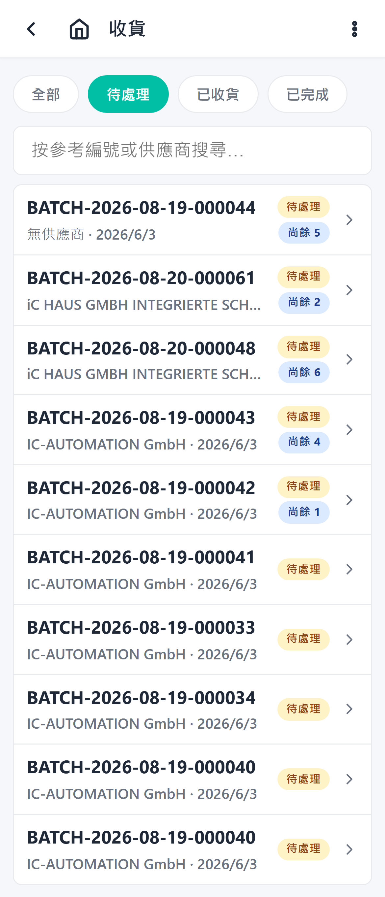
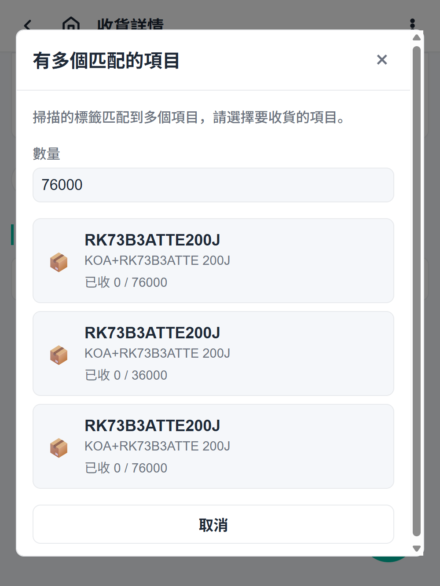
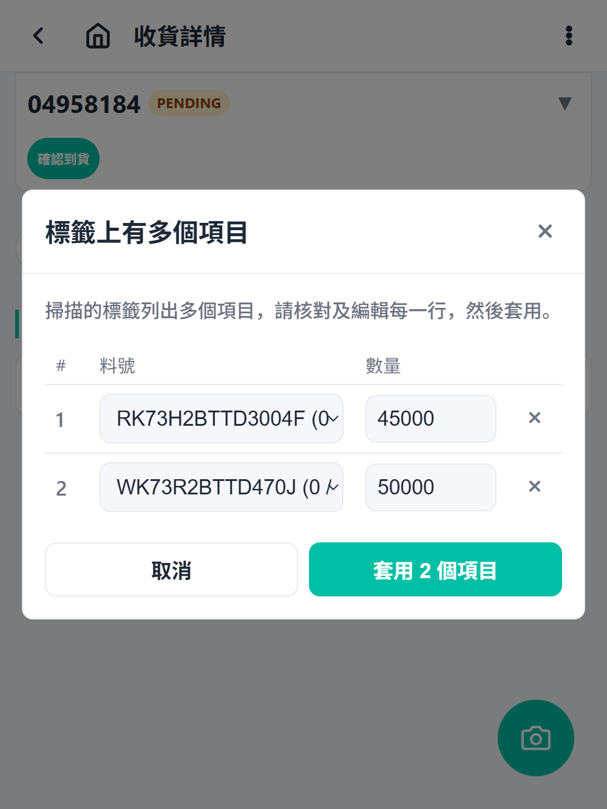

# Receiving Steps

## 1. Open the receiving list

From the home screen, tap **Receiving**. The list shows receiving orders as compact rows with status and a pending picking-order count badge; the status filters and search bar stay pinned at the top while scrolling. The list loads 50 orders at a time — tap **Load more** at the bottom for the next page, or the refresh button to reload. Search and filters apply to all orders, not just the loaded ones.

## 2. Select a receiving order

Tap the order you want to receive. The detail page opens on the Receiving view. The order name and status badge show in the app header; tap the horizontal-dots icon at the top right for the order details (supplier, date code, delivery date, remaining items) and the **Confirm arrived** / **Put away remaining** actions.

## 3. Review invoices and items

The detail shows each invoice and its line items as compact rows. When the invoice carries carton numbers, items are grouped under a carton (`ctnNo`) header with a trailing **No carton** group for the rest; otherwise the rows are flat. Tap a row to expand its quantities (expected / reserved / picked / put away / available, date/lot/COO/COW) and its actions — mismatch report, confirm, and cancel live inside the expanded row.

## 4. Confirm or adjust quantities

- If the physical quantity matches, confirm the line.
- If the quantity differs, report a mismatch. See [Mismatch handling](./mismatch-handling.md).

## 5. Create receiving-area inventory

Confirmed items become receiving-area inventory lots that can be picked or put away. If the warehouse configures sub-inventory rules (Admin → Flow Config), each item's sub-inventory is assigned automatically at this point from its org and PO number, so the stock can match picking demand right away.

## 6. Switch to Picking view (optional)

Tap **Picking** to see the linked picking orders — each order's status, required/scanned/boxed quantities, allocated lots, and boxes. The tab is read-only; to work on a picking order (scan, box, remove packages), open the picking order itself.

## Scanning labels (optional)

Tap the floating camera button to scan a supplier label instead of confirming lines manually:

- A label that matches exactly one item applies immediately.
- An ambiguous or unknown label opens the candidate review dialog — pick the
  invoice line and quantity to receive.

  

- A **carton label listing several items** opens the multi-item table: one
  editable row per item (part + quantity). Apply receives every row; failed
  rows stay editable for a retry.

  

## CN receiving scan (收貨掃描)

For CN warehouses, orders confirmed from the admin PDF-upload path land in the **Receiving scan** queue instead of going straight to put-away (manual receiving skips this step — it is already a scan).

### 1. Open the receiving scan list

From the home screen, tap **收貨掃描**. The list shows orders waiting to be scanned with per-order progress (resolved items / total items).

### 2. Scan the physical items

Tap an order to open its detail. The expected items are grouped by part number — one row per part showing **scanned / ordered** totals, a status badge, the PO numbers behind it, and the distinct batch values for reference (batch fields do not filter matching; the scanned label overwrites them). The header progress is the total scanned vs ordered quantity. Scan each item's label with the hardware scanner or camera; the app parses the label and the server credits the matching part (FIFO across its lines) — no item picking needed, even when several lines share a part:

- The group's scanned total grows with each scan; when it reaches the ordered quantity the group is complete, and an over-received quantity becomes a **warning** (with an over-received toast).
- A label that matches nothing on the order is rejected with an error toast; the same label scanned twice in a session is rejected as a duplicate.
- If a group is not as expected, use the group's **Flag** action to mark it missing, damaged, wrong part, or other (with a note). Use **Reset** to clear the group's scan state and start over.

### 3. Finalize

When every item is resolved, tap **Finalize** (optionally marking all remaining items as missing). Lines receive their credited quantity (capped at the ordered quantity) and get a put-away task; flagged and untouched lines receive nothing and stay on the order for admin follow-up. The app then takes you to Put-away.
