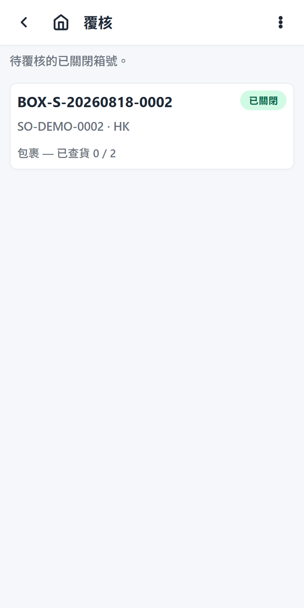

# Verify Overview

Verify is a second check of a shipping box: another worker re-scans every item in the box, and can re-open the box to correct measurements, before the box goes to shipping. The box is normally already measured and closed; when the measuring step is turned off, the box is still open and completing the verify closes it.

## When to use it

Use the Verify flow when a verify task was created for a box (one task per box — created on box close, or at labeling finish / picking finish on the still-open box when the measuring step is off; a labeling-pending order's tasks wait for its labeling to clear — see [Labeling](../labeling/overview.md)). The step can be turned off entirely in the flow config (`steps.verify.enabled=false` in the `warehouse_config` row `"flow"`; legacy `FLOW_STEPS_DISABLED` still works, deprecated) — then no verify tasks are created, closed boxes go straight to shipping, and the Verify tile is hidden.

## Concept

1. The operator opens the Verify list — boxes with a pending verify task. A box may contain packages from several picking orders (cross-order packing).

   
2. The operator selects a box — the page shows the box's packages with their re-scan progress and recorded measurements.
3. If the box needs correction, the operator taps **Reopen** — the box opens and its packages must be re-scanned before it can be re-closed.
4. On the box page (shared with measuring) the operator scans each package's QR label again to re-verify it — this works on the closed box (checking contents against the sealed box is the normal verify pass). Box size, weights (kg), and destination country can be edited while the box is open.
5. When every package has been re-scanned and the box is closed (or still open, when the measuring step is off — completing then closes the box), the operator completes the verify task — the box is now ready to ship.

## Related guides

- [Step-by-step operator guide](./steps.md)
- [Box measurements](../measuring/box-measurements.md)
- [AI scope](./ai-scope.md)
