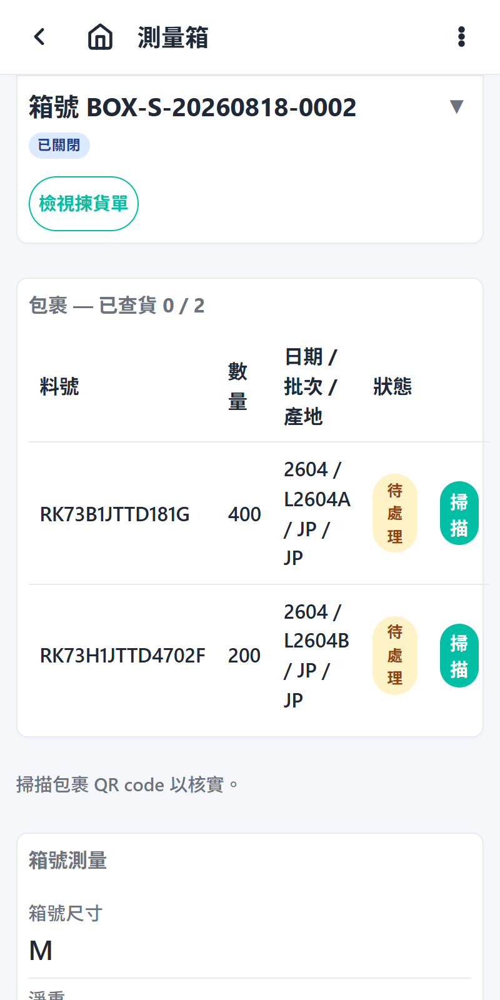

# Verify Steps

## 1. Open the verify list

From the home screen, tap **Verify**. The list shows the boxes with a pending verify task (one task per box, created when the box was closed — or at picking finish, when the measuring step is turned off). When measuring is off, finishing a picking order also jumps straight to this list.

## 2. Select a box

Tap the box to open its page. The page shows the box's packages with their re-scan progress and recorded measurements — a box may hold packages from several picking orders.

If a **carton label** was printed for the box, you can also scan it from the list — the matching box opens directly (and the carton label counts as verified).

## 3. Reopen the box if it needs correction

A closed box shows a **Reopen** button while its task is pending. Reopening returns the box to open and clears its packages' verified flags (both passes), so they must be scanned again before the box can be re-closed.

## 4. Re-verify the packages

The box page (shared with measuring) lists the box's packages in a table. Scan each package's QR label with the hardware scanner — a matching package is re-verified immediately and its row flips to **Verified**. Scanning works on the closed box too: the normal verify pass checks every item against the sealed box without reopening it. The per-row **Scan** button (camera OCR with review) is the fallback for labels the QR parser cannot handle.

Every package in the box must be re-scanned in this pass — the task cannot complete until all of them are.

The page has up to two sections:

- **Labels to verify** — shown when the box contains orders with printed labels. Scan each printed item/item-box label once (the row flips to *label scanned*), then scan the physical items; the app rejects an item whose part number, COO or date code does not match the label. If a carton label was printed, a carton row sits at the top until you scan it.
- **Items to re-scan** — orders without printed labels (including external-label orders) show one row per item with the total qty; scan in any combination until each total is reached.

## 5. Correct measurements if needed

When every package in an open box is verified, the measurements form opens automatically (or tap **Enter measurements** in the header's page-action menu). Box size, net/gross weight (kg — the net weight pre-fills from the part net-weight master), and destination country can be edited; then **Confirm box** closes the box again. See [Box measurements](../measuring/box-measurements.md).

## 6. Complete the task

When the box is closed, every package re-scanned, and every printed label verified (carton label included, when one was printed), tap **Complete verify** (the button appears only then — a missing label scan shows a "labels not all verified" error). The box moves on to the admin shipping feed.
