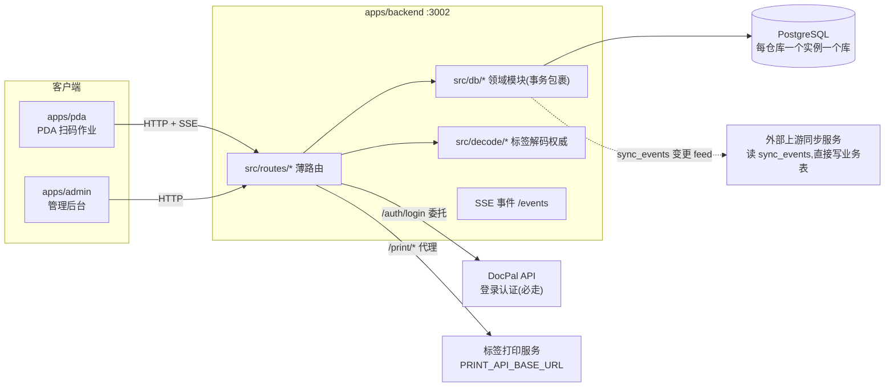

# 开发者上手指南(项目交接文档)

本文档是仓库 PDA 系统的开发者交接入口:新开发者读完本指南 + 对应流程文档,即可独立接手开发,无需口头讲解。

> 本文档只做"导航 + 关键决策摘要"。**权威细节**永远在:代码旁的 `docs/superpowers/specs/` 设计文档、`docs/app-docs/flows/*/ai-scope.md`、`docs/backend/*.md`。冲突时以那些为准。

## 0. 在 Obsidian 中使用

把**仓库根目录**作为 vault 打开(至少 `docs/` 为 vault 根),本文档体系内的相对链接、Graph view、Backlinks 全部原生可用,Mermaid 直接渲染,零配置。

- shortcut: 链接刻意用相对 Markdown 链接而非 `[[wikilink]]`——Obsidian 两者都认,但 `[[...]]` 在 GitHub 上是死文本。若要 Obsidian 新链接也生成 Markdown 格式,在 Obsidian 设置里把 "New link format" 设为 "Relative file path" 并关闭 "Use [[Wikilinks]]"。
- 每篇流程文档都有 `aliases:` frontmatter(拣货 / Picking / 贴标签…),Obsidian 里直接 `[[拣货]]` 也能补全跳转。

## 1. 项目是什么

pnpm monorepo,仓储作业的三端应用:

| 应用 | 目录 | 技术 | 说明 |
|------|------|------|------|
| PDA 手持终端 | `apps/pda` | Nuxt 3 (`ssr:false`) + Capacitor | 打包成 Android APK,仓库操作员用硬件扫码枪作业 |
| 管理后台 | `apps/admin` | Nuxt 3 (`ssr:false`) | 办公室人员用:分配、审批、配置、导出 |
| 后端服务 | `apps/backend` | Hono + Drizzle + PostgreSQL | 端口 3002,单一 HTTP API,前后端唯一契约 |

## 2. 架构图



## 3. 跑起来

完整命令见根 [`AGENTS.md`](../../AGENTS.md)("Common commands"一节),最短路径:

```bash
pnpm install && docker compose up -d   # 起共享 Postgres
pnpm dev:backend                       # :3002,启动时自动应用迁移 + 种子数据
pnpm --filter @warehouse/pda dev       # :3104 PDA 端
pnpm --filter @warehouse/admin dev     # :3100 后台(注:见 apps/admin)
```

- 登录**必须**走 DocPal(`DOCPAL_URL` 必填,无本地密码登录)。本地联调用 fake DocPal,演示账号 `operator` / `admin`,密码见 AGENTS.md。
- 改 schema 后:`pnpm --filter @warehouse/backend db:generate` 生成迁移。
- 测试:`pnpm --filter @warehouse/backend test`(node:test,需 Postgres)、`pnpm --filter @warehouse/pda test`(vitest)。

## 4. 代码分层约定(先记住这一张表)

一次请求穿过的位置,所有流程都遵守:

```
pages/<flow>/index.vue (列表)          apps/pda/pages/picking/index.vue
pages/<flow>/[id].vue (详情/作业)      ──→ composables/* ──→ useWarehouse()
                                              │ WarehouseService 接口
                                              ▼
                              services/adapters/backendWarehouse.ts (唯一适配器)
                                              │ fetch (services/apiClient.ts)
                                              ▼
                              src/routes/<flow>.ts (薄路由,只做参数/鉴权)
                                              ▼
                              src/db/<flow>.ts (领域模块,事务包裹,错误用 snake_case HTTPException)
                                              ▼
Postgres:业务表 + transaction_logs/inventory_transactions(账本,必须同事务写入)
```

- 每个业务流一个路由文件 + 一个 db 模块:`receiving.ts`、`picking.ts`、`putaway.ts`、`measuring.ts`、`verify.ts`…(`ls apps/backend/src/routes apps/backend/src/db`)。
-  mutation 请求体必须带 `actorId`(来自 JWT,永远不信任 body)。
- 列表页用 `useVisibleReload(load, topics)` 模式:挂载 + 页面可见 + SSE topic 变化时重拉(客户端无缓存)。

## 5. 全局关键业务决策(不知道就会改错代码)

| 决策 | 内容 | 权威参考 |
|------|------|----------|
| 每仓库一实例 | 没有 `warehouse_code` 列;库存/单据按 `org_id + sub_inventory_code` 分区;仓库差异靠 flow config,**不建 git 分支** | `docs/backend/flow-config.md`、spec `2026-10-09-multi-warehouse-configurable-design.md` |
| 分配只手动重算 | 任何 mutation 路由不触发再分配;管理员按单 Re-allocate 或 confirm-arrival;UI 靠 SSE `allocation.computed` 收敛。Re-allocate **严格单订单**(其他共享料号的订单行不动) | `docs/backend/allocation.md`、specs `2026-11-03-allocation-manual-only-design.md`、`2026-11-05-picking-reallocate-single-order-design.md` |
| 解码权威在后端 | 标签 QR 解析统一走 `POST /scan/decode`(supplier 模板 + 月码周期 + dateCodeFormat);PDA 本地 OCR 启发式只是 `matched:false` 兜底 | `docs/superpowers/specs/2026-11-03-backend-scan-decode-design.md` |
| 料号业务键 | `parts.part_no` **不唯一**,业务键是 `wcl_item_no`;NCC 标签印的是图号,经外部表 `wcl_part_drawno` 解析 | `docs/backend/schema-conventions.md` |
| 任务可见性三段过滤 | `assignee`(NULL=全员可见)+ 用户 sub-inventory 范围 + `allowedOrgIds`,全部服务端过滤(`src/db/user-scope.ts`),前端不做权限判断 | spec `2026-11-01-task-assignee-design.md` |
| 重扫完成口径 | 完成 = `picking_packages.rescanned_qty >= qty`,匹配是**客户端聚合**(按料号总量 + 批次字段,FIFO 部分记账) | `docs/backend/verify-measuring.md` |
| 上游同步外部完成 | 外部服务直接读 `sync_events` 表变更 feed、直接写业务表;本仓库**没有**入站同步端点 | AGENTS.md "Upstream sync" |
| 账本不可拆 | `transaction_logs` + `inventory_transactions` 必须与业务写同一事务 | AGENTS.md "Layering" |
| **WebView 只到 Chrome 101** | T23X 设备 ROM 钉死 WebView 101:禁用 `AbortSignal.timeout` 等新 Web API(曾致所有 fetch 报网络错误,BUG-043)。引入新浏览器 API 前查 caniuse | AGENTS.md "Fleet WebView" |
| 设备用 127.0.0.1 不用 localhost | 部分 ROM WebView 解析不了 `localhost` | AGENTS.md "Device networking notes" |

## 6. 流程文档索引(`flows/`)

每篇结构固定:**流程图(节点=入口页面/组件/API)→ 步骤表(前端入口 → API → 数据表)→ 关键逻辑 → 关键业务决策 → 坑**。

| 流程 | 文档 | PDA 入口 | Admin 入口 |
|------|------|----------|------------|
| 拣货 Picking | ✅ [flows/picking.md](./flows/picking.md)(结构样板) | `/picking` | `pages/picking-orders` |
| 收货 Receiving | ✅ [flows/receiving.md](./flows/receiving.md) | `/receiving` | `pages/receiving` |
| CN 收货 | ✅ [flows/receiving-cn.md](./flows/receiving-cn.md) | `/receiving-cn-scan` | `pages/receiving-cn` |
| 上架 Put-away | ✅ [flows/put-away.md](./flows/put-away.md) | `/put-away` | — |
| 贴标签 Labeling | ✅ [flows/labeling.md](./flows/labeling.md) | `/labeling` | — |
| 打印标签 | ✅ [flows/label-printing.md](./flows/label-printing.md) | `/label-printing` | `pages/label-print-rules` |
| 自訂列印標籤 | ⧗ [flows/custom-print-label.md](./flows/custom-print-label.md)(交接中:只有佔位頁) | — | `pages/custom-print-label.vue` |
| 称重量方 Measuring | ✅ [flows/measuring.md](./flows/measuring.md) | `/measuring` | `pages/shipping` |
| 复核 Verify | ✅ [flows/verify.md](./flows/verify.md) | `/verify` | — |
| 货物校验 Goods verify | ✅ [flows/goods-verify.md](./flows/goods-verify.md)(注意:该流 2026-10 已重设计为货架盘点摘要) | `/goods-verify` | — |
| 库存查询 Stock search | ✅ [flows/stock-search.md](./flows/stock-search.md) | `/stock-search` | `pages/stock-search.vue` |
| 无单上架 Ad-hoc put-away | ✅ [flows/ad-hoc-put-away.md](./flows/ad-hoc-put-away.md) | `/ad-hoc-put-away` | — |
| 分配 Allocation(后台引擎) | ✅ [flows/allocation.md](./flows/allocation.md) | (SSE 收敛) | Re-allocate 按钮 |
| 认证与用户 Auth | ✅ [flows/auth.md](./flows/auth.md) | `useAuth()` | DocPal 管理 |

## 7. 权威文档地图(按用途查)

> ✅ 2026-11-07 全量文档审计:下列英文文档已与代码对齐(goods-verify 重写、幽灵路径清除、api-design/event-catalog 补全)。今后**发现文档与代码不一致 = 按 §Feature workflow 修文档 + 记 UAT**;改功能的行为时,同一 commit 里更新对应 ai-scope / registry 行,漂移就不会回来。

- 改后端路由/接口 → [`docs/backend/api-design.md`](../backend/api-design.md)(路由目录)
- 加/改 SSE 事件 → [`docs/backend/event-catalog.md`](../backend/event-catalog.md)
- 改表/写查询 → [`docs/backend/schema-tables.md`](../backend/schema-tables.md) + [schema-conventions](../backend/schema-conventions.md)
- 改某个用户可见功能的行为 → `docs/app-docs/flows/<flow>/ai-scope.md`(边界与限制)+ 对应 spec
- 页面 ↔ 源文件映射 → [`docs/app-docs/ai/code-map.md`](../app-docs/ai/code-map.md)、[feature-registry.md](../app-docs/ai/feature-registry.md)
- 历史 bug 案例库 → `docs/uat/bugs/BUG-*.json`(每个带修复 commit,`git show` 看修法)
- 培训/操作界面文案(繁体,可直接给操作员) → `docs/app-docs/user-menu/`、`admin-user-menu/`

## 8. 新人第一周建议任务

1. 跑通本地三端 + 用 demo 账号登录,把 [flows/picking.md](./flows/picking.md) 的流程图对着屏幕走一遍。
2. `pnpm --filter @warehouse/backend test` 全绿跑一遍,读 `src/db/picking.test.ts` 感受测试写法(共享 TEST_DATABASE_URL、串行跑)。
3. 挑一个 `docs/uat/bugs/` 里 `status=closed` 的 bug,`git show` 它的修复 commit——这是理解真实坑最快的方式。
4. 改一个 admin 小字段练手:加字段要走 `apps/admin/utils/entities.ts` → `CrudTable/CrudForm` 模式。
