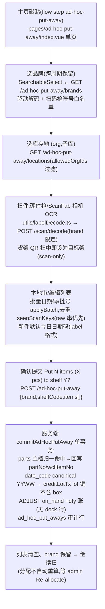

# 无单上架 Ad-hoc Put-away 流程

没有收货单支撑的件直接入库存:旧仓回填、写出归还。**单页、单批、一次提交,无任务/无锁/无状态机**;审计存 `ad_hoc_put_aways`(JSONB 快照),库存真相直接落 `inventory_lots`。

**权威细节**:[ai-scope](../../app-docs/flows/ad-hoc-put-away/ai-scope.md) · [overview](../../app-docs/flows/ad-hoc-put-away/overview.md)。⚠ 两篇的 "supplier 选择"「从下拉选架」措辞已过时:代码是 **brand** 驱动 + 选架 scan-only。

## 1. 流程图(节点标注入口)

## 2. 步骤表

| 步骤 | 入口 | API | 关键表/模块 |
|------|------|-----|-------------|
| 品牌/位置选项 | `pages/ad-hoc-put-away/index.vue`(唯一页面) | `GET /ad-hoc-put-away/brands`、`/locations`、`/part-lookup` | `parts.brand`、`org_info`、`inventory_labels` |
| 扫码解码 | `useLabelScan` + `useBrandSymbologyScope`(`{withShelfCodes:true}`) | `POST /scan/decode` | `src/decode/`(TE/NCC 在服务端解) |
| 提交 | confirm 按钮 | `POST /ad-hoc-put-away` → 201 `{id,itemCount,totalQty}` | `db/adhocPutaway.ts` `commitAdHocPutAway`、`creditLotTx` |
| 审计查看 | admin `pages/ad-hoc-put-aways/`(只读,无撤销 UI) | `GET /admin/ad-hoc-put-aways(/:id)` | `ad_hoc_put_aways` |

## 3. 关键逻辑

- **主档权威回写**:提交时 `normalizePartNo` 双列匹配 `parts`,命中后件上的 `partNo/wclItemNo` 换成**主档值**(客户端 `<brand>/<mpn>` 推导对 TE 形状是错的);未知件 404 `part_not_found`。
- **账本是 `ADJUST on_hand +qty`,不是 PUT_AWAY**:没有 dock 来源量可对冲,不造假 dock 赤字。`creditLotTx` 是「库存落架」的唯一实现,cancel-invoice put-back 完成路径**复用它**(spec `2026-11-07-cancel-invoice-putback-design.md`)。
- lot 键 = part + shelf + 批次字段 + org/子库,**不含 box_id**(与 shelf-direct 一致)。
- 去重键 = 原始扫描串(`raw:<整串>`,OCR 退化 `serial:`);KOA 序列号跨盘复用会误杀,所以 raw 优先;删行释放键。
- location 三层:页级默认 pair → 扫描时 stamp 到 item → 提交前补齐;per-item 覆写只进 items/lot/ledger,**审计头只取 items[0]**。
- 提交校验逐项 400(brand/shelfCode 非空、partNo、正整数 qty、orgId、subInventoryCode)。

## 4. 关键业务决策

| 决策 | 理由 | spec |
|------|------|------|
| 无单件直接入库存,新表仅审计 | 无收货单上下文;真相在 lot+ledger | `2026-10-07-ad-hoc-put-away-design.md` |
| brand(非 supplier)驱动解析与白名单 | 盲扫页无订单上下文,解析规则必须显式选 | 同上 |
| Admin 只读视图、无编辑/撤销 | 审计可见即可;冲正走 stock-adjust | `2026-10-08-ad-hoc-put-away-admin-design.md` |

## 5. 坑(命名三面不一——已知 bug 面)

- **代码字段是 `brand`,文档/spec 写 `supplierCode`,admin 页又读 `supplierCode` 列** → admin 列表/详情的 supplier 列**显示空**(`apps/admin/pages/ad-hoc-put-aways/index.vue`)。
- **admin 品牌筛选静默失效**:admin 发 `?supplierCode=`,后端只读 `brand` query → 不过滤任何东西。
- ledger `referenceId` 回填按 `(referenceType, '', actorId)` 认领空串行:同 actor 并发提交两批理论上会互抢(低概率)。
- 这类 lot 无 `inventory_lot_sources` → stock-search 的「来源收货单」列为空。
- 过期警告/assignee/SSE 全不覆盖此流——与标准上架的直觉差异。
- 提交路径每次全表拉 `parts` 做归一 Map(lookup 端点已改走 `idx_parts_norm_*`,提交没改)——大主档下是慢点。
- 批量 apply 按钮文案硬编码 `"Y"`(i18n 被注释)。
