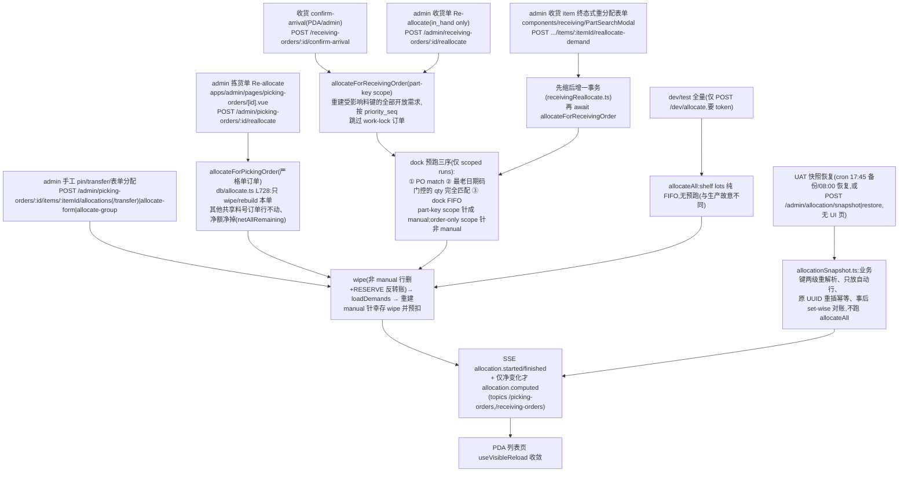

# 分配 Allocation(后台引擎,无 PDA 页面)

把库存 lot / dock 收货行按拣货需求算成 `allocations` 行 + 配对 `RESERVE` 账。**只手动触发**——任何 mutation 路由不再自动重算;UI 靠 SSE `allocation.computed` 收敛。操作员消费分配靠拣货扫码即时扣行(`reduceAllocation`,同事务),不触发重算。

**权威细节**:**[docs/backend/allocation.md](../../backend/allocation.md)**(必读)+ `src/db/allocate.ts` 头部注释(两核心的 mechanics 与 pre-pass 分叉都写在那里)。

## 1. 流程图(触发 → 引擎 → 收敛)

## 2. 触发/操作表

| 谁/动作 | 入口 | API | 引擎路径 |
|---------|------|-----|----------|
| 收货到货 | PDA receiving 详情 | `POST /receiving-orders/:id/confirm-arrival` | `awaitAllocationTask(allocateForReceivingOrder)`;失败响应 `allocation:null` 不回滚 |
| 拣货单重分配 | admin picking-orders 详情 | `POST /admin/picking-orders/:id/reallocate`(409 `order_not_open`/`lock_held`+holder) | `allocateForPickingOrder` |
| 收货单重分配 | admin receiving 详情 | `POST /admin/receiving-orders/:id/reallocate` | part-key scope |
| 逐料键表单 | admin receiving `PartSearchModal` | `POST /admin/receiving-orders/:id/items/:itemId/reallocate-demand`(逐行 reason 409) | `db/receivingReallocate.ts` |
| 手工控制 | admin picking 详情 availability 弹窗 | `GET /admin/part-availability`、`/admin/part-allocations`、`POST .../allocations(override 可抢)/transfer/DELETE .../allocations/:id` | `db/allocate.ts` L934/1100/1348 |
| 状态覆写 | admin(单/批量) | `PATCH /admin/picking-orders/:id/status`(**不排**重算)、`PATCH /admin/receiving-orders/:id/status`(**await** scoped) | `routes/admin/flowEdits.ts` |
| 消费侧 | PDA 拣货扫码 | `POST /picking-items/:id/scan` 等 | **不重算**,只扣行 |

## 3. 关键逻辑

- **需求加载**:`openQty = qty − Σ picking_packages`;`ORDER BY priority_seq, delivery_date, order_no, pi.id`;默认只取 `pending/picking` 且未持锁——`allocated` 单**根本不进 `loadDemands`**(所以 wipe 集也不含它,锁定的分配天然免疫);单订单模式不过滤状态(这是 `allocated` 的修复通道)。
- **位置匹配**:需求与源的 `(org_id, sub_inventory_code)` 对相等或 `sub_inventory_share_members` 同组;code 比较一律 `upper()`;NULL-pair 需求不限。调拨单需求经 `resolveDemandLocation` 换 pair(`pickingFromSubinventoryOrgs` 组 + 收货规则解析)。
- **源的三态**(check `chk_allocations_source`):`inventory_lot_id`(货架)| `receiving_invoice_item_id`(有 `ctn_no` 的箱粒度 dock 行)| `receiving_order_id`(无 ctn_no 整单)。
- **unknown shelf**:上游绕过 FK 写入的野 `shelf_code` lot 被引擎排除、永不打 `allocated_qty`;手工针上去 409 `shelf_not_found`;admin 用 `part-availability.shelfKnown` 识别。
- **串行 runner**:`scheduleAllocateAll`(合并触发)/`awaitAllocationTask`/`awaitAllocateAll`;`computed` 事件按 multiset key 比较**只在净变化时发**(manual 行除外)。
- **快照恢复是外科手术**:manual 冲突只报告不覆盖;绝不自动 fleet 重算。

## 4. 关键业务决策

| 决策 | 理由 | spec |
|------|------|------|
| 全部自动触发点删除,改纯手动 | 静默 fleet 重建耗秒级事务、在操作员页面下改行 | `2026-11-03-allocation-manual-only-design.md` |
| 唯一例外:confirm-arrival await part-key scoped run | parts 互不竞争、证明过够快可放进响应 | `2026-09-10-scoped-allocation-confirm-arrival-design.md` |
| Re-allocate 严格单订单 | 管理员预期按钮只影响所选单(A 重排波及 B 被当 bug 报);共享需求净额扣减 | `2026-11-05-picking-reallocate-single-order-design.md` |
| dock 预跑三序(PO match→日期码门控 perfect match→FIFO) | perfect match 不看日期码会压旧发新 | `2026-11-05-allocation-dock-match-ordering-design.md`(取代 `2026-09-22-allocation-perfect-match-design.md`) |
| `allocated`=管理员锁定的分配、`skip`=永不参与 | 办公室确认过的行引擎不再动;参考单释放占用 | `2026-09-22-picking-allocated-skip-status-design.md` |
| manual 针幸存 wipe+预扣 | 手工意图不被引擎覆盖 | `2026-09-15-admin-picking-item-actions-design.md` |
| 表单终态式(absent 源不动、先缩后增) | 弹窗带过滤器时增量表单会静默释放不可见库存 | `2026-10-12-admin-receiving-reallocate-form-design.md`、`2026-10-14-admin-picking-group-allocate-design.md` |
| UAT 夜间快照/恢复 | 上游夜间清库后修复计数器/分配且绝不覆盖有效快照 | `2026-10-26-uat-allocation-snapshot-restore-design.md` |
| 需求顺序=priority_seq | 先到先占,admin 可重排 | `2026-07-23-picking-priority-allocation-design.md` |
| 无 ctn_no 整单分配 | 老 API 语义保留 | `2026-07-09-allocate-picking-at-receiving-order-level-design.md` |

## 5. 坑

- **UI 不会自己收敛**:改完库存/优先级没有管理员按键就是陈旧的——演示时记得按 Re-allocate 或 confirm-arrival。
- 单订单 Re-allocate **不平 other 订单的未分配需求**:重排优先级后要逐单按;新单可抢走高优单现货(spec 明确 accepted trade-off)。
- order-only scope 预跑针**故意非 manual**(manual 会泄漏出订单且永不被别人 wipe,还会把 `changed` 钉死)。
- `POST /dev/allocate` 与 scoped 引擎结果**故意不同**(无预跑),别拿它当生产预期。
- recompute 失败不回滚业务写:响应 `allocation:null` = 需求 stale,非收货失败。
- NULL-pair 的 receiving 源被跳过并计入 `skippedReceivingSources`——「可见但不可分配」。
- remove-allocation 是 transient:下次重算可能分回来;「移库不扣库」:表单没放完的池子会被引擎按优先级发出去。
- 日期码 FIFO 依赖 canonical YYWW 字典序;WWYY 标签仓靠 `dateCodeFormat` 规范化 — `2026-10-22-datecode-format-config-design.md`。
- work-lock TTL 10 分钟(`WORK_LOCK_TTL_MINUTES`,`allocate.ts`);持锁单 fleet/part-key run 跳过、单订单重按 409。

## 6. Admin 控制点

- `pages/picking-orders/[id].vue`(重按/逐料手工/状态覆写)、`pages/receiving/[id].vue`(重按、`ReceivingAllocationRow` 逐行 (x))、`pages/flow-config.vue`(`picking.allocation.allowDockStock`、`pickingFromSubinventoryOrgs`)、`utils/flowApi.ts` 封装。
- 快照/恢复**无 UI**,只有 cron + API。
