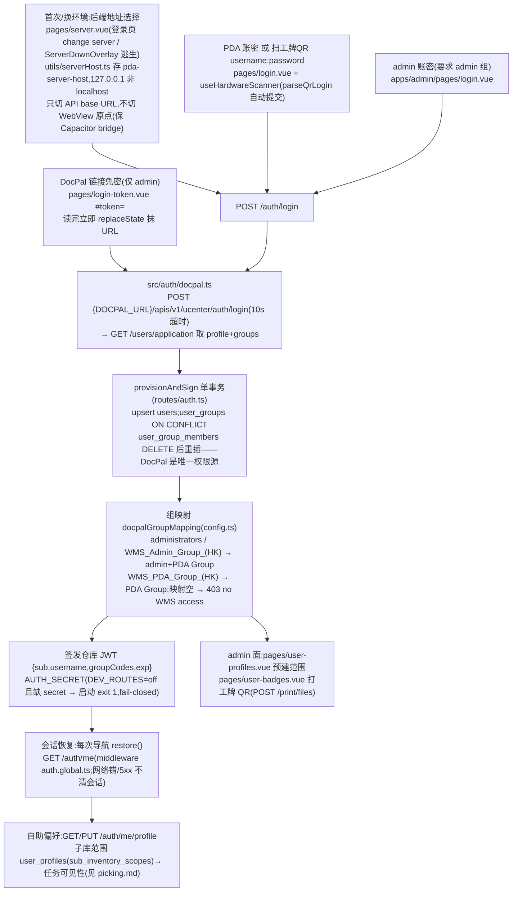

# 认证与用户 Auth 流程

**登录永远委托 DocPal API**(无本地密码;`users.password_hash` 恒空),本地自动建档 + 组映射;签发自己的 HS256 JWT(12h=一个班次)。用户/组的增删改在 DocPal,本系统没有管理 UI。

**权威细节**:`src/auth/docpal.ts` + `routes/auth.ts` + spec `2026-08-13-docpal-auth-design.md`(本地文档口径见 AGENTS.md "Auth" 一节——其豁免清单漏了 `/latency-ping`,以 `src/auth/middleware.ts` `isOpenPath` 为准)。

## 1. 流程图(节点标注入口)

## 2. 步骤/契约表

| 动作 | 入口 | API | 关键表/模块 |
|------|------|-----|-------------|
| 登录 | PDA/admin login 页 | `POST /auth/login`(401 invalid / 403 no WMS / 502 IdP down) | `db/schema` users/user_groups/user_group_members |
| 免密链接 | admin `login-token.vue` | `POST /auth/login-token {accessToken}`(验 DocPal token 后同一 provision) | `2026-09-11-token-login-link-design.md` |
| 会话 | `composables/useAuth.ts` restore / `apiAuth.ts` | `GET /auth/me` | token 存 localStorage `warehouse-token` |
| 登出 | — | `POST /auth/logout`(**no-op**,客户端丢 token;无服务端吊销,吊销机制留后手见 `routes/auth.ts` L168 注释) | — |
| 豁免路由 | — | `/health`、`/latency-ping`、`POST /auth/login(-token)`、`/dev/lab*`;`GET /events` 收 `?token=`(EventSource 不能设 header);**`/dev/allocate` 要 token** | `src/auth/middleware.ts` |

## 3. 关键逻辑

- **mutation actor 只来自 token,永不信任 body**(全局约定)。
- 每次登录**全量替换**组关系——DocPal 改组即时生效(下次登录时);本地不存权限。
- displayName 拼接规则:纯 CJK 姓+名之间不加空格;email 空串归 NULL;username 取 `userId` 优先。
- 错误面收敛:DocPal 失败统一 `DocpalAuthError(401|502)`,客户端只见通用文案,真实原因进服务端日志。
- CORS 默认全放开(`CORS_ORIGINS` 收紧);`X-Client: admin` header 跳过 **assignee 过滤**(工作可见性非安全边界,可伪造是设计内;admin 组本身的守卫在 `routes/admin/index.ts` L72,非 admin 403)。
- 服务器目录 `SERVER_HOSTS` 生产指 `https://wclwms-<city>.docpal.com.hk:9002`(PRODUCTION_URL 约定 **9002**,不是 3002);local 条目仅 dev 或 `NUXT_PUBLIC_SHOW_LOCAL_SERVER_HOST=1`。

## 4. 关键业务决策

| 决策 | 理由 | spec/出处 |
|------|------|-----------|
| 登录永远委托 DocPal,删本地密码校验 | 密码/用户/组唯一权威在 DocPal;本地 users 只是 actor 身份记录(~95 处 FK 以其 id 为键) | `2026-08-13-docpal-auth-design.md` |
| 后端自签 HS256,DocPal token 用完即弃 | 下游只认自己的 bearer,DocPal 换签名体制不动本系统 | 同上 |
| 组映射(非逐用户权限) | DocPal 1 group=1 role,API 只回 groups;映射表承担权限语义 | 同上 + `config.ts` |
| JWT bearer 非 cookie;12h TTL | WebView/LAN 无 cookie 域问题;覆盖一个班次避免班中过期 | `2026-07-21-real-login-design.md` |
| picker 只换 backend URL | 换 WebView 原点会杀 Capacitor bridge(扫码/相机/返回键) | `2026-08-13-backend-server-picker-design.md`(取代 2026-07-31 版) |
| fail-closed boot | 仓库默认 dev secret 是明文,忘配 `AUTH_SECRET`=任何人可伪造 admin token | audit 2026-11-06 #2(`src/server.ts`) |

## 5. 坑

- 网络错误/5xx **不能**清会话(部署期间踢人丢工作——audit 2026-11-03 #10 修过,别再改回去)。
- 老 web-host 端口(`:3000/:3032` 系)读旧配置时视为作废清除;别手改 localStorage。
- login-token 的 fragment 优先、query 兼容只为老链接;新链接必须用 `#token=`。
- 演示口令(`DocPal2026!` 等)只存在于本地 fake DocPal——生产 `DOCPAL_URL` 指真服务,忘配则登录 500。
- `2026-08-18-electric-sql-sync-design.md` 是 RETIRED 同步方案,**不是**登录文档(常被误引)。
