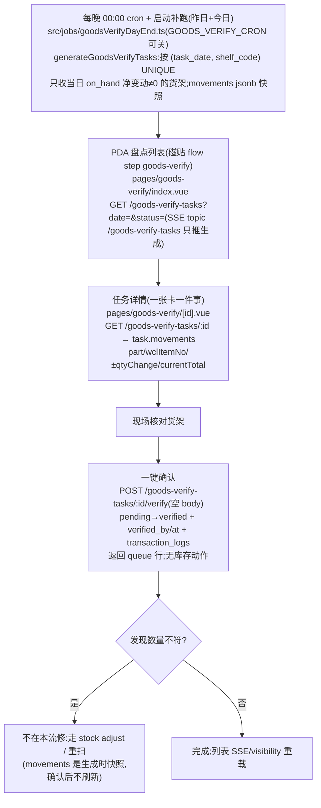

# 货物校验 Goods-Verify 流程(盘点)

**按货架按日的异动摘要确认**:每晚 cron 对「昨日有非零 `on_hand` 净变动」的货架各生成一条任务,操作员现场核对后**一键确认**。纯确认——**无盘点数录入、无 ADJUST 调账**(2026-10-17 重设计)。

**权威 = 代码**:`apps/backend/src/db/goodsverify.ts`(头部注释)+ spec `2026-10-17-goods-verify-shelf-summary-redesign.md`。✅ 旧英文手册(overview/steps/ai-scope、api-design、schema-tables、registry/code-map)曾整段停留在已废弃的按批盘点模型——2026-11-07 文档审计已统一改写,现可放心引用。

## 1. 流程图(节点标注入口)

## 2. 步骤表

| 步骤 | 入口 | API | 关键表/模块 |
|------|------|-----|-------------|
| 生成 | 服务端 cron(无 UI);或 `POST /goods-verify-tasks/generate`(系统用) | — | `goods_verify_tasks`(`inventory_transactions` 聚合)、`db/goodsverify.ts` |
| 列表 | `pages/goods-verify/index.vue` | `GET /goods-verify-tasks?date=&status=&shelfCode=` | `listGoodsVerifyTasks` |
| 详情/确认 | `pages/goods-verify/[id].vue`(`usePageHeader`) | `GET/POST /goods-verify-tasks/:id(/verify)` | `verifyGoodsVerifyTask`(tx 内 `assertActor`) |

## 3. 关键逻辑

- 生成聚合:`SUM(qty_delta)` GROUP BY shelf+part(`qty_type='on_hand'`、当日、非零),`currentTotal` = 该架该料**全部** lot 之和(不只异动批)。幂等靠 `ON CONFLICT (task_date, shelf_code) DO NOTHING`。
- `goods_verify_tasks` 保留的 legacy 列(`inventory_lot_id/box_id/part_no/expected_qty`)已不使用;状态枚举声明了 `skipped` 但**无代码写入**。
- 任务粒度是「货架×日」,不是批次;`movements` 是**快照**,确认后库存再动也不会刷新。
- goods-verify **故意不参与 assignee 派工**(队列表无 assignee 列,feature-registry 有注)。

## 4. 关键业务决策

| 决策 | 理由 | spec |
|------|------|------|
| 按架按日摘要 + 一键确认,替代逐批盘点录入 | 系统已知当日变了什么;逐件重扫整架又慢又易错 | `2026-10-17-goods-verify-shelf-summary-redesign.md` |
| 差异修复移出本流 | 本流职责=确认系统记录的异动,不是调账 | 同上 |
| 生成走夜间 cron + 启动补跑 | 日终任务必须无人干预也存在;幂等让补跑安全 | `2026-07-23-goods-verify-nightly-cron-design.md` |

## 5. 坑(含两个实测 live bug)

- **PDA 搜索会抛错**(BUG-048,Open):列表搜索过滤 `r.boxId/r.partNo/r.wclItemNo`——这些字段在 `GoodsVerifyTaskListRow` 上不存在,输入任意字符 `TypeError`(`pages/goods-verify/index.vue`)。修复前别在培训里教搜索。
- `skipped` 筛选 chip 永远无结果(无代码写该状态)。
- **`allowedOrgIds` 不过滤本队列**(代码里 goodsverify 没用 org filter;英文文档 2026-11-07 已同步更正)。
- 「今天」语义易混:PDA 默认日期取 **UTC**(`toISOString().slice(0,10)`);cron 本地午夜触发而账按 DB 日聚合,所以生成覆盖昨+今两日;显式 `date` 必须 `YYYY-MM-DD` 否则 400 `invalid_date`。
- `GOODS_VERIFY_CRON=off` 或步骤关闭 → 队列恒空;`verify` 不产 SSE,列表靠整页重载。

## 6. Admin 控制点

- **无专属页**(不在 TOC)。唯一开关:`pages/flow-config.vue` steps `goods-verify`;显示模板 `pages/pda-view-config.vue` lists.goods-verify。
- 相关主档/账本:`pages/shelves.vue`(货架 FK)、`pages/item-ledger.vue`(异动明细来源)、`pages/parts.vue`。
