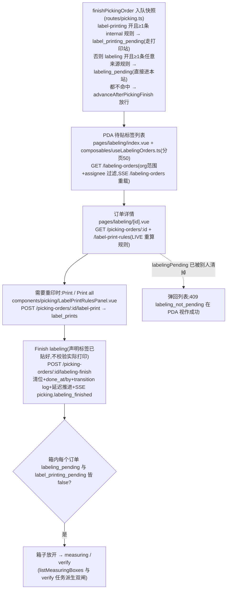

# 贴标签 Labeling 流程

拣货完成与衡量之间的人工确认站:操作员声明「内部标签已贴上」。订单状态全程保持 `picking_finished`,本站只是**旁路布尔位** `labeling_pending`——挂起期间箱被扣住,不进[衡量](./measuring.md)/[复核](./verify.md)。命中 internal 打印规则的单先走[打印标签](./label-printing.md),打印完成后**无条件**进入本站。

**权威细节**:[ai-scope](../../app-docs/flows/labeling/ai-scope.md) · [steps](../../app-docs/flows/labeling/steps.md)。✅ ai-scope 的 assignee 行已于 2026-11-07 文档审计更正:队列读 `picking_tasks`(step='labeling')的 assignee(CR-048),不是 `picking_orders.assignee`。

## 1. 流程图(节点标注入口)

## 2. 步骤表

| 步骤 | 入口 | API | 关键表/模块 |
|------|------|-----|-------------|
| 队列 | `pages/labeling/index.vue` | `GET /labeling-orders` | `db/picking.ts` `listLabelingOrders`(SQL:`picking_finished AND labeling_pending`) |
| 详情 | `pages/labeling/[id].vue` | `GET /picking-orders/:id`、`.../label-print-rules` | `db/labelPrint.ts` `resolveLabelPrintRulesForOrder` |
| 重印 | `LabelPrintRulesPanel.vue` | `POST /picking-orders/:id/label-print` | `label_print_rules` → `label_prints`(external 规则 409 `label_rule_external`) |
| 完成 | finish 按钮(`utils/labeling.ts` `finishLabelingOrAlreadyDone`) | `POST /picking-orders/:id/labeling-finish` | `picking_orders`、`transaction_logs` |

## 3. 关键逻辑

- **入队是快照、打印列表是 LIVE**:行上 `labelMatches` 每次读取重算规则;规则中途被删/停用**不会**把订单移出队列,只是详情页显示「rules no longer match」+ finish 仍可用。语义:操作员点完成即可,订单不会人间蒸发。
- **完成是 attestation(声明)**,服务端不核对是否真打印过。
- 两站串联:`finishLabelPrinting` → labeling 步开 → **无条件** `labeling_pending=true`;labeling 步关 → 直接 `advanceAfterPickingFinish`。
- 双闸联动:衡量队列与 verify 任务派生都要求箱内**每个订单**两个 pending 位皆 false——只关一个步也会扣箱;跨订单混装箱等所有成员单清完。
- external 规则(客户供标)订单进本站但面板只渲染 info 行、无打印按钮;在 verify 里算 unlabeled。
- 任何操作员可完成(共享打包台任务,无 work-lock)。
- admin 状态覆盖/order reset 会同时清 `labeling_pending` + `label_printing_pending`(`done_at/by` 保留作审计,`db/picking.ts` L3449/3560)。

## 4. 关键业务决策

| 决策 | 理由 | spec |
|------|------|------|
| 贴标立为独立阶段(而非完成即打勾) | 2026-10-27 的打印提示可选且无痕,跳过者无队列可追 | `2026-10-28-picking-labeling-step-design.md` |
| 与打印拆成两站 | CN 岗分离:一人坐打印机旁、一人地上贴 | `2026-11-02-label-printing-step-design.md` |
| 队列成员入队快照 | 规则被删不能让订单消失 | `2026-10-28` spec |
| external 订单仍进贴标队列 | 客户供标也要确认贴上,只是无可打印内容 | `2026-10-30-label-source-and-label-verify-design.md` |
| 不加新订单状态(旁路布尔) | 正交簿记,改动面最小 | `2026-10-28` spec Out of scope |

## 5. 坑

- **`db/labeling.ts` 不存在**(只有 `labeling.test.ts`)——实现在 `db/picking.ts`;别按 stub 惯性去找。
- 409 `labeling_not_pending` 客户端当成功(`isLabelingNotPending`)——「别人做完了」不是错误。
- 列表 SSE 只触发整页重载,无打印任务进度推送。
- PDA 路由解析(`utils/labeling.ts` `resolvePickingFinishRoute`):printing → labeling → (measuring 关且 verify 开) `/verify` → null;改步骤开关时这条链每跳都要回归。

## 6. Admin 控制点

- 无贴标专属页。触点:`flow-config.vue`(labeling 步勾选)、`pda-view-config.vue`(`lists.labeling`,chip `labelCount`)、`task-assignments.vue`(labeling 页签,派工写 `picking_tasks.assignee`)、`picking-orders/[id].vue`(只读状态行)。
