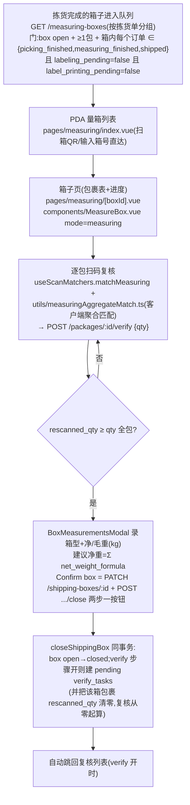

# 衡量 Measuring 流程

对打开的出货箱复核实拣内容、录箱型与净/毛重后**封箱**。没有独立 measuring 任务实体——**封箱本身就是衡量的完成**。完成口径:`picking_packages.rescanned_qty >= qty`。

**权威细节**:**[docs/backend/verify-measuring.md](../../backend/verify-measuring.md)**(聚合重扫口径的权威)· [ai-scope](../../app-docs/flows/measuring/ai-scope.md) · [steps](../../app-docs/flows/measuring/steps.md)。

## 1. 流程图(节点标注入口)

## 2. 步骤表

| 步骤 | 前端入口 | API | 关键表/模块 |
|------|----------|-----|-------------|
| 列表 | `pages/measuring/index.vue` | `GET /measuring-boxes` | `db/measuring.ts` `listMeasuringBoxes`(无 SSE,mount+visibility 重载) |
| 箱子详情 | `pages/measuring/[boxId].vue` → `MeasureBox.vue` | `GET /measuring-boxes/:id` | `getMeasuringBoxDetail`(一次读全,料号身份内嵌) |
| 重扫 | `useScanMatchers.ts` + `utils/measuringAggregateMatch.ts`;相机走 `useLabelScanReview` + `LabelScanReviewModal` | `POST /packages/:id/verify` | `verifyPackage` in `db/picking.ts`(open 箱=衡量支,`verified=true`) |
| 封箱 | `BoxMeasurementsModal.vue` | `PATCH /shipping-boxes/:id` + `POST /shipping-boxes/:id/close` | `closeShippingBox`、`verify_tasks` 派生 |

## 3. 关键逻辑

- **聚合匹配在客户端**:`measuringAggregateMatch.ts` 按「料号总量 + 批次字段」分组,数量 ≤ 组剩余,FIFO 跨包部分记账;逐行调 `verifyPackage` 落账。服务端只做 `applied = min(qty, remaining)` 与守卫。
- **显示/匹配用拣货时扫描值**:`scanned_part_no/scanned_wcl_item_no/...` 为真相(COALESCE 回退订单料号)——上游 lot 数据与标签词汇表不一致是常态。
- 日期码先规范化再比(`toCanonicalDateCode(scan, dateCodeFormat)`);展示转 label 格式。
- **完成口径是计数器不是布尔**:`verified` 列只是首次记功的显示位;别拿它当闸。
- 建议净重 `suggestedNetWeightKg`:Σ(公式克重/件数 × 包量)/1000 三位小数;`net_weight_formula` 本体存克,**端到端 kg 只在测量值**。
- assignee:`shipping_boxes.assignee` 过滤(`user-scope.ts`),detail 他人 404。
- `label_item_mismatch` 是唯一返回 JSON body(`{error, fields[]}`)的 snake_code 错误,`useScanMatchers` 有特判。

## 4. 关键业务决策

| 决策 | 理由 | spec |
|------|------|------|
| 废 `measuring_tasks`,封箱即完成 | 一箱可装多单,工作必须跟着**物理箱**走,按单任务模型假设了 1单↔1运件 | `2026-08-11-box-scoped-measuring-verify-design.md` |
| 列表 = 拣货后队列、按订单分组 | 还在拣/被弃的单的箱子没有就绪信号 | `2026-10-20-measuring-post-picking-list-design.md` |
| 用**扫到的**料号做真值 | 操作员重扫的是实物标签,按订单料号匹配会因 MPN 形状不同而失败 | `2026-10-05-measuring-scanned-part-truth-design.md` |
| kg 端到端 + 建议净重仅预填 + 单按钮 Confirm box | 秤与单据用 kg;Save-then-finish 每箱都是死时间 | `2026-07-28-measuring-verify-refinements-design.md` |
| labeling/label-printing 挂起期扣箱 | 标签没贴好不准衡量 | `2026-10-28-picking-labeling-step-design.md`、`2026-11-02-label-printing-step-design.md` |

## 5. 坑

- **`2026-10-20` spec 的状态名已过期**(写 `IN ('finished','shipped')`;代码是 `('picking_finished','measuring_finished','shipped')` + 两个标签闸)。
- `all_packages_must_be_verified` 封箱守卫**只在 measuring 步开启时触发**;步关闭时拣货页能封一个从未重扫/无量方数据的箱(有意设计,见 `2026-11-01-picking-box-operations-design.md`)。
- 记账**按流隔离**:封箱派生 verify 任务时 `rescanned_qty` 清零;若 verify 步关闭则不清零、也不派任务。
- 一箱跨多单:它出现在**每个**成员单的分组下,但也只要有任何一单未完成/标签未清就不出现在队列。
- 全部验完即禁用扫码器(`enabled: !allVerified`)——**此页无法撤销多余重扫**(无 un-verify 动词),去 verify 页 reopen。
- 多次记账的扫码可能部分成功后 409;`MeasureBox.vue` catch 后 `load()` 重同步。
- 箱型下拉是 `constants/pocOptions.ts` 硬编码,**不是** `box_size_list` 表(admin 的 box-sizes 页维护的是另一回事);modal 无 destination 编辑(服务端 `PATCH` 收 `destinationCountry`,PDA 只读)。
- 无 SSE:收敛全靠 mount/visibilitychange。

## 6. Admin 控制点

- `pages/flow-config.vue`:measuring/verify 步骤开关(改变整个几何,见 verify.md)。
- `pages/task-assignments.vue` measuring 页签(写 `shipping_boxes.assignee`)。
- `pages/net-weight-formulas.vue`(克)、`pages/box-sizes.vue`、`pages/pda-view-config.vue`(`lists.measuring` 行模板)。
- 无 measuring 专属页;队列在 `pages/picking-orders/[id].vue` 只读可见。
