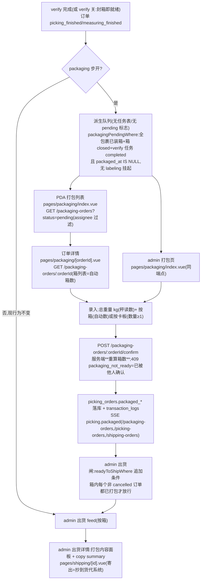

# 打包 Packaging 流程(可选 CN 段,verify 之后)

对**已完成复核的出货订单**录入**总重量**与**箱数(自动)/卡板数**,确认一次即完成。订单级、一单一次;确认后该订单的箱才进入 admin 出货 feed(寄出审核 + 复制给货代)。默认关闭,仓库在 admin 流程配置开启 `packaging` 步(寄出 `shipping` 步默认开,只控制 admin 导航)。

**权威细节**:[design spec](../../superpowers/specs/2026-11-10-packaging-shipping-steps-design.md) · [ai-scope](../../app-docs/flows/packaging/ai-scope.md) · [api-design §Packaging](../../backend/api-design.md) · [flow-config](../../backend/flow-config.md)

## 1. 流程图(节点标注入口)

## 2. 步骤表

| 步骤 | 前端入口 | API | 关键表/模块 |
|------|----------|-----|-------------|
| 队列(PDA/admin) | `apps/pda/pages/packaging/index.vue`、`apps/admin/pages/packaging/index.vue` | `GET /packaging-orders?status=pending\|completed` | `db/packaging.ts` `listPackagingOrders` + `packagingPendingWhere` |
| 详情(箱清单=自动数) | `apps/pda/pages/packaging/[orderId].vue` | `GET /packaging-orders/:orderId` | `getPackagingOrderDetail` |
| 确认 | 详情页表单(重量+箱/卡板切换+window.confirm;无扫描) | `POST /packaging-orders/:orderId/confirm {weight, palletCount?}` | `confirmPackaging`(事务内重查队列谓词) |
| 出货闸 | admin `pages/shipping/`(寄出) | `GET /shipping-orders`、`POST /shipping-orders/:boxId/ship` | `readyToShipWhere`(packaging 条件)、`packaged` 列 |
| 指派 | admin `pages/task-assignments.vue`(packaging 页签) | `PATCH /admin/task-assignment` flow=packaging | `picking_tasks` step='packaging' 行(CR-048 模式) |

## 3. 关键逻辑

- **队列是纯派生 SQL**:没有任何创建钩子/状态位——verify 完成、重开、取消等状态变化**自动**改变队列成员;不存在"任务漏建"。谓词与 `readyToShipWhere` 同构(箱级→订单级)。
- **箱数永远由服务端在 confirm 事务里重算**:客户端显示自动数,但录入值不参与判定——杜绝手填错数(「auto count」的落点)。
- **一次确认**:重复 confirm 命中 409 `packaging_not_ready`(队列谓词含 `packaged_at IS NULL`),PDA 以「已确认」处理并退回列表(`utils/packaging.ts` `isPackagingNotReady`,同 labeling 惯例)。
- **跨订单共箱**:箱内 A、B 两订单,A 打包不影响 B 的队列;出货闸要求**每个非 cancelled 订单**都打包(取消订单不卡箱——put-back 流会清包)。
- **重开无需额外闸**:`reopenShippingBox` 本来就要求 pending 复核任务,而已打包订单的复核任务必然 completed——重开在打包后不可达(picking.ts 注释记录)。
- **admin 订单重置**(CR-050)连 `packaged_*` 一起清,重置单会重新排队打包。
- **重量独立于箱毛重**:秤读数即真值,Σ箱毛重只做提示显示,不做强制比对。
- `shipping`(寄出)步**只 gate admin 导航**;出货端点/页面行为与旧一致(存量仓库默认开,零变化)。

## 4. 关键业务决策

| 决策 | 理由 | spec |
|------|------|------|
| 打包单位=拣货订单(非箱) | 「箱数(auto count)」即聚合语义;一单一确认 | `2026-11-10-packaging-shipping-steps-design.md` |
| 派生队列,无表无标志 | 条件全可计算;不碰 verify/close 事务,破坏面最小 | 同上 D2 |
| 状态不扩展,`packaged_at` 即真相 | 订单 `measuring_finished → shipped` 链的 ~9 个消费查询零改动 | 同上 D3 |
| 出货仍按箱,打包只做闸 | 数据模型允许跨订单共箱;箱级 ship 已存在 | 同上 D4 |
| assignee 走 `picking_tasks` 步骤行 | `picking_orders` 上游同步;labeling 已验证该路径 | CR-048、`2026-11-01-task-assignee-design.md` |
| `shipping` 步默认开 | 只 gate 导航;默认关会让存量仓库失去 /shipping 链接 | 同上 D5 |
