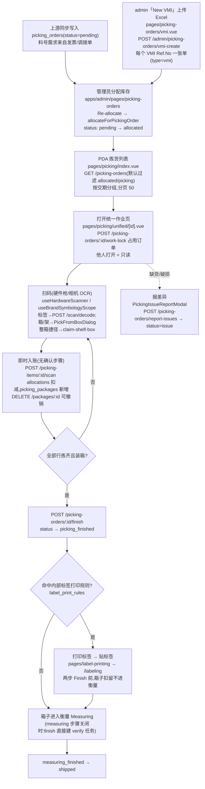

# 拣货 Picking 流程

从库存中按出库订单(picking order)取料、装箱、完成。这是全系统最复杂的流程:扫码即时记账、工作锁、跨订单装箱、标签阶段扣留。

**权威细节**:[`docs/app-docs/flows/picking/ai-scope.md`](../../app-docs/flows/picking/ai-scope.md)(功能边界全量清单)、[`steps.md`](../../app-docs/flows/picking/steps.md)(操作员视角)。本文 = 开发者视角摘要 + 入口地图。

## 1. 流程图(节点标注入口)

## 2. 步骤表

| 步骤 | 前端入口(pda) | 后端 API(routes/picking.ts) | 关键表 |
|------|----------------|------------------------------|--------|
| 列表 | `pages/picking/index.vue` + `PickingFilterModal` | `GET /picking-orders` | `picking_orders` |
| 占用/释放 | 统一页挂载/卸载(`useVisibleReload` 之外单独管) | `POST`/`DELETE /picking-orders/:id/work-lock` | — |
| 明细(嵌套一次读全) | `pages/picking/unified/[id].vue` + `PickingItemsSection`/`PickingUnifiedItems` | `GET /picking-orders/:id` | orders→items→allocations→packages + boxes |
| 标签扫码 | `PickingScanReviewModal`(OCR 复核)、`utils/labelDecode.ts` | `POST /scan/decode`、`POST /picking-items/:id/scan` | `picking_packages`、`allocations` |
| 箱/架/整箱 | `PickFromBoxDialog`、`ChooseBoxDialog`、整箱横幅 | `GET /picking-shelf-stock`、`POST /picking-orders/:id/claim-shelf-box` | `shelf_boxes`、`allocations` |
| 装箱 | `PickingBoxesSection` | `POST /shipping-boxes/:id/packages`、`/scan`、`/add-all-unboxed`、`box-each-unboxed` | `shipping_boxes` |
| 撤扫/撤箱内 | 行内 Remove scan / Move out | `DELETE /packages/:id`、`DELETE /shipping-boxes/:id/packages/:packageId` | — |
| 完成 | Finish 按钮 + `LabelPrintPrompt` | `POST /picking-orders/:id/finish` | `transaction_logs`+`inventory_transactions`(同事务) |
| 报差异 | `PickingIssueReportModal` | `POST /picking-orders/report-issues`、`/resolve-issue` | `issue` 字段 |

Admin 侧:`pages/picking-orders`(Re-allocate、状态覆写、明细)、**New VMI 上传** `pages/picking-orders/vmi`(浏览器解码 VMI_Template_*.xlsx,每个 VMI Ref.No 建一张 `type=vmi` 拣货单,gate 料号主档 + 子库存→org,见 `specs/2026-11-09-vmi-picking-excel-upload-design.md`)、`pages/task-assignments`(assignee)、`pages/label-print-rules`、`pages/outdated-warnings`。

## 3. 关键逻辑(改代码前必读)

- **工作锁**:打开统一页即 POST work-lock,离开释放,10 分钟过期。锁住的订单**分配引擎永不 wipe/重建**——这是"分配只手动重算"决策的组成部分。
- **扫码即记录,没有 Confirm**:每次扫码立即 `POST /picking-items/:id/scan`;失败留在 Pending scans 里可 Remove。撤销用 Remove scan(库存退回、分配重开)。
- **聚合匹配、FIFO 拆分**:同料号多行合并成一行显示;标签数量超单行但 ≤ 料号总量时自动跨行 FIFO 拆分。匹配口径:`part_no` 和 `wcl_item_no` 都接受(`normalizePartNo`,忽略空格);单品牌档案下无 `wclItemNo` 组时派生 `<brand>/<itemId>`。
- **原料按订单品牌优先解析 QR**(`supplier_profiles.brands` vs `parts.brand`),其余模板兜底;解码失败才走 PDA 本地 OCR 启发式。
- **箱码 ≠ 标签码**:匹配不到模板的原始码按位置码处理——收货纸箱(`ctn_no`)整箱排队(内容已知且封箱,重扫拒绝);货架箱/架码打开 Pick-from-box 对话框,后续料号只在该箱分配内排队。
- **先扫货架(flow config `pickingShelfScan`)**:开启时,货架/箱来源的行在设定位置前扫码被拒;纯 dock(收货区)来源不受此限。
- **一箱一 COO**:加入不同 COO 被拒(无 COO 放行);Add all 例外,混了显示 ⚠ Mixed COO 标记。
- **两类过期预警别混淆**:① 供应商扫码预警(`outdated_scan_warnings`,扫码成功但**阻止 finish**,需 admin 解除);② 分配库存年龄预警(仅展示,永不阻止)。
- **列表可见性三段过滤全在服务端**(`src/db/user-scope.ts` + `pickingOrderOrgFilter`):assignee、用户 sub-inventory 范围、`allowedOrgIds` AND 组合;`invoice`/`vmi` 走同一谓词(精确 (org, sub) 对),`tn` 调拨单谓词不同(调拨归 org 不归 store;NCI org 143 看全部调拨),type 为 NULL(刚同步/未选类型的测试单)不过滤。越权明细 = 404。
- **状态机**:`pending → allocated → picking → picking_finished → measuring_finished → shipped`;侧态 `issue`/`skip`。`allocated`=管理员锁定分配(引擎不再动);`skip`=永不参与分配。

## 4. 关键业务决策(为什么这么设计)

| 决策 | 理由 | 权威 spec |
|------|------|-----------|
| 列表只放 `allocated`/`picking` | 办公室没确认的单不许开工;pending/issue/shipped 归 admin 管 | `specs/2026-09-22-picking-allocated-skip-status-design.md`(状态拆分见 `2026-10-22-picking-status-split-design.md`) |
| 扫码即时入账、去掉确认步骤 | 减少操作员步骤,防止"扫了没确认"的差异 | `specs/2026-10-12-picking-unified-detail-scan-design.md` |
| OCR 统一进复核列表(单/多条同一路径) | 相机识别不可信,必须人工可改 | `specs/2026-10-26-picking-ocr-unified-review-design.md` |
| Re-allocate 严格单订单 | 多单共享料号时,只重建本单,其他单的行不动、净额扣减 | `specs/2026-11-05-picking-reallocate-single-order-design.md` |
| 命中打印规则的单先走打印/贴标两站 | 箱子必须贴好内部标签才准进衡量,否则复核无据可依 | `specs/2026-10-28-picking-labeling-step-design.md`、`2026-10-27-picking-finish-label-print-prompt-design.md` |
| 跨订单装箱(scan into box) | 现场一箱可装多单包裹,按箱出运 | `specs/2026-11-01-picking-box-operations-design.md` |
| assignee 过滤只影响读、不影响写 | 派工可见性,不是权限模型 | `specs/2026-11-01-task-assignee-design.md` |
| 解码迁到后端 `/scan/decode` | 模板/月码规则曾前后端各一份,PDA 与 admin 漂移 | `specs/2026-11-03-backend-scan-decode-design.md` |
| VMI 只是又一个订单来源,不建新表/新队列 | 上传落库后与上游同步单完全同构(分配、工作锁、拣货、装箱照旧);类型 `vmi` 走 invoice 可见性分支 | `specs/2026-11-09-vmi-picking-excel-upload-design.md` |

## 5. 坑(踩过的位置)

- **Chrome 101**:本页曾用 `AbortSignal.timeout` 全端 fetch 挂死(BUG-043)。新 Web API 先查 caniuse。
- **扫码枪符号集**:`useBrandSymbologyScope` 按订单品牌 `barcode_types` 白名单收窄硬件解码器;`{ withShelfCodes: true }` 保证货架/箱 QR 始终可扫——新增扫码场景记得带上。
- **`rescanned_qty` 是唯一完成口径**,重扫匹配是客户端聚合逻辑(见 `docs/backend/verify-measuring.md`),别在页面上另搞一套计数。
- **分配快照/恢复**:`allocated` 单的管理员覆写路径有快照机制(spec `2026-10-26-uat-allocation-snapshot-restore-design.md`),改动 `allocate.ts` 前读它。
- 测试在 `apps/backend/src/db/picking.test.ts`;跑测试共享 `TEST_DATABASE_URL`,串行。
