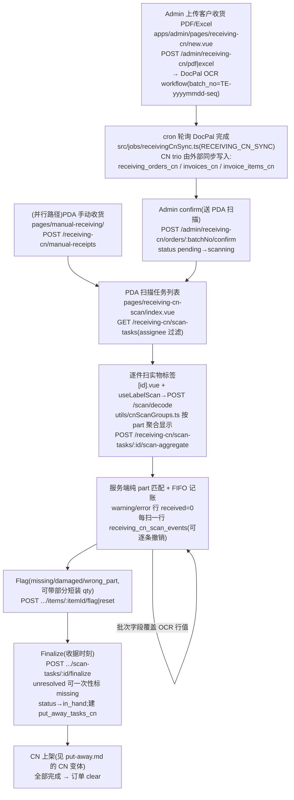

# CN 收货 Receiving-CN 流程

内地仓的**发票/PDF 驱动**收货:客户收货单经 DocPal OCR 工作流变结构数据 → PDA 逐件物理扫描对账 → finalize 收据 → CN 上架。整条流由 flow config 的 `receiving-cn` 步骤门控(off 时所有 `/receiving-cn/*`、`/put-away-cn/*` 路由 404,PDA 磁贴隐藏)。

**权威细节**:spec `2026-11-01-cn-receiving-scan-design.md`(+ 后续 11-04/11-05 修订)。⚠ **`docs/app-docs/flows/receiving/ai-scope.md` 与 11-01 原文对 CN 扫描的描述已滞后**——批次字段参与过滤、逐行 scan 端点等都被 2026-11-05 part-only 匹配取代,以 `src/db/receivingCnScan.ts` 为准。

## 1. 流程图(两条并行路径)

## 2. 步骤表

| 步骤 | 入口 | API | 关键表/模块 |
|------|------|-----|-------------|
| 上传 | admin `pages/receiving-cn/new.vue`(`utils/cnReceivingExcel.ts`) | `POST /admin/receiving-cn/pdf`、`/excel` | `receiving_cn_workflows`、`src/docpalWorkflow.ts` |
| 同步 | cron(默认 120s) | — | CN trio(按 `batch_no` 匹配) |
| Confirm | admin 列表/详情 | `POST /admin/receiving-cn/orders/:batchNo/confirm`、`/reset` | `db/receivingCn.ts` `startCnReceivingScanTx`/`resetCnOrder` |
| 扫描 | `pages/receiving-cn-scan/[id].vue` + `utils/cnScanGroups.ts` | `POST /receiving-cn/scan-tasks/:id/scan-aggregate`(detail `GET .../scan-tasks/:id`) | `db/receivingCnScan.ts` `scanCnTaskAggregate`、`receiving_cn_scan_events` |
| Flag/撤销 | 同上(组级动作) | `POST .../items/:itemId/flag`、`/reset`、`POST .../scan-events/:eventId/remove` | `scan_status/scan_reason/flag_qty` 列 |
| Finalize | 同上 | `POST /receiving-cn/scan-tasks/:id/finalize` | +`put_away_tasks_cn` |
| 手动收货 | `pages/manual-receiving/`(`utils/manualReceiving.ts`) | `POST /receiving-cn/manual-receipts` | in_hand 单+invoice+items+task 一事务 |

## 3. 关键逻辑

- **纯 part 匹配**:候选 = 同 part 的 open 行(`scan_status IS NULL`);OCR 的 date_code/lot/coo/cow **从不参与过滤**,扫到的批次值**覆盖**行上的 OCR 值(2026-11-05:错 date_code 曾致 404 卡死操作员)。
- **FIFO 记账**:`po_no, po_line, id` 序吸收数量;NULL `line_qty` 行最后吸收;超扫余量倒入最后 credited 行 → `warning/qty_mismatch`。每次 scan 一行 `receiving_cn_scan_events`,`takes` jsonb 记逐行记账 → 单扫可撤销(但**不恢复被覆盖的批次字段**,代码内有 `shortcut:` 注释)。
- **finalize 是收据时刻**:`received_qty=LEAST(scan_qty,line_qty)`;error 行 received=0(除带 `flag_qty` 的部分短装,CR-047);short-flag 自动补足至全额短装(BUG-044,audit `flag_topped_up`)。
- 显示分组纯按 `normalizePartKey(wclItemNo||partNo)`,组内 distinct 批次值 ` · ` 拼接;去掉选行弹窗是刻意的(CR/spec 2026-11-04)。
- flag/reset/scan 把结果**镜像进休眠的 mismatch 列**,复用 admin 现有差异显示。
- 重扫去重只在**客户端会话内**(服务端无 CN 版 `receiving_scan_labels`)。
- 可见性:`assigneeFilter`(detail 命中他人 assignee 也 404,不泄露存在)+ `cnReceiving()` 门控;admin 看详情时惰性修正 org/sub(`prepareCnOrderDetail`)。

## 4. 关键业务决策

| 决策 | 理由 | spec |
|------|------|------|
| PDF→OCR 与库存之间插入物理扫描站 | 纸面单据不能直接变库存 | `2026-11-01-cn-receiving-scan-design.md` |
| 逐 scan 小事务(非本地暂存一次提交) | 订单是服务端共享实体、admin 实时可见、抗 app 崩溃 | 同上 Alternatives |
| warning/error 行 received=0 永不进上架 | 「只上架干净货」;CN remaining 公式天然排除 | 同上 |
| 匹配/分组改纯 part + 批次覆盖 | OCR 批次字段不可信 | `2026-11-05-cn-receiving-part-only-scan-matching-design.md`、`2026-11-04-cn-receiving-scan-grouping-design.md` |
| 不新增子开关:整个 CN 世界由 `receiving-cn` 一步门控 | 配置面最小 | 11-01 spec |
| CN 仓禁用标准 receiving 步骤,一个仓库只跑一条流 | 两世界共存但互斥 | `2026-10-16-customer-receiving-upload-design.md`、`2026-10-27-manual-receiving-pda-design.md` |

## 5. 坑

- **CN 表不在 `sync_events` 触发器清单**——外部同步直接写 CN trio;backend 对它们的 finalize 写**不进**出站 feed,下游若依赖 CN 账需要另行确认。
- `404 no_matching_item` 现只意味「该 part 无 open 行」,不再意味批次冲突。
- `receiving_cn_scan_events` 只在 CR-046 迁移后存在:历史扫描无法逐条撤销。
- finalize 的建任务条件是「≥1 received_qty>0 行」,部分 flag error 行也计数(spec 原文措辞与实现有出入)。
- admin reset 与操作员 finalize 竞态 → 409 `order_not_scanning`;`unresolvedAs` 只接受 `'missing'`。
- UAT 记录:`docs/uat/features/CR-046.json`、`CR-047.json`、`docs/uat/bugs/BUG-044.json`(functionId PDA-008)。
