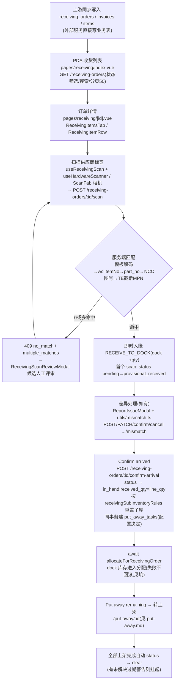

# 收货 Receiving 流程

核对到货与发票差异、确认实物到达、生成收货区(dock)库存,是[上架](./put-away.md)的前置。核心特征:**标签解析与料号匹配全部在服务端完成**(解码权威),PDA 只是薄客户端。

**权威细节**:[ai-scope](../../app-docs/flows/receiving/ai-scope.md) · [steps](../../app-docs/flows/receiving/steps.md) · [mismatch-handling](../../app-docs/flows/receiving/mismatch-handling.md)。

## 1. 流程图(节点标注入口)

## 2. 步骤表

| 步骤 | 前端入口 | API | 关键表/模块 |
|------|----------|-----|-------------|
| 列表 | `pages/receiving/index.vue`(`AppListPage` + `useVisibleReload` topic `/receiving-orders`) | `GET /receiving-orders` | `receiving_orders`、`receiving_invoices(_items)` |
| 详情 | `pages/receiving/[id].vue` + `components/receiving/ReceivingItemsTab.vue` | `GET /receiving-orders/:id`、`GET /receiving-orders/:id/picking` | + `user-scope.ts` 过滤 |
| 扫码 | `composables/useReceivingScan.ts`、`useHardwareScanner.ts`、`useLabelScan.ts`;`ReceivingScanReviewModal/MultiItemModal` | `POST /receiving-orders/:id/scan` | `db/receiving.ts` `scanReceivingOrder`;`receiving_scan_labels`、`inventory_transactions`(RECEIVE_TO_DOCK) |
| 差异 | `components/ReportIssueModal.vue` + `utils/mismatch.ts` | `GET/PATCH/POST /receiving-invoice-items/:id/mismatch(/confirm|cancel)` | `receiving_invoice_items` 扁平列 + `transaction_logs` |
| 到货确认 | 详情页 header 动作 | `POST /receiving-orders/:id/confirm-arrival` | + `put_away_tasks`、分配 |
| 关联拣货(只读) | `ReceivingPickingTab.vue` | `GET /receiving-orders/:id/picking` | `allocations` 等 |
| 转上架 | header `to: '/put-away/'+id` | — | 见 [put-away.md](./put-away.md) |

## 3. 关键逻辑(改代码前必读)

- **服务端匹配次序**:`supplier_profiles` 模板解码 → `wcl_item_no` 优先 → `part_no`/`wcl_item_no` 联合 → NCC 图号回退(`lookupPartsByDrawingNo`,`wcl_part_drawno`)→ TE 截断 MPN 回退(`lookupPartKeyCandidates`)→ 0/多命中抛 409 带 candidates。body 显式字段**覆盖**解析值 — `db/receiving.ts`。
- **序列号去重按「订单+料号」**记 `receiving_scan_labels`(KOA 同序列号跨料号复用),在数量守卫之前预检;重扫 409 `label_already_scanned`,超扫 409 `scanned_qty_exceeds_remaining`。
- **confirm-arrival 是一揽子动作**:行 `received_qty=line_qty`(NULL `line_qty` 行保持不动并计入 `needsAttentionItems`)、按 `receivingSubInventoryRules` first-match-wins 重盖 `sub_inventory_code`(解析结果不在 `org_info` 时跳过不报错)、可选同事务建 `put_away_tasks`、随后 await 分配。
- **分配失败绝不回滚到货**:route 层 try/catch,响应 `allocation: null`,需求保持陈旧直到 admin Re-allocate。
- 差异是 item 上的扁平列(`reported_mismatch/mismatch_reason/mismatch_qty/wrong_part_no/...`),**没有独立差异表/审批链**;每次 report/edit/confirm/cancel 写一条 `transaction_logs`(mismatch_reported/updated/confirmed/cancelled)。注意 **confirm 只写日志不清 flag**,cancel 才清空。
- 相机 `ScanFab` 仅在 `provisional_received` 显示,但服务端 scan 端点本身接受 `pending`+`provisional_received`。
- 订单显示名 `displayName` 由 flow config `receivingOrderNameTemplate` 计算(`src/receivingOrderName.ts`)。
- 每用户子库范围**只影响读**(列表可见 + 越权 detail 404),不影响写/分配 — `db/user-scope.ts`。

## 4. 关键业务决策

| 决策 | 理由 | spec(均在 `docs/superpowers/specs/`) |
|------|------|------|
| 扫描匹配收归服务端,废掉 `/scan-candidates` | 客户端不再镜像一套匹配逻辑,前后端不漂移 | `2026-11-03-backend-scan-decode-design.md` |
| 到货确认时自动重盖 sub-inventory | 上游常缺该字段,而分配按 (org,子库) 匹配 | `2026-09-02-receiving-subinventory-rules-design.md` |
| 列表带 pending 拣货单计数徽标 | 让收货员知道哪些单在等货 | `2026-07-01-receiving-list-picking-order-count-design.md` |
| admin 状态覆盖只盖状态、不补库存/分配 | 可回退、不误建账本 | `2026-09-22-admin-receiving-status-override-design.md` |
| 差异 = item 扁平列 + 日志,无审批链 | demo 规模刻意简化(ai-scope Out of scope 亦确认) | `2026-07-03-receiving-mismatch-design.md` |
| 过期日期码只警告不阻断收货 | 业务只要求提示;阻断发生在拣货 finish | `2026-10-20-allocation-outdated-stock-warning-design.md` |
| shipper 导出按 location/share group 拆分 | 多办公室分单 | `2026-09-21-shipper-split-by-location-design.md`、`2026-09-30-shipper-group-by-share-group-design.md` |

## 5. 坑

- `parts.part_no` **不唯一**,别拿裸 partNo 当键;业务键 `wcl_item_no`。
- 订单链接 QR `warehouse://receiving/<id>` 要在**首页/列表**扫——详情页把硬件解码器限制到 supplier `barcode_types` 白名单,QR 可能被排除。
- NULL expected 时超量收货守卫**跳过**(不报错)。
- `allowDockStock=false` 的仓库:收货 tab 隐藏、put-away 成拣货硬门槛。
- confirm-arrival 的重分配表单(admin PartSearchModal)是**终态式**(先缩后增),绕过逐项 over-allocation 守卫 — `2026-10-12-admin-receiving-reallocate-form-design.md`。
- Chrome 101 WebView 限制(同全局)。

## 6. Admin 控制点

- `apps/admin/pages/receiving/`:列表(默认筛 `pending,in_hand`、批量状态覆盖)、详情(Confirm In-hand、item 批次编辑/删除未作业行、Re-allocate、shipper 下载、审计 logs 含 `putAway[]`)。
- `pages/flow-config.vue`:`receivingSubInventoryRules`、`receivingOrderNameTemplate`、`dateCodeFormat`、`outdatedStockYears`、步骤开关。
- `pages/issues/receiving.vue`、`pages/outdated-warnings.vue`(resolve 后补跑被挂起的 auto-clear)。
