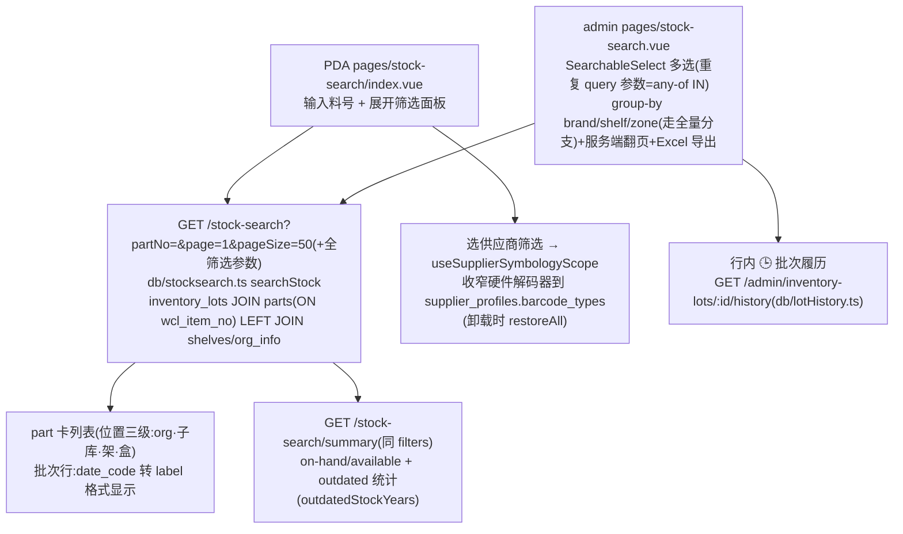

# 库存查询 Stock Search 流程

按料号/图号/品牌/位置/日期码查在架库存,双端同构(PDA 轻、admin 超集)。**只读流程**:一次聚合查询替代旧 3-call cascade,无 mutation、无状态机。

**权威细节**:[ai-scope](../../app-docs/flows/stock-search/ai-scope.md) · [overview](../../app-docs/flows/stock-search/overview.md)。

## 1. 流程图(节点标注入口)

## 2. 步骤表

| 步骤 | 入口 | API | 关键表/模块 |
|------|------|-----|-------------|
| 搜索 | `pages/stock-search/index.vue`(PAGE_SIZE=50 load-more,`loadSeq` 防 stale) | `GET /stock-search`(`?page` 存在→`{rows,total}`;缺省→legacy `{parts,lots}`) | `db/stocksearch.ts` |
| 筛选选项 | `loadOptions()` | `GET /stock-search/options`(locations=`org_info` 全主 LEFT JOIN `inventory_labels`,**按调用者子库范围**) | 同上 `stockSearchOptions` |
| 汇总条 | summary-strip | `GET /stock-search/summary` | `stockSearchSummary` |
| 扫码 | `useSupplierSymbologyScope`(`composables/useScannerConfig.ts`) | 解码 `POST /scan/decode` | `supplier_profiles`、`db/scantemplates.ts` |
| admin | `pages/stock-search.vue` + `StockSearchLotHistoryModal` | 同一端点 + `GET /admin/inventory-lots/:id/history` | `db/lotHistory.ts` |

## 3. 关键逻辑

- **分页是 opt-in**:`?page=` 才切行分页(`pageSize` clamp 1..200);排序白名单 `LOT_SORTS`,未知键回落默认序 `il.part_no, date_code NULLS LAST, shelf, box` 且默认序**始终追加作 tiebreaker**(翻页稳定性)。
- **`partNo` 排序/匹配实际作用于 `p.wcl_item_no`**(admin 列显示 `wclItemNo ?? partNo`)。
- **两个 drawing-no 别混**:① 本流的 `?drawingNo=` = 对 `inventory_lots.drawing_no` 规范化子串匹配(upper+去空白);② `db/partDrawno.ts` `lookupPartsByDrawingNo` 是 **NCC 扫码解码**用(查外部表 `wcl_part_drawno`),不在查询路径上。
- **位置筛选 = 精确 (org,子库) 配对 IN**(重复 `location=orgId:code` 参数),不做两列叉积——同 code 可存在于多 org。
- 日期码区间 `dateCodeFrom/To` 用 canonical YYWW 字符串比较(**字典序恰=时间序**;边界倒置自动交换;设界后 NULL/非法 date_code 永不匹配)。
- supplier↔料号关系靠批次收货履历推断(`inventory_lot_sources`→receiving 链 EXISTS),没有正式供应商-料号目录。
- `allowedOrgIds` 经 `allowedOrgFilter` 始终先作用;每用户子库范围**只限 options.locations**,搜索本体不限(设计如此)。
- 卡上 onHandQty 只覆盖**已加载** lots;权威总量看 summary strip。零数量 lot 有意包含。

## 4. 关键业务决策

| 决策 | 理由 | spec |
|------|------|------|
| 单聚合端点替代 3-call cascade | 一次查询、同一 SQL 语义、少往返 | `2026-07-04-stock-search-design.md` |
| opt-in `{rows,total}` 分页 + 暴露 drawingNo | 真实数据数千 lot,全量传输+客户端翻页太贵 | `2026-09-25-stock-search-paging-drawing-no-design.md` |
| PDA parity 只做前端、后端零改动 | 后端本来就支持全参数,差异纯是筛选 UI + apiClient 曾不能发重复参数 | `2026-09-30-web-stock-search-admin-parity-design.md` |
| 供应商白名单「宁松勿堵」 | 任一 brand 无带白名单的 profile → 完全不限制 | AGENTS.md 符号集节 |

## 5. 坑

- **admin 的 supplier 筛选当前隐藏**(库存数据暂无 supplier;后端参数保留)。
- admin group-by 模式走**全量 legacy 分支**(非服务端翻页),localStorage key `admin-group:stock-search`。
- lot 被合并后,被合并批次的 ledger 行只挂在**幸存 lot** 的 history 下。
- PDA 供应商下拉借用了 `GET /admin/suppliers`(与 shelves 同 trick)——收紧 admin 路由鉴权时记得它会断。
- 本流不发 SSE 业务事件(`useVisibleReload` 无 topics)。
- `db/partLedger.ts` 是 admin item-ledger 页用的,不属于 stock-search 端点。
