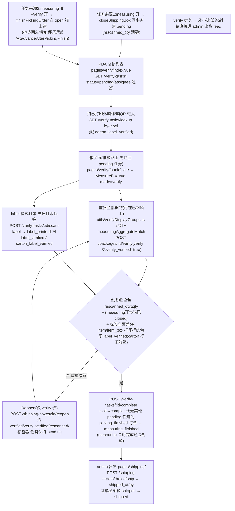

# 复核 Verify 流程

出货前对箱子做**二次重扫**核对:一箱一 `verify_tasks`(UNIQUE `shipping_box_id`),从零重扫(衡量时的记账已被清零)。最后一箱完成 → 订单 `measuring_finished`;出货本身在 admin 侧(见下)。

**权威细节**:**[docs/backend/verify-measuring.md](../../backend/verify-measuring.md)** · [ai-scope](../../app-docs/flows/verify/ai-scope.md) · [steps](../../app-docs/flows/verify/steps.md)。✅ steps.md「目的国可编辑」已于 2026-11-07 文档审计更正:PDA 无编辑控件(`destinationCountry` 只读,API 可 PATCH)。

## 1. 流程图(节点标注入口)

## 2. 步骤表

| 步骤 | 前端入口 | API | 关键表/模块 |
|------|----------|-----|-------------|
| 列表 | `pages/verify/index.vue`(按拣货单分组+发票号搜索框,均客户端计算) | `GET /verify-tasks?status=pending` | `db/verify.ts` `listVerifyTasks` |
| 标签进入 | 同上(`useHardwareScanner`,标签匹配**先于**箱号) | `GET /verify-tasks/lookup-by-label?raw=` | `label_prints`;路由注册顺序敏感(在 `/:id` 之前) |
| 箱子页 | `pages/verify/[boxId].vue`(box-keyed,内部重取任务) | `GET /verify-tasks/:id` | `getVerifyTaskDetail`(批次锚=COALESCE(扫值,存量)) |
| 重扫 | `MeasureBox.vue`(mode=verify)+ `utils/verifyDisplayGroups.ts` | `POST /packages/:id/verify {qty, partNo?...}` | `verifyPackage` in `db/picking.ts` |
| 标签核验 | 「Labels to verify」区 | `POST /verify-tasks/:id/scan-label {raw}` | `scanVerifyTaskLabel`(raw 与 `label_prints.payload[].params` **任一字串值相等**) |
| 重开 | 同上 Reopen | `POST /shipping-boxes/:id/reopen` | `reopenShippingBox` |
| 完成/出货 | complete 按钮;admin `pages/shipping/` | `POST /verify-tasks/:id/complete`;`POST /shipping-orders/:boxId/ship` | `completeVerifyTask`;`db/shipping.ts` |

## 3. 关键逻辑

- **从零重扫**:任务派生即清零,否则第二次核对继承第一次的功,核对形同虚设。
- 聚合匹配与衡量同一套客户端逻辑(`measuringAggregateMatch.ts`),mode 无关系列数据;open/closed 区别只在 `verifyPackage` 服务端分支(开=measuring 支,关+pending 任务=verify 支)。
- **label 模式实时判定**:箱内订单命中 ≥1 条 active **internal** 规则(`resolveLabelPrintRulesForOrder`)→ 标签核验闸生效;external/无规则订单走纯数量聚合。
- 服务端硬比对只在 `label_verified` 之后:料号两边归一;`coo`/`dateCode` 仅当打印记录带值才比 → 409 `label_item_mismatch {fields[]}`。
- 客户端 `canComplete` 镜像服务端闸,但**故意不查 item 标签覆盖**——留服务端兜底。
- measuring 关时完成:无重量/箱型(出货 feed 显示 `—`),destination 回退 `picking_orders.ship_to`。
- 订单升 `measuring_finished` 的条件:该订单在此箱的包裹全完成,**且没有其他 pending 任务**覆盖该订单(跨箱单不会被提前翻状态)。

## 4. 关键业务决策

| 决策 | 理由 | spec |
|------|------|------|
| 任务按 `shipping_box_id` UNIQUE(一箱一任务) | 复核跟着物理箱,箱可跨订单 | `2026-08-11-box-scoped-measuring-verify-design.md` |
| 完成=计数器聚合而非逐标签 | 同料号批量实物,标签级身份让合法重扫失败 | `2026-10-03-picking-scan-truth-and-aggregate-verify-design.md` |
| 重扫判定锚定**拣货时扫到的**批次值 | 核的是实物标签,不是上游 lot 数据 | `2026-10-14-picking-scan-batch-validation-design.md` |
| label 模式=数量重扫之上叠标签扫描+硬比对 | 自印标签的订单有更强可追溯契约 | `2026-10-30-label-source-and-label-verify-design.md` |
| measuring 关⇒finish 在 open 箱建任务、complete 负责封箱 | 关闭衡量步不能让箱永远卡在 open、进不了出货 feed | `2026-11-01-picking-box-operations-design.md`、`2026-07-28-verify-step-and-flow-step-config-design.md` |
| Reopen 是「全面重测」:清布尔+计数+标签戳 | 复核发现问题要能整体重来,而非只读抽查 | `2026-07-28-measuring-verify-refinements-design.md` |

## 5. 坑

- **步骤开关改变整个几何**:measuring 关 → `canMeasure` 隐藏量方、`shipping_box_not_closed` 不再触发、拣货 finish 直接跳 `/verify`(`utils/labeling.ts` `resolvePickingFinishRoute`)。verify 关 → 无任务、订单永不 `measuring_finished`(`picking_finished → shipped` 直跳)。
- 路由按 **box** 但读按 **task**:`[boxId].vue` 重取整个 pending 列表找任务(POC 规模注释);deep-link 已完成任务的箱会渲染 `verify_task_not_found`。
- Reopen 只在**该箱有 pending 任务**时可用(409 `verify_task_not_pending`)。
- 标签路径 404 `label_print_not_found` 被 adapter 归 `null` 落回聚合匹配——**真不匹配与「不是标签」不可区分**;测量模式箱只拦 carton 标签扫(item 标签留给 verify 阶段)。
- label 模式订单若有包**无打印记录**(贴了标没印)→ 静默回退纯聚合。
- 无 SSE(measuring/verify 从不 `emitEvent`);`event-catalog.md` 里 `verify_tasks.*` 行是给外部同步的行级 feed,不是 SSE。
- 没有 `db/labelVerify.ts` 实现文件——label 模式核验逻辑在 `db/verify.ts` + `db/picking.ts`(`labelVerify.test.ts` 测的就是这两个模块)。

## 6. Admin 控制点

- `pages/shipping/index.vue`:出货 feed(已封未运,verify 开时闸在完成任务上)、多选 Mark shipped、`[id].vue` 单箱明细(只显 `verified`,不显 `verify_verified/rescanned_qty`)。已知死控件:shipper 下载按钮无 `@click`。
- `pages/flow-config.vue`:steps.verify / steps.measuring;`pages/task-assignments.vue` verify 页签;`pages/label-print-rules/` 决定哪些单进 label 模式。
