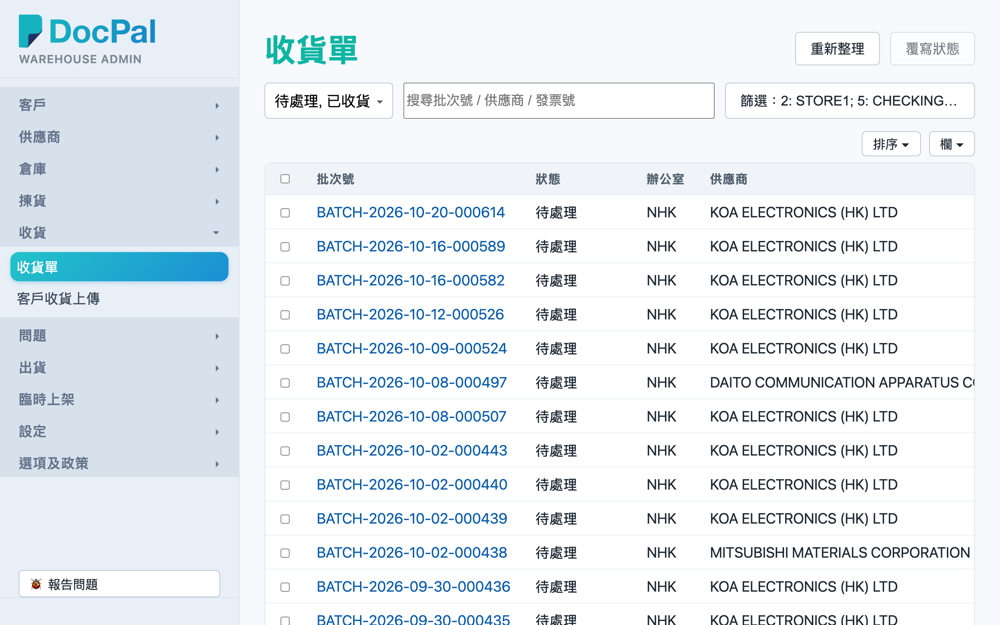
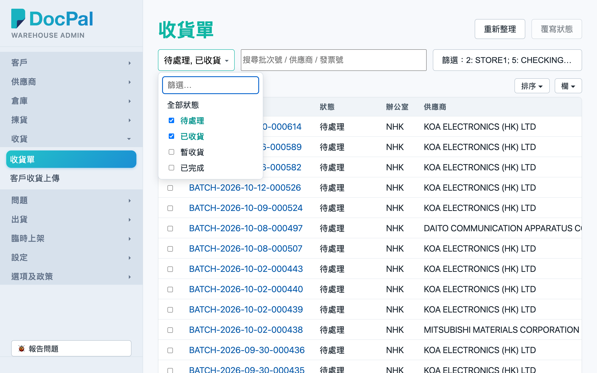
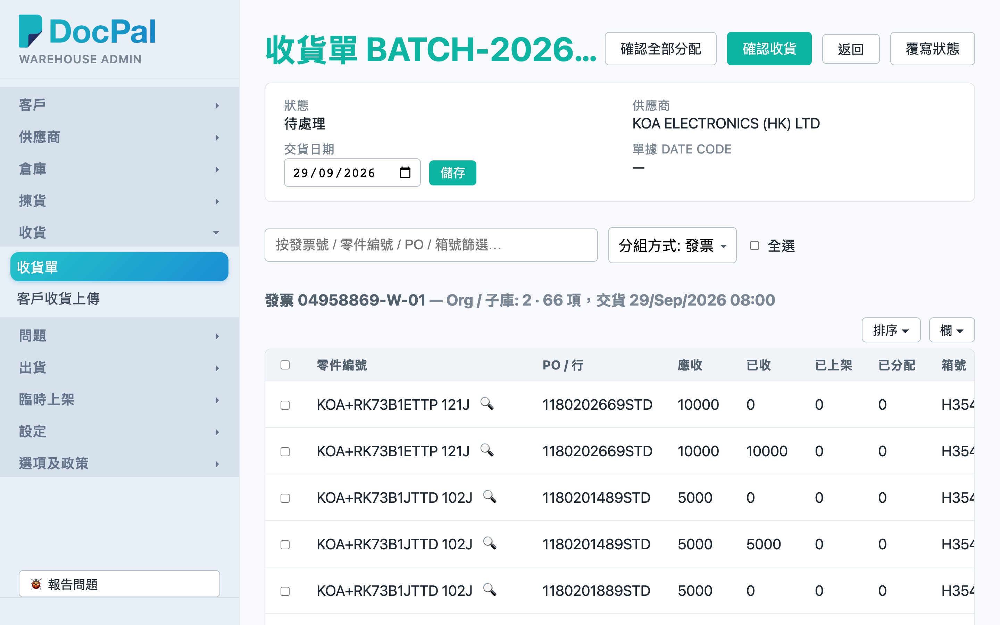
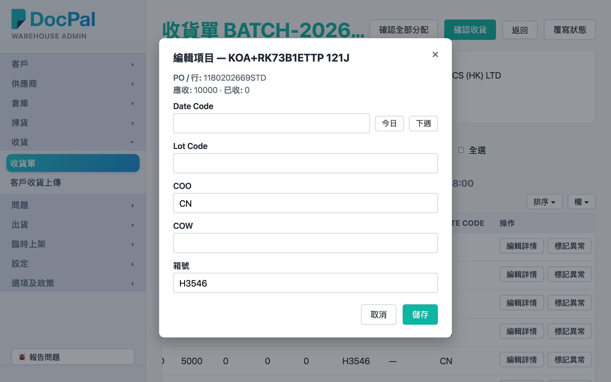

# 第 1 章 收货单（Receiving Orders）

## 用途

「收貨單」页面用于查看及管理所有供应商收货批次（batch）：查看每张收货单的状态和进度、修改单上项目的 Date Code / Lot Code / COO / COW / 箱号、在货到齐后执行「確認收貨」、重新执行库存分配，以及下载出货单（shipper）Excel。一般由办公室文员或仓务主管使用，日常配合 PDA 的收货扫描流程：PDA 同事扫货后，文员在这里核对并确认。

## 开始之前

- 你需要一个属于 **admin 群组** 的账号，才能登录 admin 控制台。
- 收货单由上游系统同步进来，无需手工开单；没有发票的空单不会在列表显示。
- 「確認收貨」和「重新分配」会即时影响拣货单的库存分配，操作前请确认 PDA 同事已扫完货或已点好实数。
- 收货单状态分四种：**「待處理」**（pending）、**「暫收貨」**（provisional_received）、**「已收貨」**（in_hand）、**「已完成」**（clear）。

## 逐步操作

### 第 1 步：进入收货单列表

1. 登录 admin 控制台。
2. 在左边导航菜单，点击 **「收貨」** 下的 **「收貨單」**。
3. 画面显示收货单列表，默认只显示「待處理」和「已收貨」状态的单。

### 第 2 步：筛选、搜索和排序

1. **状态筛选**：在列表上方的状态下拉框（显示「全部狀態」）选择一个或多个状态；不选任何状态即为显示全部。
2. **搜索**：在「搜尋批次號 / 供應商 / 發票號」栏输入关键字，系统会自动搜索（停手约 0.3 秒后生效）。
3. **排序**：点击栏位标题（例如「批次號」、「交貨日期」、「建立日期」）即可排序，再点一次反转次序。
4. 列表下方的分页器可以翻页和改每页数量；筛选条件会记在网址里，从详情页点返回不会丢失。

### 第 3 步：打开收货单详情

1. 在列表点击蓝色的批次号，或者双击该行，进入「收貨單 {批次號}」详情页。
2. 页面上方显示：状态、供应商、交货日期（可以直接修改，改完点击旁边的 **「儲存」**）、单据 Date Code。
3. 下方按发票分组列出所有项目，每行显示零件编号、PO / 行、应收、已收、已上架、已分配、箱号、图号、Date Code。
4. 想集中查看某些项目：在「按發票號 / 零件編號 / PO / 箱號篩選…」栏输入关键字；或者用「分組方式」下拉改成按 **「箱號」** 或 **「料號」** 分组。

### 第 4 步：修改单个项目（Date Code / Lot Code / COO / COW / 箱号）

1. 在项目行最右点击 **「編輯詳情」**。
2. 弹出「編輯項目 — {料號}」窗口，里面有：Date Code（可用「今日」／「下週」按钮快速填入）、Lot Code、COO、COW、箱号。
3. 填好后点击 **「儲存」**；留空的栏位会被清走原有数值。
4. 画面自动刷新，表格显示新数值。

### 第 5 步：批量修改多个项目

1. 在每行左边的勾选框选多个项目；要一次选完当前显示的全部项目，勾选 **「全選」**。
2. 勾选后会出现一条蓝色工具栏，显示「已選 N 項」，点击 **「批次編輯」**。
3. 在「批次編輯 — N 個項目」窗口填入要改的栏位；**留空的栏位会保留各项目原本的值**（与单项编辑不同）。
4. 点击 **「儲存」**。如有个别项目失败，页面上方会显示哪个料号出错。

### 第 6 步：确认收货（Confirm Arrival）

1. 当订单状态是「待處理」或「暫收貨」，详情页右上方会看到蓝色 **「確認收貨」** 按钮。
2. 点击后，系统弹出确认：「確認訂單 {批次號} 已到貨？此操作會將訂單標記為已收貨，並將每行實收數量設為應收數量。」
3. 确定后订单变成「已收貨」，系统同时即时重新计算这张单相关的库存分配；页面会显示绿色横幅「庫存分配已完成 — 數據已刷新」。如果计算需要较长时间，会看到黄色「後台正在計算庫存分配…」，等它完成即可。

### 第 7 步：重新分配（Re-allocate）

1. 订单状态是「已收貨」时，右上角有 **「重新分配」** 按钮。
2. 点击并确认「重新分配收貨單 {批次號} 的貨品？」。
3. 系统会按这张收货单涉及的料号，重新计算所有相关开放中拣货单的分配（手工钉住的分配不会动）；完成后看到绿色提示，项目的「已分配」栏会更新。
4. 注意：订单未确认收货就点这个按钮会报错「訂單確認收貨後才能重新分配」；如果有 PDA 同事正在拣相关的拣货单，会出现「使用中」错误，要等他们完成后再试。

### 第 8 步：下载出货单（Shipper）

1. 订单状态是「已收貨」时，点击 **「下載出貨單」** — Excel 里面是当前的分配数量（即哪张拣货单会从这批货拿多少）。
2. 订单状态是「已完成」时，按钮会变成 **「下載已完成出貨單」** — 里面是实际已拣数量。
3. 点击后浏览器会自动下载 `.xlsx` 文件，文件名带批次号。
4. 注：页面上没有「下載送貨單列表（DOL）」按钮 — 这个功能暂时未开放。

### 第 9 步：覆写状态（进阶，慎用）

1. 在详情页点击 **「覆寫狀態」**，或者在列表勾选多张单后点击右上角 **「設定狀態（N）」**。
2. 在弹窗选择「新狀態」，可填「原因（選填）」，点击 **「儲存」**。
3. 如果将「已完成」的单改回其他状态，画面会警告：该单的库存会重新进入分配供应；将已收货的单退回「待處理」，已收数量会保留。请确定确实需要才这样做。

## 常见问题

**Q：为什么找不到某张收货单？**
A：列表默认只显示「待處理」和「已收貨」的单。试试在状态筛选加入「暫收貨」／「已完成」，或者不选任何状态显示全部。另外没有发票的空单系统不会显示。

**Q：为什么看不到「確認收貨」按钮？**
A：这个按钮只会在订单状态是「待處理」或「暫收貨」时出现。如果已经是「已收貨」就无需再点。

**Q：点「重新分配」弹出「訂單確認收貨後才能重新分配」？**
A：先做第 6 步「確認收貨」，订单进入「已收貨」状态后才可以重新分配。

**Q：点「重新分配」提示订单「使用中」？**
A：代表有 PDA 同事正在相关拣货单拣货，系统锁定了。等他完成（或取消）之后再点一次。

**Q：批量编辑时我只改了 Date Code，其他栏会不会被清走？**
A：不会。批量编辑留空的栏位会保留原值；但**单项**编辑留空的栏位会被清走，注意区分。

**Q：点「下載出貨單」失败怎么办？**
A：页面上方会显示「出貨單下載失敗」和原因。先点击 **「重新整理」** 再试；持续失败请联系系统管理员。
