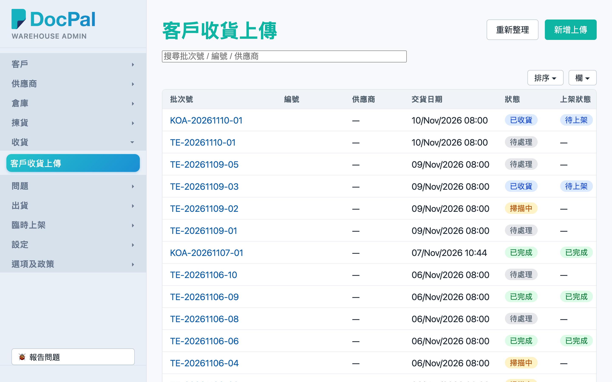
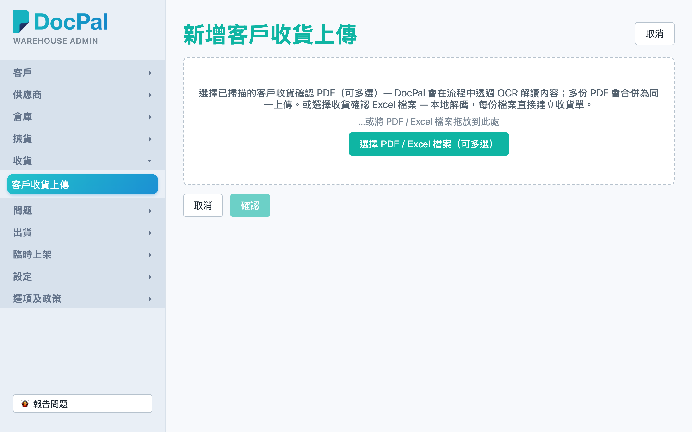
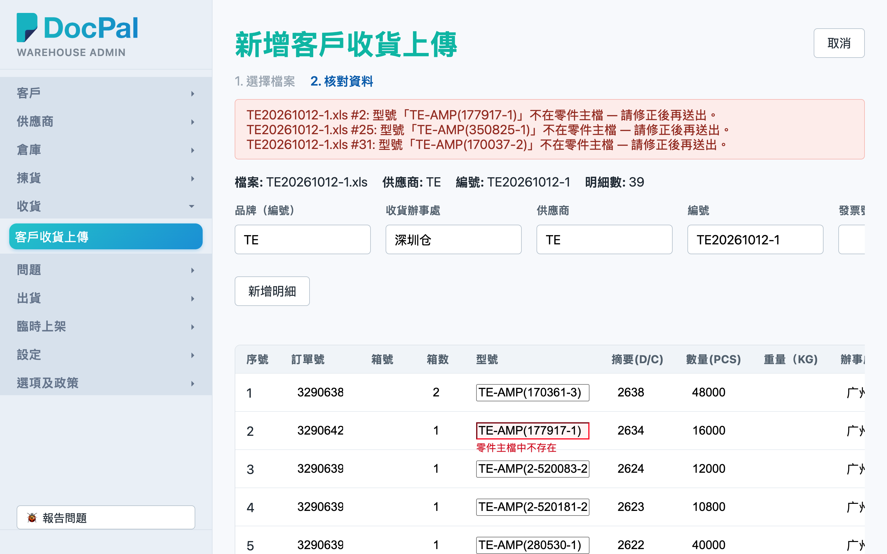
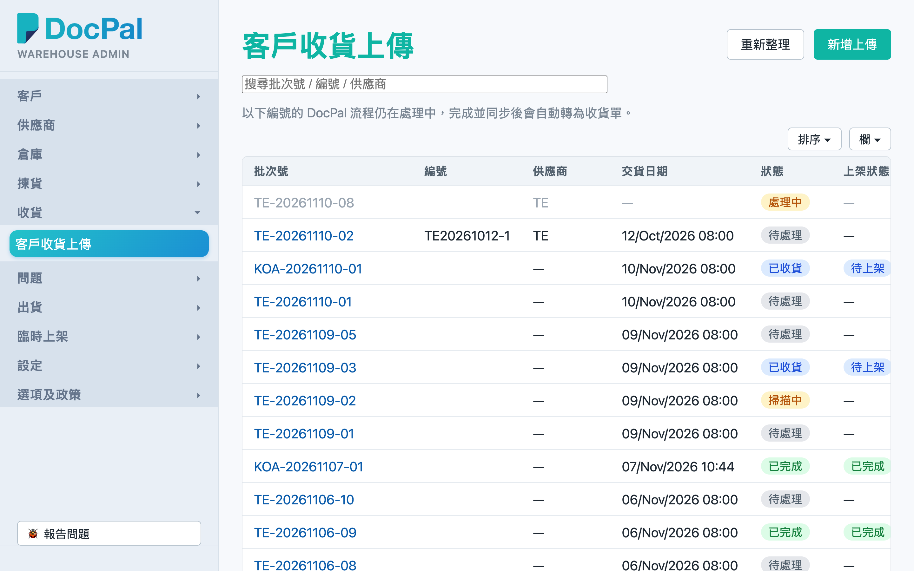
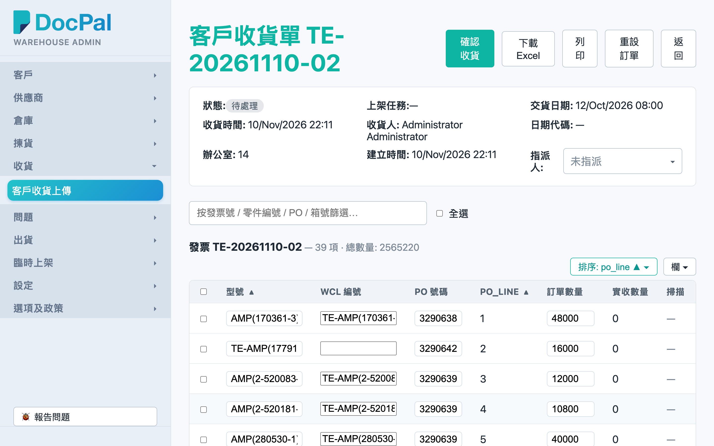

# 第 2 章 客户收货上传（CN Receiving Upload）

## 用途

「客戶收貨上傳」页用于将客户（CN 仓）的「收貨確認及付款通知書」导入系统，建立 CN 收货单，之后才能由仓库同事用 PDA 扫描实货、再上架。有两种上传方式：

- **Excel（.xls / .xlsx）**：浏览器本地解码，你可以在画面上核对并修改资料后再送出；资料无问题会立即建立收货单。
- **PDF（已扫描的确认书）**：送到 DocPal workflow 做 OCR 解读，需要等待一段时间才会变成收货单。

一般日常由办公室文员负责上传与核对，仓库主管负责确认收货与跟进异常。

## 开始之前

- 你的账号必须属于 admin 群组，才能用 admin 控制台登录。
- 准备好客户提供的收货确认 Excel 档（或已扫描的 PDF）。一次上传中 **PDF 与 Excel 不能混合**；多份 PDF 会合并为同一个上传，多份 Excel 则每份各建一张收货单。
- Excel 上传会对照零件主档：明细中的「型號」要在零件主档中找到，才能自动建立；找不到就要在核对画面修正。
- 整个流程的衔接：上传建立收货单 →（如是「待處理」状态）admin 在详情页点击「確認收貨」→ PDA 同事扫描实货 → 扫完后才会出现上架任务 → PDA 完成上架。本章涵盖上传至确认收货这一段。

## 逐步操作

### 第 1 步：进入「客戶收貨上傳」列表

1. 用 admin 账号登录 admin 控制台。
2. 在左边导航 menu 点击 **「客戶收貨上傳」**。
3. 画面显示 CN 收货单列表，栏位包括：批次号、编号（通知书编号）、供应商、交货日期、状态、上架状态、建立日期。
4. 顶部有搜索栏（提示字：「搜尋批次號 / 編號 / 供應商」）可以直接筛选；右上角有「重新整理」与「新增上傳」两个按钮。

### 第 2 步：开始新增上传

1. 点击右上角 **「新增上傳」**，进入「新增客戶收貨上傳」页（步骤一「選擇檔案」）。
2. 点击 **「選擇 PDF / Excel 檔案（可多選）」** 选择文件，或者直接把文件拖放到虚线框（「…或將 PDF / Excel 檔案拖放到此處」）。
3. 注意事项：
   - 只接受 .pdf / .xls / .xlsx，其他格式会显示「只接受 .pdf / .xls / .xlsx 檔案。」
   - PDF 与 Excel 混合会显示「PDF 與 Excel 檔案不能同批上傳。」
4. 选择了 PDF 的话，文件名会列在下面，可以点击「×」删除个别文件；确认后点击 **「確認」** 送出，DocPal workflow 就会开始 OCR 处理。

### 第 3 步：核对／修改 Excel 解码结果（步骤二「核對資料」）

选择了 Excel 之后，系统会即时在浏览器解码：

1. **资料全部正常**：系统会自动送出并建立收货单，直接跳转到新收货单的详情页（多份 Excel 则跳转到第一份的详情页），无需再做操作。
2. **发现问题**：画面会进入步骤二「核對資料」，顶部红色错误列会逐项列出问题，例如「缺少編號。」「缺少型號。」「數量必須為正整數。」「型號「XXX」不在零件主檔 — 請修正後再送出。」
3. 每份 Excel 显示为一个区块，上面可以修改表头栏位：品牌（編號）（留空会自动取首笔明细的品牌）、收货办事处、供应商、编号、发票号码、收货日期。
4. 下面明细表每一格都可以直接修改：订单号、箱号、箱数、型号、摘要(D/C)、数量(PCS)、重量（KG)、办事处、发货项、备注。点击「新增明細」可以加行，点击「刪除」可以删行或整个文件区块。
5. 表格底部有合计对照：Σ 箱数 / Σ 数量(PCS) 与 Excel 原本的合计行。如果不一致会出现「合計不符」提示——这只是警告，你仍然可以送出，但建议核对清楚。
6. 改好之后点击 **「確認」** 送出；想返回重新选择文件就点击「返回」。

### 第 4 步：追踪上传与 DocPal workflow 状态

1. 返回「客戶收貨上傳」列表。
2. PDF 上传未处理完的，会以灰色文字显示在列表最顶部，状态栏显示「處理中」，批次号无法点击进入；页面会显示提示「以下編號的 DocPal 流程仍在處理中，完成並同步後會自動轉為收貨單。」
3. 列表每 10 秒会自动刷新，处理完成后该行会自动变回正常收货单（可以点击进入）。画面顶部有更新提示条时，点击「重新整理」即时更新。

### 第 5 步：查看收货单详情、确认收货

1. 在列表点击蓝色的 **批次号**，进入「客戶收貨單 {批次号}」详情页。
2. 顶部卡片显示：状态（待处理／扫描中／已收货／已完成）、上架任务状态（待上架／已完成）、交货日期、收货时间、收货人、日期代码、办公室、建立日期，以及「指派人」下拉（选择了某用户之后，PDA 只有该用户能看到这张单）。
3. 下面按发票分组显示明细，栏位包括型号、WCL 编号、PO 号码、订单数量、实收数量、扫描（正常／数量不符／异常／未扫描）、上架进度（已上架/实收数量与货架位置）、箱号、日期代码、批号、COO、COW、子库、建议货架等。
4. 如果订单还是「待處理」：
   - 可以直接在表格中修改各栏（改完即存），或用每行右边的「編輯」按钮／勾选多行后用「批量編輯」；
   - 核对无误后点击右上角 **「確認收貨」**，确认对话框会提示「訂單會進入掃描狀態 — 需由 PDA 掃描實物後才會上架」。确认后订单变为「掃描中」，等待 PDA 同事扫描实货。
5. 需要文件可以点击 **「下載 Excel」**（重新生成的收货确认书，有上架任务时会附上 QR code 方便 PDA 直接扫入上架）或 **「列印」**（PNG 版）。
6. 页面底部有操作记录（Audit Log），记录每一次修改。

## 常见问题

**Q：上传了 PDF，但列表一直看不到收货单？**
A：DocPal OCR workflow 需要时间处理。列表最顶部会有灰色「處理中」行，每 10 秒自动刷新；完成后会自动变成正式收货单。等了很久仍未完成，先点击「重新整理」，再不行就向系统管理员查询 workflow 状态。

**Q：点击进入详情看到「收貨單尚未同步」？**
A：代表 DocPal 流程还未处理完或者上游还未同步资料。稍后返回列表重新整理即可，无需重复上传。

**Q：Excel 上传时出现「型號「XXX」不在零件主檔」？**
A：先检查型号有没有打错；如果是新型号，要请相关同事先在零件主档建立，之后回到核对画面修正再点击「確認」。

**Q：PDF 与 Excel 一起选择了，为什么出错？**
A：两种文件不能同批上传（会显示「PDF 與 Excel 檔案不能同批上傳」）。分开两次上传。

**Q：确认了收货之后发现资料错误，怎么办？**
A：详情页右上角有「重設訂單」按钮（状态未是「已完成」才能看到）。重设会清除所有扫描／收货／上架进度，订单返回「待處理」，你修正资料后再「確認收貨」。已完成的订单因为库存已入账，不能重设。

**Q：「合計不符」警告是不是一定要处理？**
A：不是阻挡性错误，仍然可以送出。但它代表明细加总与 Excel 印出的合计行不一致，通常是解码或原始文件有出入，建议逐行核对箱数与数量(PCS)再送出。
