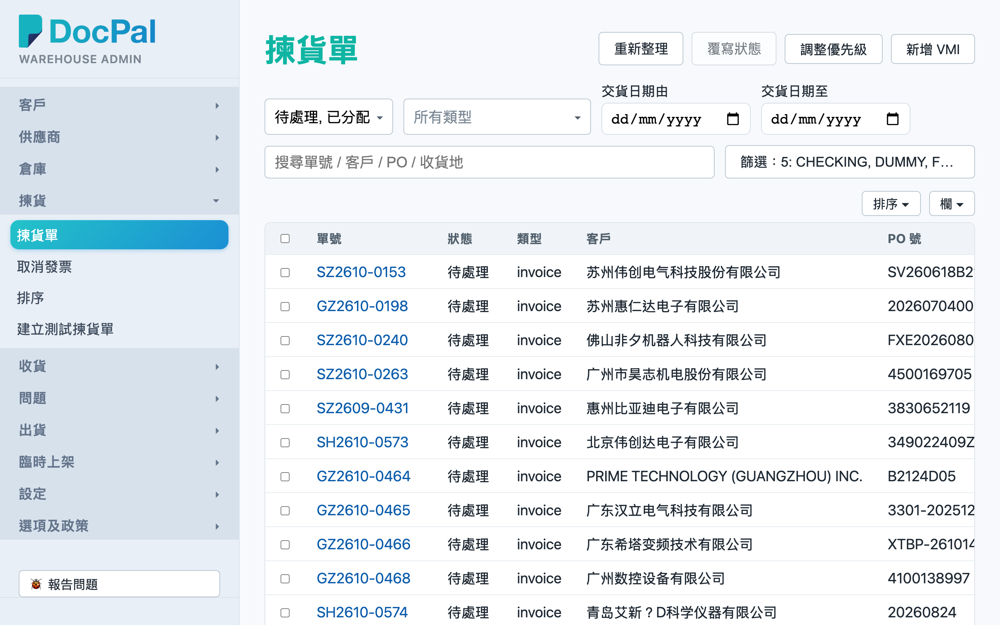
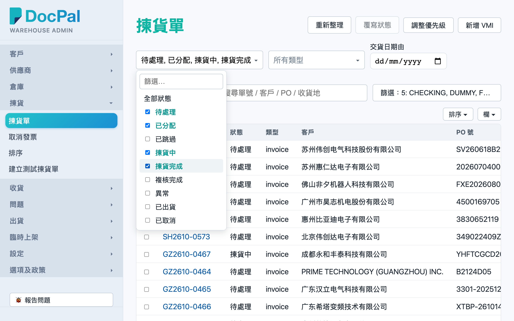
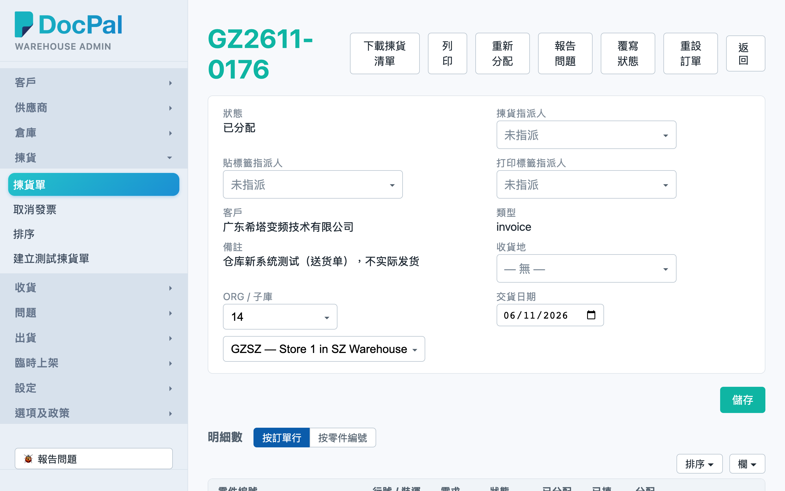
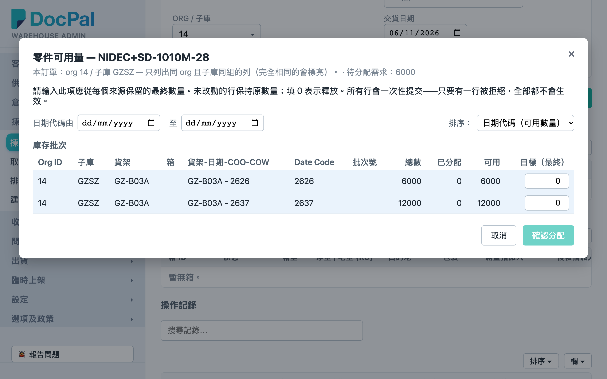
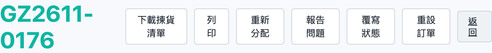
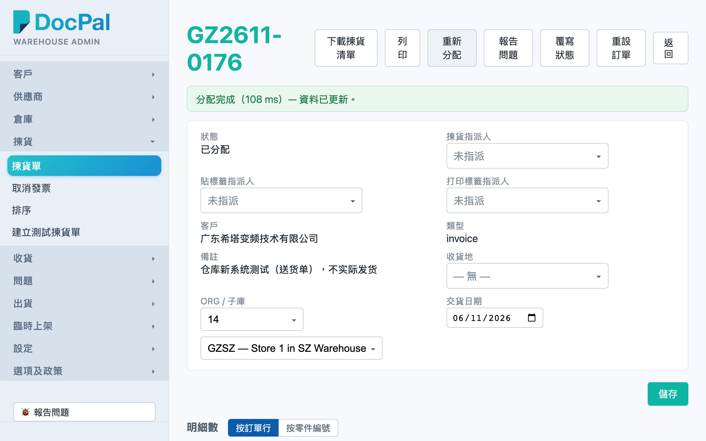

# 第 3 章 拣货单（Picking Orders）

## 用途

「揀貨單」页用于查阅和跟进所有拣货单：按状态／类型／交货日期筛选、用单号或客户搜索、进入详情页修改交货日期和收货地、调整分配的日期代码（date code）、下载拣货清单（packing list／TN 拣货用的清单 Excel）或打印，以及在需要时点击「重新分配」（Re-allocate）让系统为该张单重新计算货源分配。日常由办公室文员和仓库主管使用；PDA 仓员拣货的进度会即时反映在这里。

## 开始之前

- 你需要有 **admin 群组的账号**，先用桌面浏览器登录到 admin 控制台。
- 拣货单由上游系统同步下来（VMI 单除外，由「新增 VMI」上传建立），无需人工逐张开单。
- PDA 流程衔接：本页修改了交货日期或执行了重新分配之后，PDA 拣货列表会自动看到最新状态；如果仓员**正在拣**该张单（列表「鎖定人」栏有人名），重新分配会被拦截，要等他们完成或释放。
- 如需调整多张单的处理先后次序，请使用列表页右上角的「調整優先級」（本章不覆盖）。

## 逐步操作

### 第 1 步：进入「揀貨單」列表

1. 登录后，在左侧导航菜单点击「**揀貨單**」。
2. 页面顶部是标题「揀貨單」，右上角有「**刷新**」、「**覆寫狀態**」、「**調整優先級**」、「**新增 VMI**」几个按钮；下方是筛选栏和订单列表。

### 第 2 步：筛选和搜索订单

1. 「**狀態**」下拉（可输入文字搜索、可多选）：默认勾选「待處理」和「已分配」，即只显示尚未开工的单。想查看拣货中或已出货的单，加选「揀貨中」、「揀貨完成」、「已出貨」等；全部不勾选即等于显示全部状态。
2. 「**類型**」下拉：选择 invoice、tn 或 vmi；全部不勾选 = 所有类型。
3. 「**交貨日期由**」和「**交貨日期至**」：选择日期范围，只显示交货日期落在范围内的单。
4. 最右侧的搜索框（提示文字「搜尋單號 / 客戶 / PO / 收貨地」）：输入后等待约半秒自动搜索；按 **Enter** 立即搜索——如果结果**恰好只有一张单**，系统会直接跳转到该张单的详情页，无需再点击。
5. 列表每一行显示：单号、状态、类型、客户、PO 号、收货地、交货日期、明细数、已拣/总数、分配状态（已分配／部分分配／未分配，附数量）、锁定人、指派人、备注等。点击列标题可以排序，页底可以翻页和修改每页行数。
6. 如需进入详情页：**点击蓝色单号**，或者**双击该行**。

### 第 3 步：修改交货日期／收货地／Org／子库

1. 在详情页上半部的资料区，找到「**交貨日期**」栏，点击日期框选择新日期。
2. 同一区域还可以修改「**收貨地**」（国家/地区下拉）和「**Org / 子庫**」——注意 Org 和子库**要两个一起选择或一起清空**，只选一个会出现红字「請同時選擇 Org 和子庫（或兩者都清空）」，无法保存。
3. 修改完成后，点击资料区右下角的「**儲存**」按钮。成功会看到「已儲存。」提示；之后列表和 PDA 都会看到新日期。

### 第 4 步：调整分配的日期代码（date code）

拣货单每行料件的「分配」栏会显示系统选择了哪个货架批次（格式类似「批次 A01-01 / BOX-1-2625」，尾段是日期代码）。如需改用其他日期代码的货：

1. 在「明細數」表格该行，点击料号旁边的「**🔍**」（可用量）按钮。
2. 弹出「零件可用量」窗口，列出该种料的所有库存批次和未完成收货来源。上方有「**日期代碼由**／**至**」筛选，可以只查看某段 date code 的批次。
3. 在需要的批次输入数量，点击「**分配**」。这种人工分配会被记住（manual pin），之后执行「重新分配」也**不会**被冲掉。
4. 如需移除某项现有分配：返回详情页「明細數」表，在「按訂單行」模式下点击该项分配右侧的「**x**」（移除分配），确认后系统会在后台重新计算。
5. 如需一眼看清该种料共有多少行需求，可以点击表格标题旁边的「**按零件編號**」切换成合并显示，再点击 🔍 一次性完成所有分配。

### 第 5 步：下载拣货清单／打印（packing list／TN 用）

1. 在详情页顶部点击「**下載揀貨清單**」：浏览器会下载一个 `picking-list-<單號>.xlsx` Excel 文件，内容反映**下载当时**的分配，可以直接交给仓员或附入 packing list／TN 文件流程。
2. 如需图像版：点击旁边的「**列印**」按钮，会弹出打印窗口，预览后打印或保存 PNG。
3. 两者都是只读操作，不会改动订单任何资料，可以随时重复下载。

### 第 6 步：重新分配（Re-allocate）

何时需要点击：系统**不会**自动重算分配，所以当你知道货源有变——例如刚收了新货入库、某批货被挪走了、或者想改用其他 date code——就要人工点击一次。

1. 打开该张单的详情页（状态要是「待處理」、「已分配」或「揀貨中」才能看到这个按钮）。
2. 点击顶部「**重新分配**」按钮，弹出确认「重新分配訂單 XXXXX？」，点击确定。
3. 等待几秒，完成后顶部会出现绿色横幅「分配完成（xxx ms）— 資料已更新。」，明细的分配栏已换成新结果。
4. 请放心：重新分配**只影响这一张单**——其他正在使用同一料号的拣货单不会被改动；你之前用 🔍 做过的人工分配（manual pin）会保留。

如果点击后看到红字「訂單 XXXXX 正由某某操作中 — 請稍後再試」，即表示有仓员在 PDA 拣这张单，等他完成或联系他释放之后再点击。

## 常见问题

**Q：为什么找不到某张拣货单？**
A：最常见原因是状态筛选——默认只显示「待處理」和「已分配」。在「狀態」下拉加选其他状态（或全部不勾选），再试搜索。也可以检查「交貨日期由／至」是否设了范围把它排除了。

**Q：为什么没有「重新分配」按钮？**
A：这个按钮只在状态为「待處理」、「已分配」或「揀貨中」时才出现；已拣货完成、已出货或已取消的单不能重算分配。

**Q：点击「重新分配」会不会搞乱其他单？**
A：不会。它只会清除再重建**这张单**的分配，其他拣货单原封不动；其他人工分配（用 🔍 下的 pin）也会保留。

**Q：点击后弹出「正由某某操作中」怎么办？**
A：即表示有仓员在 PDA 拣这张单（列表「鎖定人」栏会看到他的名字）。等他拣完、或叫他退出该单之后再点击；不要急着重试。

**Q：改了交货日期点击「儲存」，但出现红字说要同时选择 Org 和子库？**
A：「Org / 子庫」是一对——要么两个都选，要么两个都清空。补上另一个之后再点击「儲存」即可。

**Q：下载了拣货清单之后再改分配，Excel 会自动更新吗？**
A：不会，该 Excel 是下载那一刻的快照。改完分配记得重新点击「下載揀貨清單」获取最新版本。
