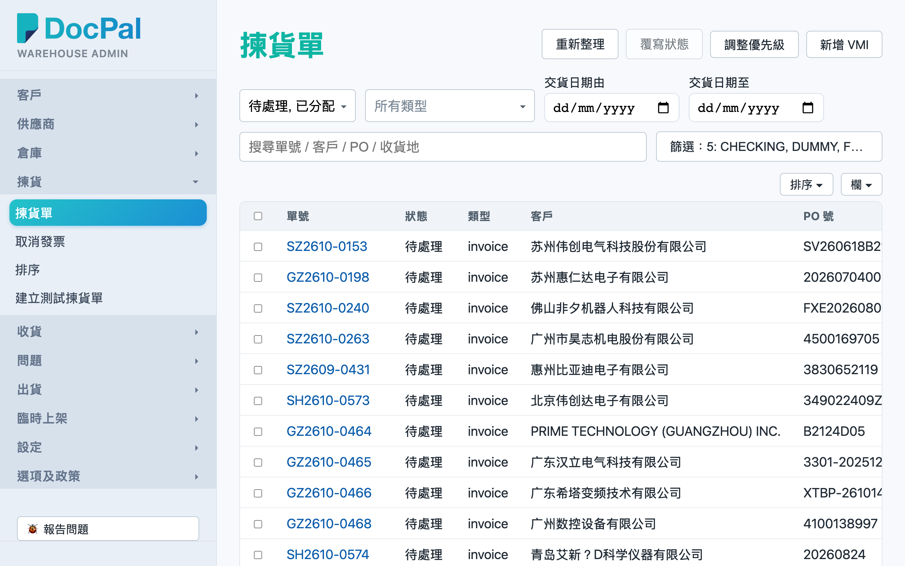
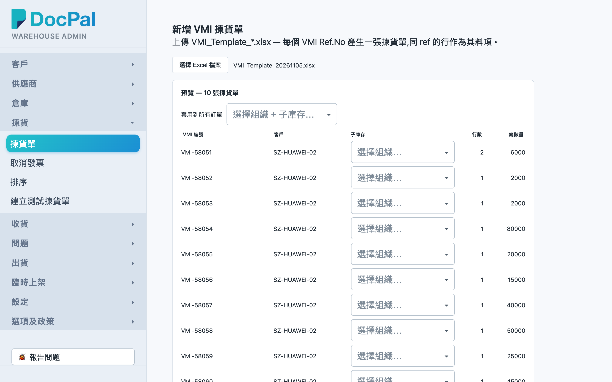
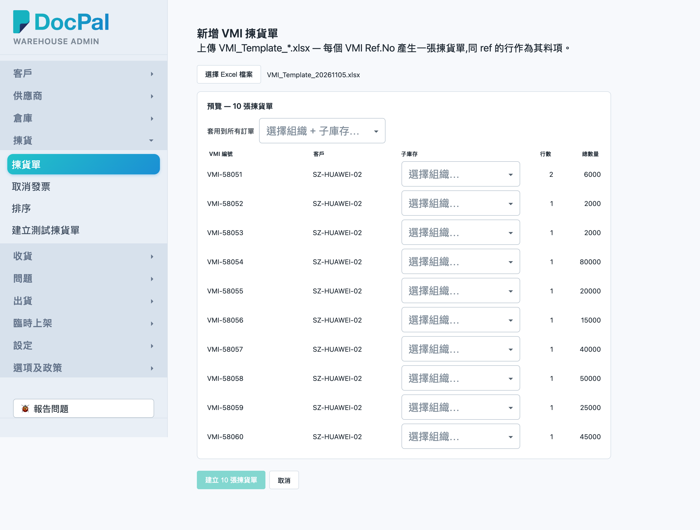

# 第 4 章 新增 VMI（VMI Excel Upload）

## 用途

「新增 VMI 揀貨單」页面用于将客户提供的 VMI Excel 文件（`VMI_Template_*.xlsx`）批量导入系统：文件内每一个 **VMI Ref.No** 会生成一张拣货单，同一 Ref.No 的每一行即为该单的料项。系统会在你的浏览器本地读取并核对 Excel 内容，确认无问题后一次性创建全部拣货单。创建完成后，这些 VMI 拣货单会出现在「揀貨單」列表中，之后按正常拣货流程（分配库存 → PDA 拣货）处理。此操作一般由办公室文员或仓库主管执行。

## 开始之前

- 你已有 admin 群组账号，并已通过浏览器登录 Admin 控制台。
- 已收到客户的 VMI Excel 文件（`.xlsx` 或 `.xls`），文件内需有一个工作表，表头必须包含以下四列（列次序可任意）：**VMI Ref.No**、**Item**、**Qty**、**Sub Inventory**；其余列（Customer Code、Customer Name、Ship To Address、Customer PO、PO Line、Customer Item）如有会一并导入，没有也不妨碍上传。
- Excel 内的 **Item** 必须是零件主档中已有的型号；**Sub Inventory** 必须是本仓库已设定的子库代码，否则会被拦截，创建按钮无法点击。
- 创建出来的拣货单类型会标记为 `vmi`，初始状态为「待處理」，必须先完成库存分配（Re-allocate），PDA 同事才能看到并进行拣货。

## 逐步操作

### 第 1 步：进入拣货单列表

1. 在左侧导航菜单中，点击「拣貨」分组下的「**揀貨單**」。
2. 画面显示拣货单列表，右上方有一排按钮：「重新整理」、「更改狀態」、「調整優先級」、「新增 VMI」。

### 第 2 步：打开新增 VMI 页面

1. 点击「**新增 VMI**」按钮。
2. 进入「新增 VMI 揀貨單」页面，页面顶部有说明文字：「上傳 VMI_Template_*.xlsx — 每個 VMI Ref.No 產生一張揀貨單，同 ref 的行作為其料項。」

### 第 3 步：选择 Excel 文件

1. 点击「**選擇 Excel 檔案**」按钮，在弹出的文件选择窗口中选择客户的 VMI Excel 文件。
2. 点击后按钮会短暂显示「解析中…」，文件名会显示在按钮右侧。
3. 文件是在你的浏览器内本地读取，创建之前不会写入系统；选错文件可再次点击「選擇 Excel 檔案」重新选择。

### 第 4 步：逐行核对预览并修正问题

1. 解析成功后，画面会出现「**預覽 — N 張揀貨單**」区块，每一行代表一个 VMI Ref.No，显示：「**VMI 編號**」、「**客戶**」、「**子庫存**」、「**行數**」、「**總數量**」。
2. 逐行核对 VMI 编号、客户、行数与总数量是否与客户文件一致。
3. 查看「**子庫存**」一列：
   - 如果该子库代码只对应一个组织，系统会自动填好。
   - 如果对应多个组织，列内会出现「選擇組織…」下拉框，需要手动选择一个（显示格式为「組織編號 · 子庫存代碼」）。
4. 如果文件有问题，页面上方会出现红色提示「**建立前請先修正以下問題:**」，逐条列明问题，例如：
   - 「有列缺少 VMI Ref.No。」
   - 「單 X：數量『Y』必須為正整數。」
   - 「型號『Z』不在零件主檔。」
   - 「子庫存『S』（單 X）未在本倉庫設定。」
5. 有问题时无需在网页上修改——回到 Excel 文件修改，保存后再点击「選擇 Excel 檔案」重新上传，直至红色提示消失为止。
6. 有多张订单且全部属于同一组织＋子库存时，可以使用「**套用到所有訂單**」下拉框一次性设定全部，无需逐张选择。

### 第 5 步：创建拣货单

1. 确认预览无问题、每张单的子库存都已选好后，点击底部的「**建立 N 張揀貨單**」按钮（N 为实际单数）。如果按钮为灰色，表示还有问题未修正或有订单未选择组织。
2. 按钮会显示「建立中…」，完成后自动跳回「揀貨單」列表。
3. 如果不想创建，随时可以点击「**取消**」返回列表，不会留下任何数据。

### 第 6 步：确认创建结果

1. 在「揀貨單」列表中，用「類型」筛选列选择 `vmi`，或在搜索栏输入 VMI Ref.No 找到刚创建的单。
2. 点击单号进入详情页，核对料项、数量、客户与收货地。
3. 之后按正常流程进行库存分配，PDA 同事才能开始拣货。

## 常见问题

**Q：上传后出现「找不到 VMI 表頭 — 工作表需要 VMI Ref.No / Item / Qty / Sub Inventory 欄。」怎么办？**
A：文件内没有一个工作表同时具备这四个列名。打开 Excel 检查列名写法（大小写不分，但名称要正确，例如「VMI Ref.No」），改好后重新上传。如果文件有封面页不要紧，系统会自动查找下一个工作表。

**Q：「建立 N 張揀貨單」按钮为灰色无法点击？**
A：三个可能：(1) 页面上方还有红色问题清单未清除；(2) 有订单的「子庫存」列仍是「選擇組織…」未选择；(3) 仍在解析或创建过程中。逐项检查即可。

**Q：出现「型號『X』不在零件主檔。」如何处理？**
A：即 Excel 内的 Item 型号在系统零件主档中不存在。先与相关同事确认是客户写错型号还是主档尚未建立此料；改好 Excel 或建好主档后重新上传整个文件。

**Q：出现「零件主檔檢查失敗 — 請重試。」是不是文件有问题？**
A：不是，这是系统检查零件时网络或服务器出错。稍等片刻再点击「選擇 Excel 檔案」重新上传一次；若持续失败请联系系统管理员。

**Q：上传后才发现内容有错，已经创建了怎么补救？**
A：创建前点击「取消」是最安全的做法。如果已经创建，回到「揀貨單」列表找到那些单，用「更改狀態」将它们取消（填写原因），修正 Excel 后重新上传。

**Q：同一个 VMI Ref.No 的行，Customer 或 Sub Inventory 不一致会怎样？**
A：系统会以第一行的值作为整张单的客户与子库存，之后行的不同值不会提示，因此上传前要确保同一 Ref.No 的数据一致。
