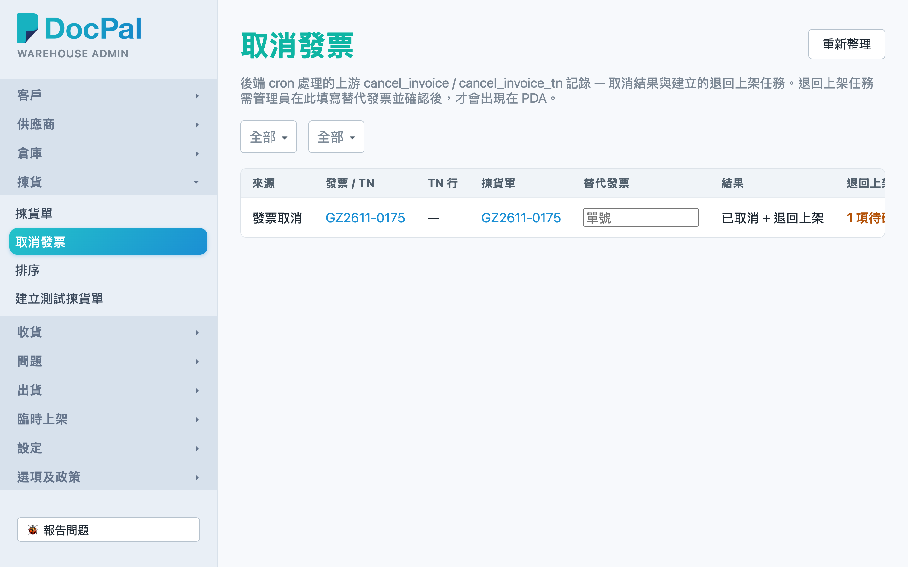
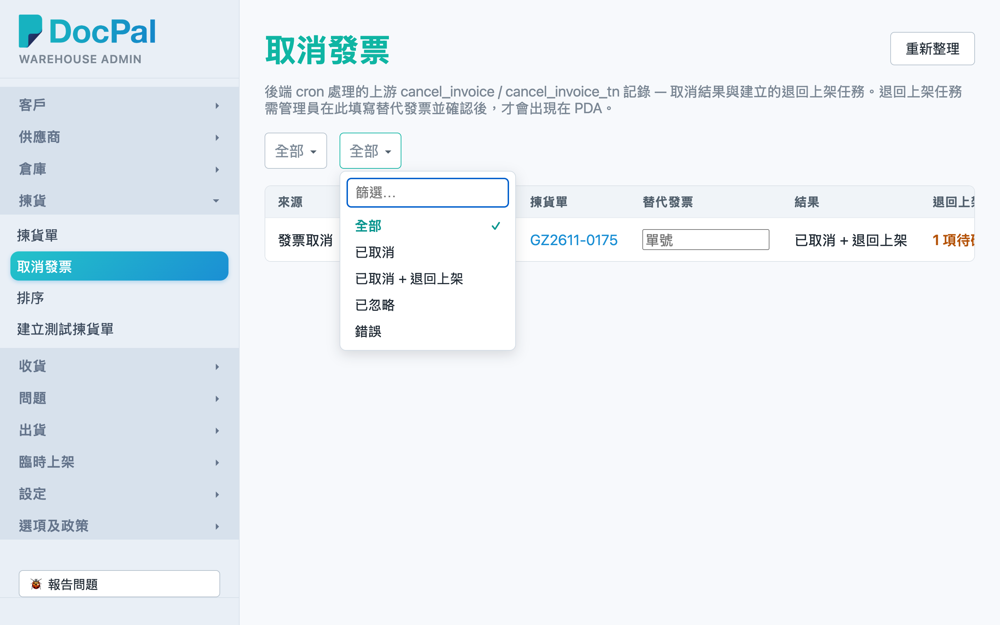
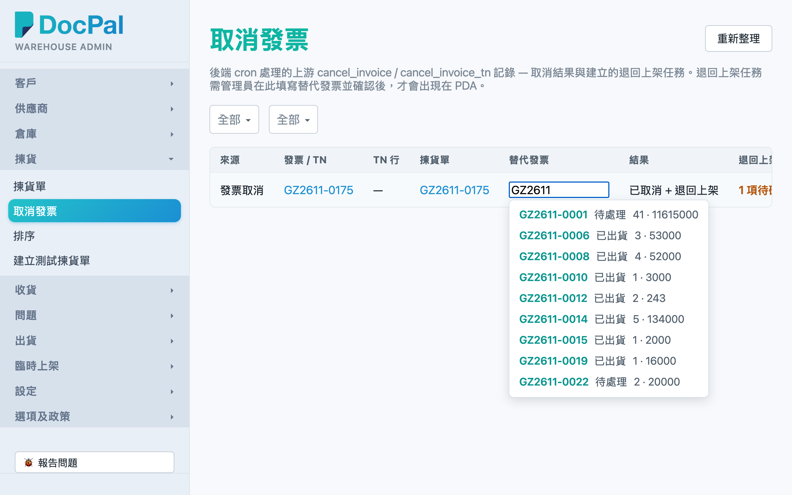
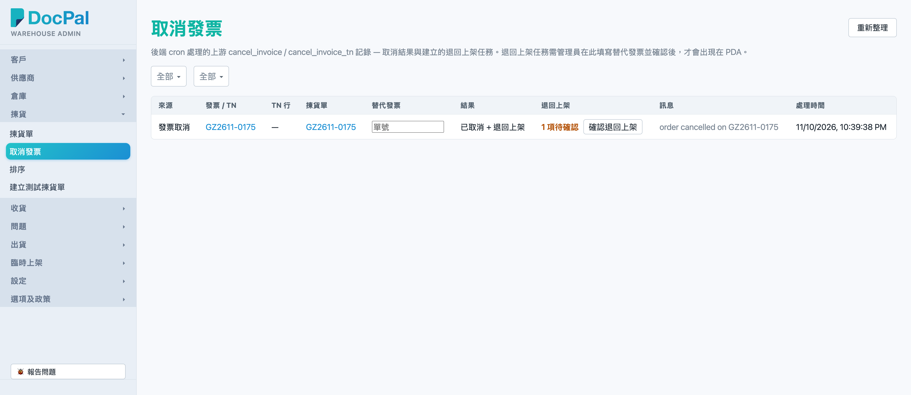

# 第 5 章 取消发票（Cancel Records）

## 用途

当上游系统取消了一张发票（或者发票内某一个 TN 行），系统会自动处理并在本页「取消發票」留下一条记录。如果该张发票的货已经拣出，系统会顺带建立「退回上架」任务，但**这些任务不会立即在 PDA 出现**——必须先由管理员在本页填写替代发票编号、再点击「確認退回上架」，PDA 才会看到退回上架任务。本页主要供办公室文员／仓库主管用来核对取消记录、登记替代发票、放行退回上架。

## 开始之前

- 你需要有 **admin 群组的账号**，才能用桌面浏览器登录 admin 控制台。
- 取消记录由系统自动产生（上游传送取消数据后自动处理），无需人工建立；本页主要是跟进。
- 一般情况下，办公室会就已取消的发票**重新开一张更正的发票**，请先拿到那个新单号，再进行确认。
- 确认之后，退回上架任务才会出现在 PDA 的退回上架清单，仓员才可以执行——所以不要未核实就点击确认。

## 逐步操作

### 第 1 步：进入「取消發票」页面

1. 登录 admin 控制台之后，在左边导航菜单选择「揀貨」分组下的「**取消發票**」。
2. 画面顶部会看到页面标题「取消發票」、右上角一个「**重新整理**」按钮，下面有一段灰色说明文字，解释本页的用途。

### 第 2 步：查看有哪些取消记录

列表每一行是一条取消处理记录，栏位包括：

- **来源**：「發票取消」（整张发票取消）或「TN 行取消」（只取消发票其中一行）。
- **发票 / TN**：被取消的发票编号；如果系统找到对应拣货单，编号是蓝色链接，点击进入会跳转到该张拣货单的详情页。
- **TN 行**：取消的 TN 行编号（只适用于 TN 行取消）。
- **拣货单**：受影响的拣货单号，同样可以点击进入查看详情。
- **结果**：处理结果，分别是「已取消」、「已取消 + 退回上架」、「已忽略」或「錯誤」（错误会用红色显示）。
- **退回上架**：此张取消产生的退回上架任务数目。
- **讯息**：系统处理时的补充说明。
- **处理时间**：系统何时处理了这条取消。

注意：「無法匹配」的记录不会在列表出现（系统已经过滤）。如果没有任何记录，列表会显示「沒有取消記錄。」

### 第 3 步：筛选记录（如有需要）

表格上方有两个筛选栏：

1. 「**來源**」下拉：选择「發票取消」或「TN 行取消」；默认「全部」。
2. 「**結果**」下拉：选择「已取消」、「已取消 + 退回上架」、「已忽略」或「錯誤」；默认「全部」。

一选完筛选，列表会即时重新载入，无需再按按钮。列表亦会自动更新——系统处理新的取消记录时会自动刷新，你也可以随时点击右上角「重新整理」。

### 第 4 步：填写替代发票编号

针对结果为「已取消 + 退回上架」的记录：

1. 在该行的「**替代發票**」栏，点击进入输入框（提示文字是「單號」）。
2. 输入新开的更正发票／拣货单号。输入时系统会即时搜索现有拣货单，弹出建议列表（显示单号、状态、行数和总数量）；见到合适的可以直接点选。
3. 如果新单还未同步到系统，搜索不到也可以**直接照打单号**，一样会接受。
4. 点击离开输入框（或选了建议）之后，系统会自动保存，无需点击「儲存」按钮。
5. 保存成功后，如果系统找到该单，输入框右边会出现一个「↗」链接，点击进入可以跳转到替代发票对应的拣货单详情页核对。

### 第 5 步：确认退回上架

1. 同一行的「**退回上架**」栏，如果有待确认的任务，会看到橙色字「**N 項待確認**」加一个「**確認退回上架**」按钮。
2. 核实替代发票已经填妥、无误之后，点击「**確認退回上架**」。
3. 点击完之后列表会重新载入：「N 項待確認」会消失，退回上架栏只显示任务数目。由这刻开始，仓员在 PDA 的退回上架清单就会看到这些任务。

### 第 6 步：跟进错误记录（如有）

如果某行「結果」显示红色「錯誤」：

1. 查看该行的「訊息」栏，了解系统报告的问题（例如找不到对应拣货单）。
2. 与上游开单的同事核实取消数据是否正确；修正后系统再处理时，本页会自动更新。
3. 处理期间按钮和输入框会暂时变灰（停用），等它完成再继续操作。

## 常见问题

**Q：为什么找不到某张被取消的发票？**
A：先用「來源」和「結果」筛选查看是否被过滤了（默认是「全部」）。另外，系统处理结果为「無法匹配」的记录不会在本页显示；如果确认上游已取消但这里完全没有记录，可能数据还未同步到，等一等再点击「重新整理」。

**Q：「確認退回上架」按钮不见了／点不了？**
A：按钮只会在有「N 項待確認」的行才出现；已经确认过的行只会显示任务数字。点击完之后按钮会暂时变灰，等列表刷新完就会消失。

**Q：替代发票打了单号但搜索不到建议，是不是打错？**
A：不一定。新开的替代发票可能还未同步到仓库系统，搜索建议只找现有拣货单；直接照打单号一样会保存，系统不会当它是错。

**Q：填错了替代发票怎么办？**
A：只要再点击进入「替代發票」栏，改成正确的单号，点击离开就会自动保存新值（清除全部内容就等于删除替代发票记录）。如果已经点击了「確認退回上架」，退回任务已放行到 PDA，要通知主管在 PDA 或系统那边跟进。

**Q：「結果」显示红色「錯誤」要怎么做？**
A：查看「訊息」栏的原因，多数是取消数据与现有拣货单对不上。与上游核实数据后等系统重新处理；本页会自动刷新显示最新结果，无需你手动删除任何东西。

**Q：为什么一定要在这里确认，PDA 才看到退回上架任务？**
A：因为取消发票之后，办公室通常会重新开一张更正发票。系统等你在本页登记替代发票并确认，才放行退回上架任务，避免仓员在未搞清楚哪张单取代哪张单之前就将货放回架。
