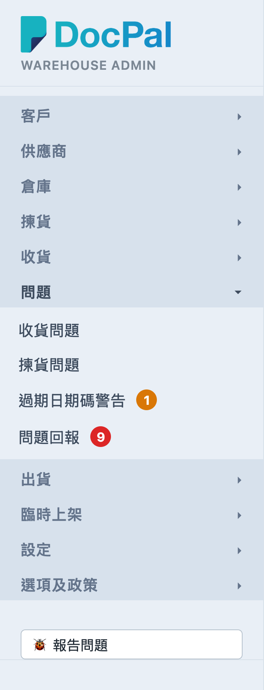
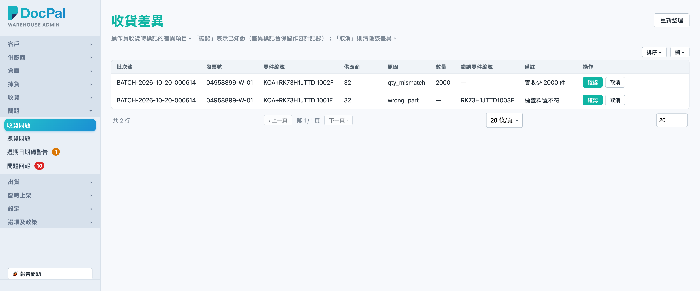
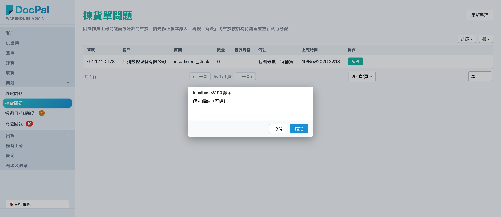
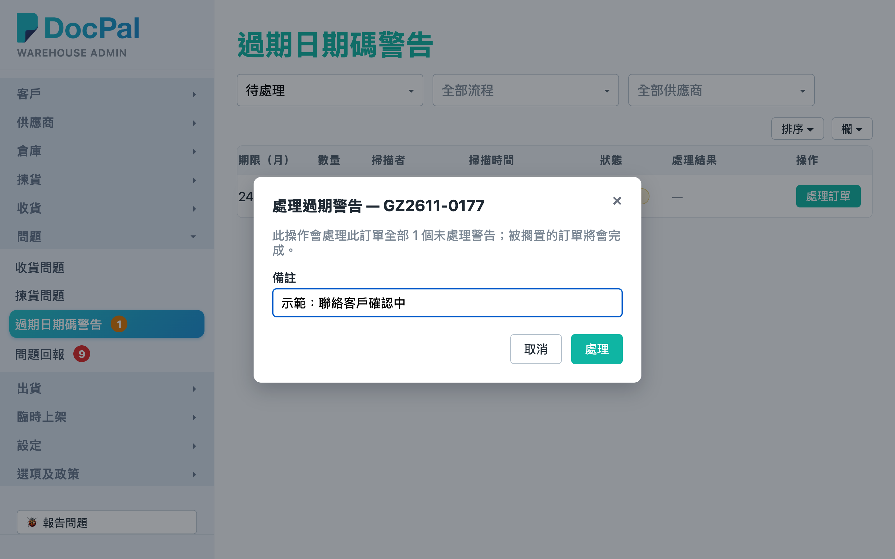
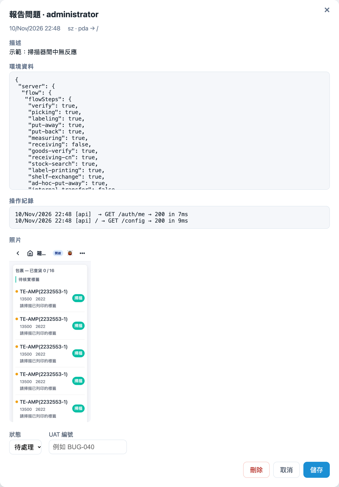

# 第 6 章 问题与警示（Issues & Warnings）

## 用途

本章介绍左侧菜单「**问题**」分组下的四个页面：**收货问题**（收货差异）、**拣货问题**（拣货单问题）、**过期日期码警告**和**问题回报**。仓员在 PDA 收货时标记了差异、拣货时上报了问题，或者扫描时遇到过期日期码货品，全部都会在这里等待你跟进。「问题回报」是 PDA 与 admin 使用者通过「报告问题」功能发送的 bug 报告收件箱。这些页面主要供办公室文员／仓库主管处理 PDA 上报的异常，不处理的话相关单据会一直停滞。

## 开始之前

- 你需要有 **admin 群组的账号**，才能用桌面浏览器登录 admin 控制台。
- 这些页面全部是「被动」页面——数据来自 PDA 操作员的上报，没有上报就没有记录，无需人工创建。
- 拣货问题的「解决」会将单据放回待处理并重新分配库存，所以**点击之前一定要先修正根本原因**（例如补回货、改包装规格）。
- 过期日期码警告的处理是**整张单一次性处理**：同一张单有多少个未处理警告，点击一次「处理订单」就全部处理完毕。
- 导航菜单上「过期日期码警告」和「问题回报」右边会有一个圆形数字徽章（分别是橙色和红色），显示还有多少个待处理项目，超过 99 会显示「99+」。

## 逐步操作

### 第 1 步：进入「问题」分组

1. 登录 admin 控制台之后，在左侧导航菜单点击「**问题**」分组（如果已收起，点击分组标题展开）。
2. 会看到四个链接：**收货问题**、**拣货问题**、**过期日期码警告**、**问题回报**。留意「过期日期码警告」和「问题回报」右边的数字徽章。

### 第 2 步：处理收货差异（收货问题）

1. 点击「**收货问题**」，页面标题是「收货差异」。列表每一行是一个 PDA 收货时标记的差异项目，字段包括：**批次号、发票号、零件编号、供应商、原因、数量、错误零件编号、备注**。
2. 点击任意一行可以跳转到那张收货单的详情页，核对实际情况后再返回处理。
3. 每行右边有两个按钮：
   - 「**确认**」：表示已知悉这个差异。差异标记会保留在系统作为审计记录，此行会从列表消失。
   - 「**取消**」：清除这个差异标记（例如属于误报），此行会从列表消失。
4. 点击按钮之后按钮会显示「儲存中…」，完成后列表自动更新。如果什么差异都没有，列表会显示「暫無未處理的收貨差異。」右上角「**重新整理**」可以随时手动刷新。

### 第 3 步：处理拣货单问题（拣货问题）

1. 点击「**拣货问题**」，页面标题是「拣货单问题」。这里列出的是因操作员上报问题而**被冻结**的拣货单，字段包括：**单号、客户、原因、数量、包装规格、备注、上报时间**。
2. 点击一行会跳转到那张拣货单的详情页，看清楚原因（例如缺货、包装规格不对）。
3. **先去修正根本原因**——例如补货上架、通知订单同事改单。
4. 返回本页，点击那行右边的「**解決**」按钮。浏览器会弹出一个输入框「解決備註（可選）：」，可以填写处理说明，留空也可以；点击确定继续，点击「取消」则不会执行任何操作。
5. 解决之后那张单会**放回待处理状态，并自动重新执行分配**，PDA 仓员可以再次看到它。如果什么问题单都没有，列表会显示「暫無有未解決問題的揀貨單。」

### 第 4 步：处理过期日期码警告

1. 点击「**过期日期码警告**」。这里列出 PDA 拣货／上架扫描时发现超出供应商期限的日期码货品，字段包括：**流程**（拣货／上架）、**订单**（蓝色链接，点击进入单据详情页）、**零件、供应商、日期码、期限（月）、数量、扫描者、扫描时间、状态**和**处理结果**。
2. 页顶有三个筛选栏：「状态」（默认「**待处理**」，可选「已处理」或「全部状态」）、「流程」（默认「全部流程」）、「供应商」（默认「全部供应商」，可以多选）。选择完毕列表即时更新。
3. 对着待处理的行，点击右边的「**處理訂單**」按钮，会弹出对话框「處理過期警告 — （單號）」，里面写明「此操作會處理此訂單全部 N 個未處理警告；被擱置的訂單將會完成。」
4. 在「**備註**」栏填写处理说明（例如「已聯絡供應商確認可照常出貨」，提示文字「處理備註（可留空）…」），然后点击「**處理**」。不想处理就点击「取消」或右上角「×」。
5. 完成后页顶会出现绿色提示「已處理 （單號） 的 N 個警告。」，那些行的状态会变为「已處理」，「处理结果」栏会显示处理人、时间和你填写的备注。导航徽章的数字会即时减少。

### 第 5 步：查看问题回报（bug 收件箱）

1. 点击「**问题回报**」。这里是 PDA 和 admin 使用者通过「报告问题」功能（PDA 页顶／admin 左下角的 🐞 按钮）发送的报告，字段包括：**报告时间、报告人、界面**（哪个 app 哪一页）、**类别、状态**。
2. 顶部两个筛选栏：「状态」（待处理／已分类／已关闭／全部状态）和「类别」（全部类别，例如扫码失败、日期码错误等）。
3. 点击那行右边的「**詳情**」按钮，会弹出完整报告：**描述**、**环境资料**、**操作纪录**（使用者提交前的操作轨迹）、**照片**（如有）。
4. 对话框底部可以更新：
   - 「**狀態**」下拉：待处理 → 已分类 → 已关闭（跟进流程）。
   - 「**UAT 編號**」栏：如果这个问题已经登记为 UAT bug，填入编号（提示「例如 BUG-040」）。
5. 点击「**儲存**」完成，页顶会显示「已儲存」；误传的报告可以点击「**刪除**」移除。关闭对话框之后，导航的红色徽章数字会更新。

## 常见问题

**Q：为什么「收货问题」／「拣货问题」没有任何记录？**
A：没有记录即没有操作员上报异常，是好事。收货差异一经「确认」或「取消」都会从列表消失，所以处理过的不会再看到。

**Q：拣货问题点击了「解决」，但那张单之后又弹回来？**
A：「解决」只是将那张单放回待处理；如果根本原因（例如仍然缺货）未修正，操作员很快会再次上报。点击「解决」前一定要先去拣货单详情页看清楚「原因」并修正好问题。

**Q：过期警告想逐个处理可不可以？**
A：不可以，处理是整张单一次性的——点击「处理订单」会处理那张单全部未处理警告。对话框里面会预先告诉你有多少个（「此操作會處理此訂單全部 N 個未處理警告」），数量不对就先不要点击。

**Q：处理过期警告时不填备注可不可以？**
A：备注可以留空，但建议一定填写——「处理结果」栏会长期显示这段文字，日后追溯才知道当时怎样处理。

**Q：「问题回报」的红色徽章数字不变？**
A：徽章是进入页面时以及离开「问题回报」页时才刷新。刚刚处理完报告，离开该页之后数字才会更新；无需理会它，不影响实际报告。

**Q：删除了的问题报告可不可以找回？**
A：不可以，「删除」是即时移除，无法还原。不确定的话，宁愿将状态改为「已关闭」。
