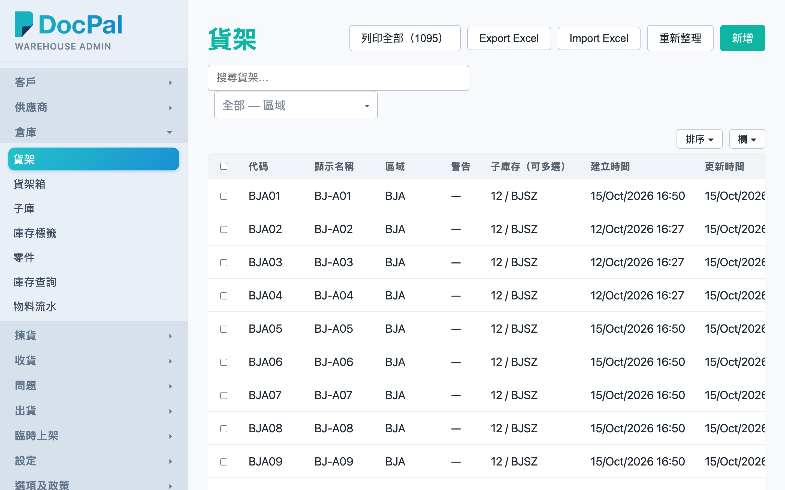
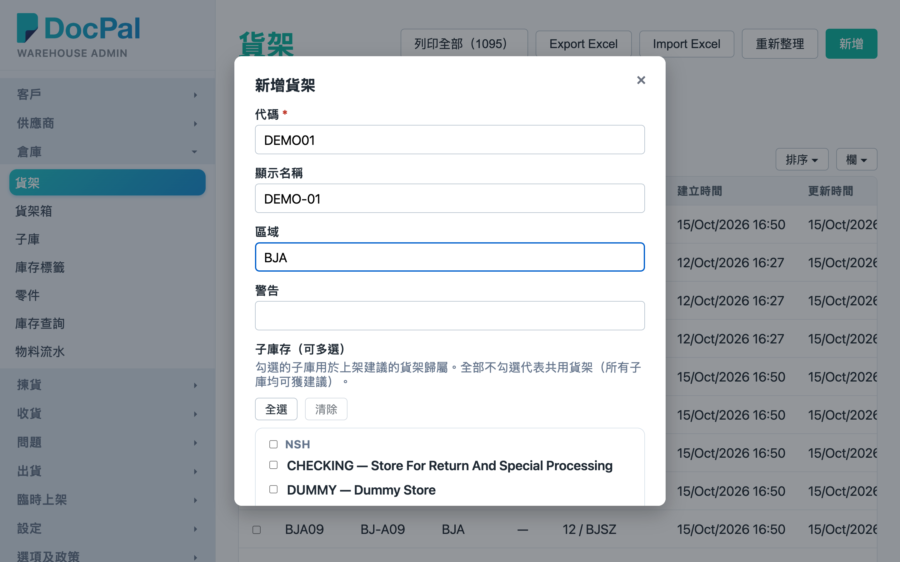
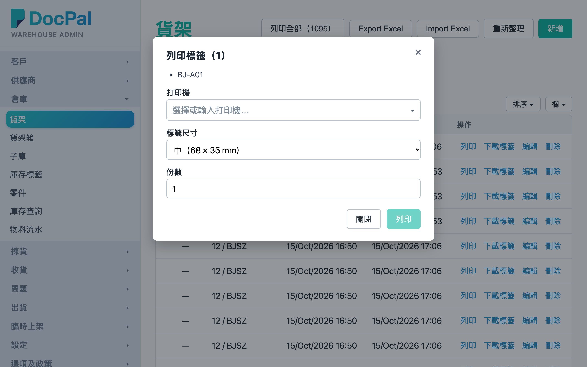
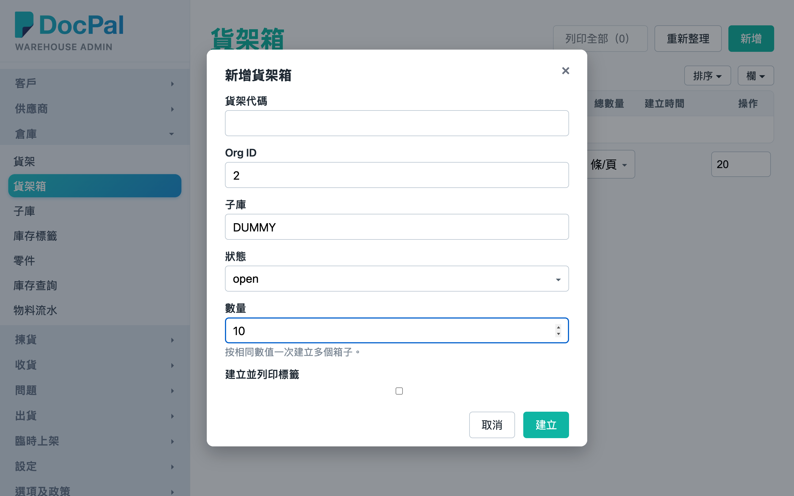
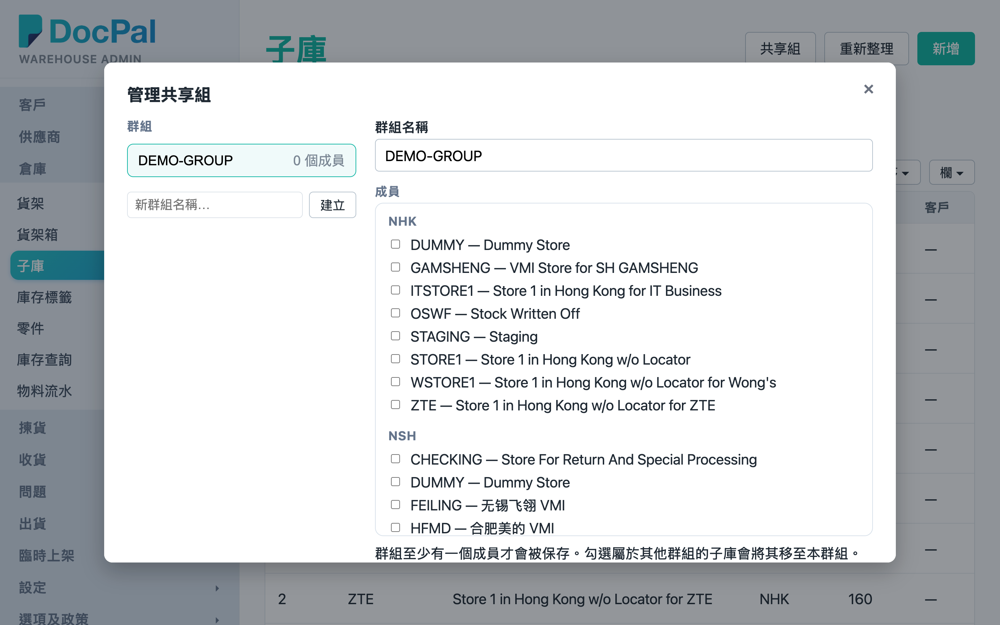

# 第 7 章 仓库设置（Warehouse Setup）

## 用途

本章涵盖 Admin 控制台中的五个仓库基础设置页：**货架**、**货架箱**、**子库**、**箱型**、**国家**。它们负责维护仓库的物理与逻辑结构：货架位置及其 QR 标签、货架箱（批量建立与打印箱标签）、子库与共享组、箱型尺寸选项，以及国家列表。这些设置直接影响 PDA 流程——例如上架时 PDA 扫描的货架 QR、上架建议的货架归属、拣货时跨子库共享的范围，以及收货时选择的原产地。一般由仓库主管在开仓、新增货架或调整仓库布局时使用，日常无需频繁修改。

## 开始之前

- 使用具有 admin 群组权限的账号，在桌面浏览器登录 Admin 控制台。
- 货架与货架箱的 QR 标签必须先打印并贴上实体货架，PDA 才能扫描——建议设置完成后立即打印。
- 「子庫存（可多選）」选择的子库，会影响 PDA 上架建议将货架归属到哪个子库；共享组会影响拣货分配时能否跨子库取货。
- 箱型与国家属于选项数据，PDA／收货流程的下拉选项会用到，增删前请确认现有单据不受影响。
- 打印货架／箱标签前，请确认打印机已在打印服务中设置好（打印对话框内可选择打印机与标签尺寸）。

## 逐步操作

### 第 1 步：进入货架页

从左侧菜单点击「貨架」。页面显示全部货架的表格，列包括「代碼」、「顯示名稱」、「區域」、「警告」、「子庫存（可多選）」、「建立時間」、「更新時間」。上方有搜索框（搜索货架）和「區域」筛选下拉。

### 第 2 步：新增一个货架

点击右上角「新增」按钮，弹出「新增貨架」对话框。填写：

- **代码**（必填）：货架的唯一代码，QR 标签编码的就是这个代码，建立后不可修改。
- **显示名称**：标签上印的名称，例如「A-01-03」。
- **区域**：货架所属区域，用于筛选。
- **警告**：提示文字；凡分配指向此货架就会显示 ⚠ 图标，留空即无警告。
- **子库（可多选）**：勾选此货架属于哪些子库（用于上架建议归属）；全部不勾选代表共用货架，所有子库都可以获得建议。

点击「建立」完成。

### 第 3 步：编辑／删除货架

在该行右侧「操作」列点击「編輯」，可修改「顯示名稱」、「區域」、「警告」或子库存（「代碼」不可修改），点击「儲存」。点击「刪除」会先弹出确认「刪除 {代碼}？」。注意：删除有库存或任务指向的货架前，请先确认没有未完成的上架／拣货工作。

### 第 4 步：打印货架 QR 标签

- **单张**：在该行点击「列印」，弹出「列印標籤」对话框，选择打印机、标签尺寸（小 53×16mm／中 68×35mm／大 104×35mm／特大 104×40mm／A4 标签纸 24 格）、份数，点击「列印」。也可以点击「下載為 PDF」。
- **批量**：用每行左侧的复选框勾选多个货架，点击表格上方「列印所選（N）」；或者点击「列印全部（N）」。批量会按所选尺寸排版成 A4 页面逐页打印。
- **下载图档**：点击该行「下載標籤」，直接下载一张 PNG（上方 QR、下方货架名和区域），不经打印服务，适合交给印刷厂。

### 第 5 步：批量编辑与 Excel 导入导出

- 勾选多个货架后点击「批量編輯（N）」，可以一次性更新全部所选货架的子库存，另外可勾选「同時更新警告」和「同時更新區域」。全部子库不勾选代表改为共用货架。
- 点击「Export Excel」下载全部货架（Code / Name / Group / Warning / Sub-Inventory 五列）。修改完成后点击「Import Excel」选择该文件：以 Code 对照，已存在的货架会更新、新代码会建立；空白格不会改动原有数据。导入完成会显示建立／更新／略过数量。

### 第 6 步：管理货架箱

从左侧菜单点击「貨架箱」。表格显示「ID」、「貨架」、「Org ID」、「子庫」、「狀態」（open／closed／verified）、「明細數」、「總數量」、「建立時間」。

- **批量建立**：点击「新增」，在「新增貨架箱」对话框填写「貨架代碼」（可留空，之后再绑定）、「Org ID」（例如 2）、「子庫」（例如 STORE1）、「狀態」和「數量」——数量填多少就一次建立多少个相同设置的箱，系统会自动编配箱 ID。勾选「建立並列印標籤」可以建立完成后立即弹出打印对话框。点击「建立」。
- **打印／下载**：每行「操作」列有「列印」、「下載標籤」；也可以用复选框勾选后点击「列印所選（N）」，或者「列印全部（N）」。
- **详情**：点击 ID 链接进入「貨架箱」详情页，查看箱的完整数据和其中的明细（零件编号、数量、已核对、核对时间）。点击「← 返回貨架箱列表」返回列表。
- **编辑／删除**：「編輯」可修改货架、Org ID、子库、状态（货架留空即清除货架分配）；「刪除」需要确认「刪除箱 {ID}？」。

### 第 7 步：管理子库与共享组

从左侧菜单点击「子庫」。页面上方有一句说明：库存按 Org ID + 子库划分，同一共享组内的子库可以互相满足彼此的拣货需求。

- **新增子库**：点击「新增」，「Org ID」和「子庫」（代码）必填；「描述」、「辦公室代碼」、「組織 ID」、「客戶代碼」选填（客户代码只有客户专用仓才需要设置）。点击「建立」。
- **筛选与编辑**：用搜索框按 Org／代码／名称／客户／共享组筛选；每行可「編輯」（修改描述、办公室代码、组织 ID、客户代码）或「刪除」。
- **共享组**：每行「共享組」列的下拉可以直接指派或清除该子库的组别。要批量管理，点击页面上方「共享組」按钮，弹出「管理共享組」对话框：左侧输入新群组名称点击「建立」开新组，右侧勾选属于这个组的子库（已属其他组的子库会标示「屬於 X」，勾选即将其移过来），点击「儲存」。注意：群组至少要有一个成员才会被保存；移除最后一个成员即删除该组。

### 第 8 步：管理箱型与国家

- **箱型**：左侧菜单点击「箱型」，点击「新增」建立，填写「代碼」（必填，建立后不可修改）和「描述」。每行可「編輯」／「刪除」。这里的代码会出现在出货箱流程的箱型选项中。
- **国家**：左侧菜单点击「國家」，同样用「新增」建立，填写「代碼」（必填）、「名稱」（必填）、「短代碼」。每行可「編輯」／「刪除」。收货时填写原产地／原产国会用到这个列表。

## 常见问题

**Q：点击「新增」后点击「建立」无反应／弹出错误？**
A：先检查必填栏（红色 * 或者提示「XX為必填項」）。Org ID 必须是整数（例如 2），不可填写字母。子库代码在同一个 Org ID 下不可重复。

**Q：打印标签点击了「列印」但打印机没有出纸？**
A：先在对话框确认选择了正确的打印机；确认打印服务与打印机在线。可以改用「下載為 PDF」（货架）或「下載標籤」（PNG）下载到本机，再用普通打印机打印。

**Q：货架箱建立到一半失败（例如提示「已建立 N 個箱子後失敗」）？**
A：前面成功的箱已经建立了，不会重复。点击「重新整理」查看已建立的箱，差多少就补建多少。

**Q：删除货架／子库／箱型后发现做错了，怎么补救？**
A：系统没有复原功能，只能重新「新增」建立回来。所以删除前一定要确认没有库存、任务或单据仍指向它；货架可以先善用「Export Excel」留底，出事时用「Import Excel」一次性还原。

**Q：为什么有些货架的分配会看到 ⚠ 警告图标？**
A：因为那个货架设置了「警告」文字。想消除就编辑该货架，将「警告」栏清空再储存。

**Q：修改了共享组，拣货分配何时才生效？**
A：共享组只影响之后重新计算的分配。如果现有拣货单已分配了，要在拣货单页点击「重新分配」才会按新共享组重新取货。
