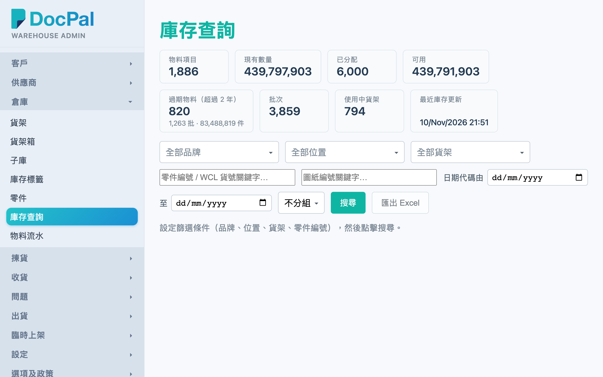
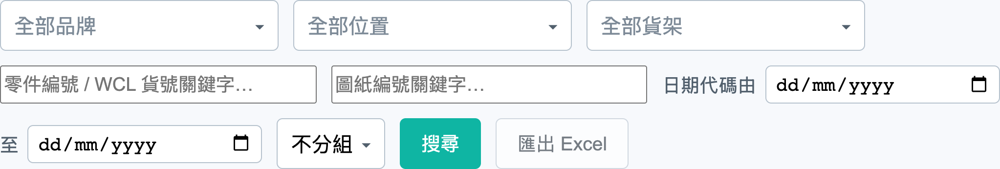
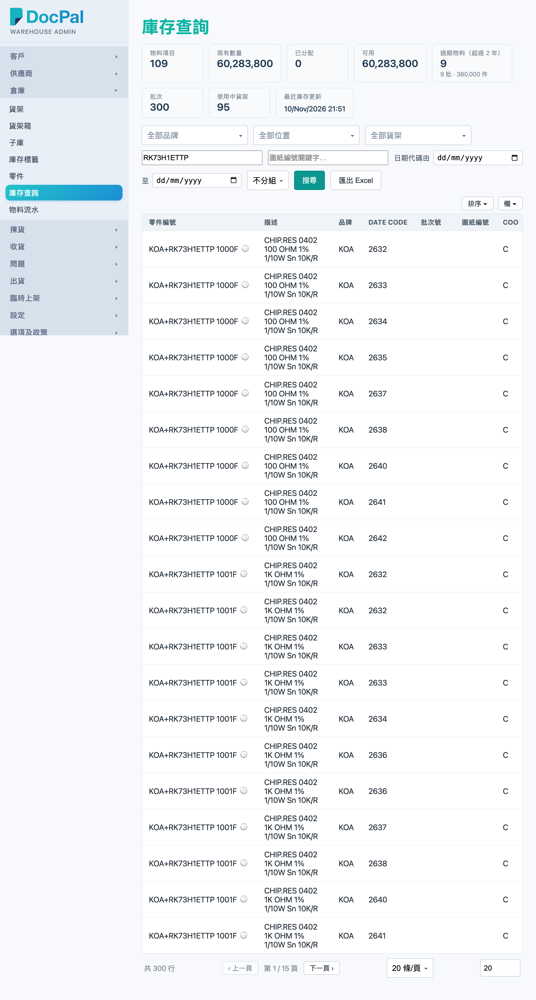
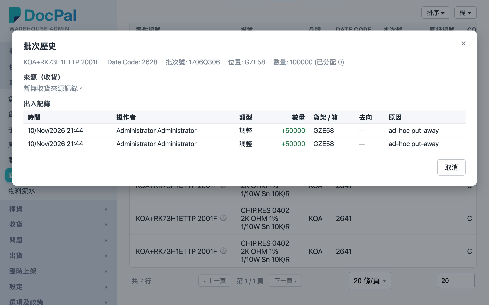

# 第 8 章 库存查询（Stock Search）

## 用途

「庫存查詢」是仓务主管与办公室文员用来查询仓库实时库存的页面：某个料还有多少、放在哪个货架、哪些批次已被拣货单分配、哪些批次太旧（过期）。除了查数量，还可以打开每个批次的「批次歷史」，追溯该批货从收货到出货的所有出入记录，查数、对单、处理客户查询都依赖它。本页面为只读 — 不会修改任何库存数据。

本章最后还会简介两个相关的只读查询页：「臨時上架」（查 PDA 临时上架的记录）与「內部調撥單」（查子库之间的调拨单进度）。

## 开始之前

- 你需要有 admin 群组的账号，才能登录 Admin 控制台。
- 库存数据来自日常操作：收货、上架、拣货、出货全部经 PDA 完成后，此页才会有数据。如果仓库刚开通、尚未进行任何操作，搜索结果会是空的。
- 你只会看到你账号所属子库范围内的库存；看不到某个位置的货，可能是权限设置问题，请联系系统管理员。
- 页面顶部的概要卡（物料项目、现有数量等）一进入页面就会显示全仓总数，无需按搜索。

## 逐步操作

### 第 1 步：进入「庫存查詢」页

登录 Admin 控制台后，在左侧导航 menu 点击「庫存查詢」。页面顶部是一排概要卡，显示全仓总览：「物料項目」、「現有數量」、「已分配」、「可用」、「過期物料（超過 N 年）」、「批次」、「使用中貨架」、「最近庫存更新」。

### 第 2 步：设置筛选条件

概要卡下面是筛选栏，可以任意组合，留空即为「全部」：

- 「全部品牌」下拉框：选择一个或多个品牌（可以输入关键字搜索选项）。
- 「全部位置」下拉框：按 Org／子库选择位置，可多选。
- 「全部貨架」下拉框：选择指定货架，可多选。
- 「零件編號 / WCL 貨號關鍵字…」输入框：输入料号的一部分即可。
- 「圖紙編號關鍵字…」输入框：按图纸编号搜索。
- 「日期代碼由」／「至」：选择日期范围，旁边会显示对应的日期码（例如 2532）；点击「清除」可以移除该条件。

### 第 3 步：按「搜尋」查看结果

点击蓝色的「搜尋」按钮（在料号输入框按 Enter 同样有效）。下方的「批次」表会列出符合条件的库存批次，字段包括：零件编号、描述、品牌、Date Code、批次号、图纸编号、COO、COW、货架、区域、箱、Org / 子库、总数、已分配、可用。

- 「總數」是批次的实际数量；「已分配」是已被拣货单预留的数量；「可用」才是还可以自由运用的数量。
- 点击字段标题可以排序；表格底部分页可以翻页及调整每页行数。
- 顶部概要卡会跟随筛选条件更新，变为「目前筛选范围」的总数。
- 如果其他同事刚完成上架或重新分配，画面会弹出更新提示，点击提示中的刷新按钮即会重新搜索。

### 第 4 步（可选）：用「分組」整理结果

「分組」下拉框可以将结果「按品牌」、「按货架」或「按区域」分组显示；选回「不分組」即还原。分组模式下每组一个表，组标题显示组名与批数（例如「A0101 — 3 批」）。分组选择会被记住，下次进入无需再选。注意：分组模式会一次性加载所有符合条件的批次，数量多时会稍慢。

### 第 5 步（可选）：导出 Excel

搜索完成后「匯出 Excel」按钮会亮起，点击它会下载一个 `stock-search-日期时间.xlsx` 文件，包含所有符合当前筛选条件的批次（不限于当前页），字段与画面一致，Date Code 会以标签上的格式显示，方便直接交给客户或同事。未按过「搜尋」之前此按钮为灰色。

### 第 6 步：查批次历史（异动记录）

在批次表的「零件編號」一列，每行料号旁边有个 🕒 时钟图标，点击它打开「批次歷史」窗口：

- 顶部显示批次基本资料：料号、Date Code、批次号、COO/COW、位置（货架或「(暫存區)」）、数量与已分配数。
- 「來源（收貨）」表：该批货由哪张收货单（批次号）收入、数量、时间。
- 「出入記錄」表：该批货每一笔异动流水 — 时间、操作者（无记名即「系統」）、类型（收货（暂存）、上架、预留、拣货、调整、出货等）、数量（绿色 + 为入、红色 − 为出）、货架/箱、去向（拣货单号 → 出货箱号）、原因。

看完点击右上角「×」或「取消」关闭。

### 第 7 步：顺便查看「臨時上架」与「內部調撥單」

两者都是只读查询页，由左侧 menu 进入：

- **临时上架**：列出 PDA「臨時上架」功能做过的每批上架记录。可以用「全部供應商」、「全部貨架」下拉框和「從」／「至」日期筛选，再点击「重新整理」。表内显示 ID、供应商、货架、Org、子库、明细数、总数量、操作人、建立时间；点击 ID 进入详情页查看每件物料的零件号、WCL 物料号、数量、日期码、批次号、产地、序号。
- **内部调拨单**：显示上游系统同步下来的内部调拨单（子库之间的库存移动），调拨执行流程上线前此页为只读。用「全部狀態」下拉框（待处理／已分配／拣货中／异常／已完成）或「單號 / 客戶…」搜索框筛选。表内显示单号（点击进入查看行项目详情）、移出／移入位置、状态、分配状态、行数 / 数量、已拣 / 已分配、客户、建立时间。

## 常见问题

**Q：明明仓库里有货，为什么搜索显示「暫無庫存批次」？**
A：最常见是筛选条件太严 — 检查品牌／位置／货架下拉框是否已选了选项，或者日期代码范围太窄（点击「清除」移除）。其次，PDA 已收货但未上架的货会在暂存区，「貨架」栏为空；试试留空所有条件直接搜索全仓。仍然找不到，可能是你账号的子库范围不包括该位置，请联系系统管理员确认。

**Q：「匯出 Excel」按钮是灰色点不了？**
A：要先至少按过一次「搜尋」才会亮起。另外如果搜索结果是零批，导出不会产生文件。

**Q：「可用」数量与「總數」不同，为什么？**
A：差额就是「已分配」— 已被拣货单预留的数量。想查看哪张单预留了，点击该行的 🕒 图标查看批次历史的「出入記錄」，「預留」类型的去向栏会显示拣货单号。

**Q：「過期物料（超過 N 年）」是怎么算的？**
A：按批次的 Date Code 计算，日期码早于设定年数（由系统管理员在流程设置中调整）即算过期，概要卡会列出过期物料数，下面注明是多少批、多少件。用「日期代碼由／至」筛选可以列出过期批次明细。

**Q：为什么画面突然弹出提示说数据已更新？**
A：有其他同事完成了上架或重新计算了拣货分配，系统会即时通知。点击提示上的刷新按钮重新搜索，就会看到最新数据。

**Q：批次历史的「操作者」显示「系統」，即是谁做的？**
A：该笔异动是系统自动产生（例如同步或自动分配），并非人工操作，所以没有操作员名。想继续追查可以查看「去向」与「原因」栏的单号线索。
