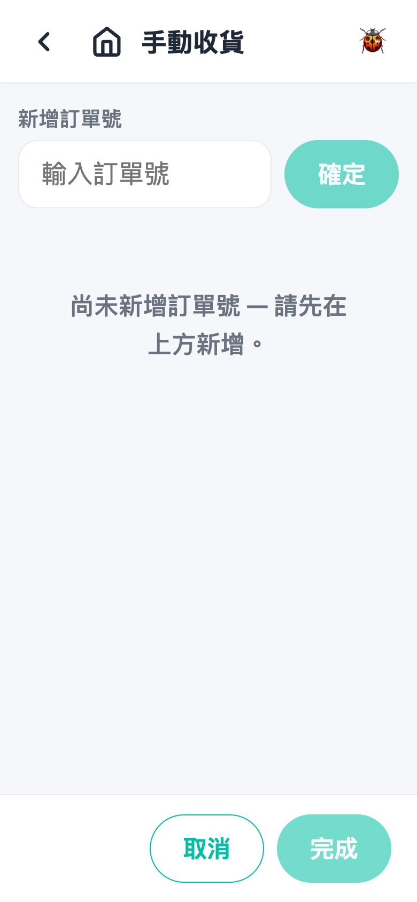
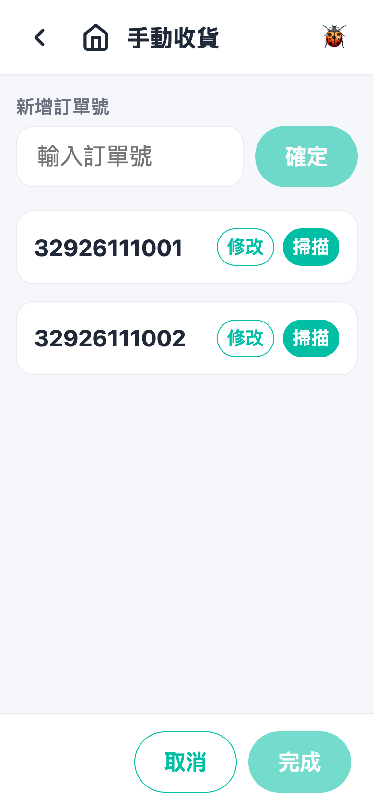
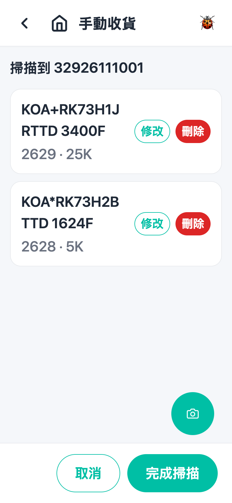
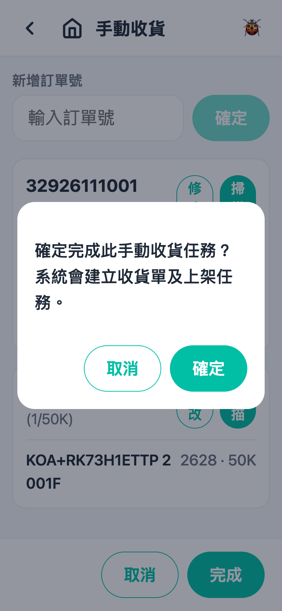

# 第 1 章 手动收货（Manual Receiving）

## 用途

手动收货用于国内仓（CN 仓）收货：当供应商送货到仓而系统没有预先建好收货单时，操作员在 PDA 上手动输入订单号、逐张扫描实物标签，一次性提交，系统即会建立收货单和上架任务。一个任务可以包含多张订单，但**只限同一个品牌**（扫描第一张标签后自动锁定）。完成后系统会自动跳转到「上架」页面，直接进行下一道工序。

## 开始之前

- 已用你的账号登录 PDA app。
- 主页有「手動收貨」这个方块（只限开启了国内收货流程的仓；看不到请联系主管）。
- 准备好：实物货品连同供应商标签、对应的订单号（例如送货单上的单号）。
- 这道工序**没有任务指派**——无需等派单，随时可以开新任务。
- 扫描可以使用机身扫描按钮（硬件扫描），或者画面右下角的相机按钮拍摄标签。

## 逐步操作

### 第 1 步：由主页进入

登录后在主页点击「**手動收貨**」方块。进入后看到顶部有「新增訂單號」输入栏，下面显示「尚未新增訂單號 — 請先在上方新增。」

### 第 2 步：新增订单号

在「新增訂單號」栏输入第一张订单的单号（与送货单一致），点击「**確定**」。订单会以卡片形式出现在下面。有多张订单就重复输入。注意：

- 同一个单号不可以输入两次（会提示「此訂單號已在任務中。」）。
- 点击卡片上的「**修改**」可以修改单号。

### 第 3 步：进入扫描画面

在要收货的订单卡片上点击「**掃描**」。画面顶部会显示「掃描到 ＜訂單號＞」，表示现在扫描的货会计入这张单。

### 第 4 步：扫描货品标签

用机身扫描按钮逐张扫描实物上的供应商标签（或者点击右下角相机按钮拍摄标签）。每扫一张：

- 系统会自动解读料号、数量、Date Code、Lot Code、COO、COW 等资料，成功后货品会即时加入清单（显示 WCL 料号／料号、Date Code、数量）。
- **第一张能识别供应商的标签会锁定整个任务的品牌**——之后扫到其他品牌的标签会被拒绝（提示「此任務已鎖定品牌 …」）。
- 同一张标签扫两次会被拒绝（提示「此標籤已掃描過。」）。
- 如果标签**没有数量**，系统会弹出「修改貨品」窗口，请即场输入数量再点击「確定」。

### 第 5 步：检查及修改已扫货品

在扫描清单里面，每项货品右边有两个按钮：

- 「**修改**」：弹出窗口修改料号、WCL 料号、数量、Date Code、Lot Code、COO、COW，改完点击「確定」。料号必填、数量必须是正整数，否则会提示「必須填寫料號及正整數數量。」
- 「**刪除**」（红色）：移除扫错的项目。

### 第 6 步：完成这张单的扫描

确认清单齐全后，点击底部「**完成掃描**」返回任务页。订单卡片会显示进度（例如 `(3/1500)`，即 3 项、总数 1500）。如果还有第二张单，返回第 3 步继续。

注意：点击「取消」会**放弃这张单刚刚扫描的所有项目**，返回扫描前的状态。

### 第 7 步：完成整个收货任务

所有订单都扫齐货之后（每张单至少要有一项货品，否则「完成」按钮无法点击），在任务页底部点击「**完成**」，再在确认窗口点击「確定」。系统会建立收货单和上架任务，显示「手動收貨已完成。」，然后自动跳转到「上架」页面继续上架。

## 常见问题

**Q：扫不到码／扫完没有反应？**
A：先确认在「掃描」画面（顶部有「掃描到 ＜訂單號＞」）。换个角度再扫，或者改用右下角相机按钮拍摄标签。锁定品牌后，扫描器只会辨认该供应商的码制，属正常。

**Q：提示「無法從標籤讀取料號。」**
A：该标签不符合任何供应商模板。检查标签是不是这批货的、有没有破损；必要时通知主管更新供应商模板。

**Q：提示「此任務已鎖定品牌 …，不同品牌的標籤請另開任務。」**
A：一个手动收货任务只可以收同一品牌。先完成（或取消）现在这个任务，再为另一个品牌开新任务。

**Q：扫错了／数量不对怎么办？**
A：未提交前都可以在扫描清单用「修改」改数量，或者「刪除」整项再重扫。提交了之后就要通知主管处理。

**Q：点击「取消」会不会丢失数据？**
A：任务页点击「取消」会问你「放棄此手動收貨任務？所有已輸入的訂單及貨品將會刪除。」——确定后全部清空。扫描画面的「取消」只是放弃那张单新扫描的项目。

**Q：「完成」按钮灰色无法点击？**
A：每张订单至少要扫入一项货品。检查是不是有一张单还是空的；不需要的单，卡片上「修改」旁边没有删除按钮——可以清空后重新开始（取消任务），或者确保每张单都有货。
