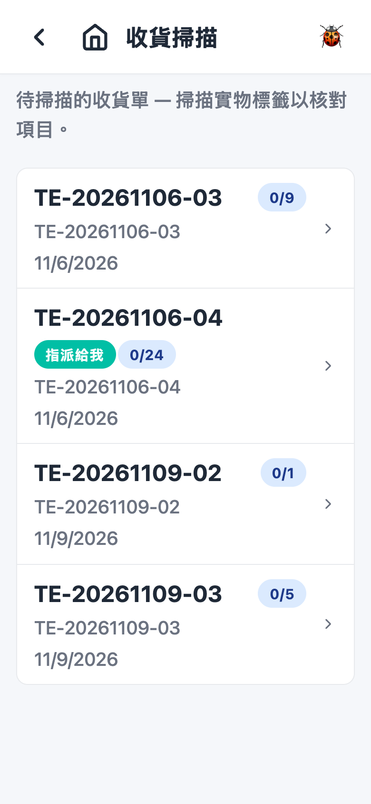
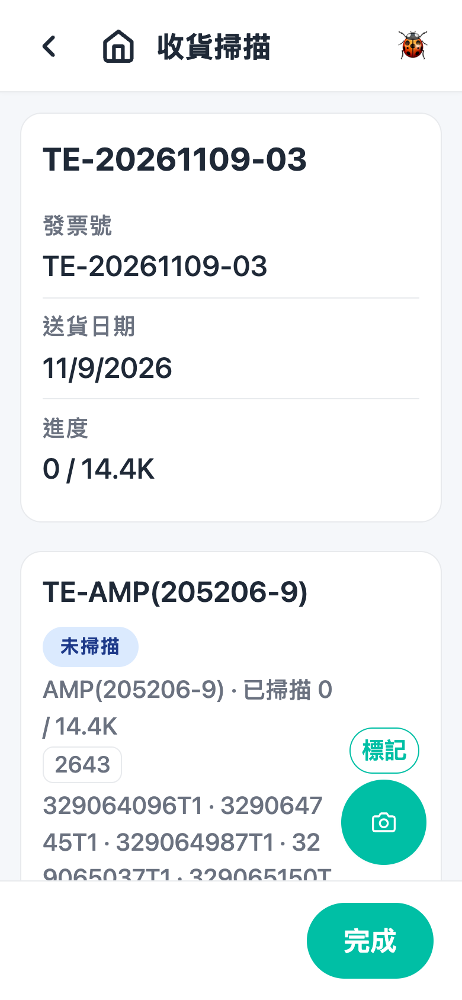
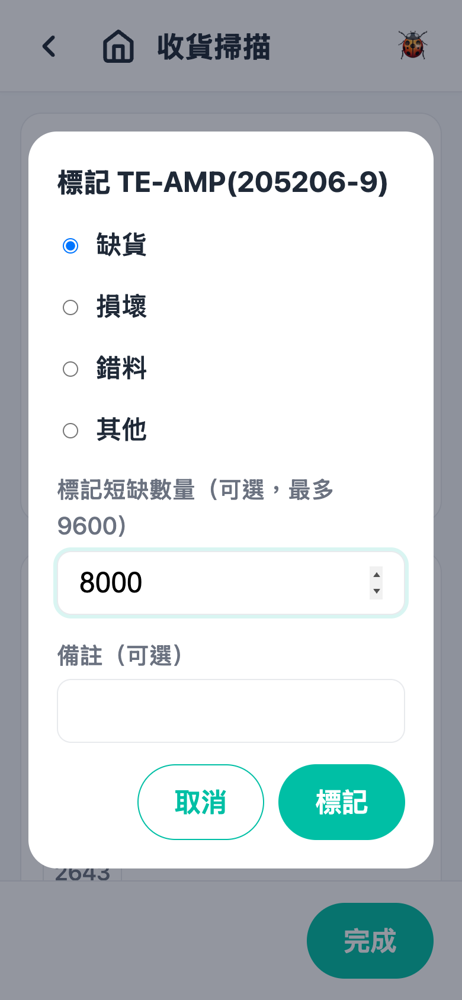
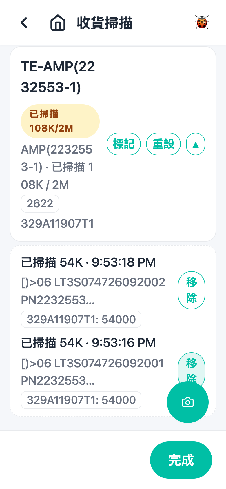
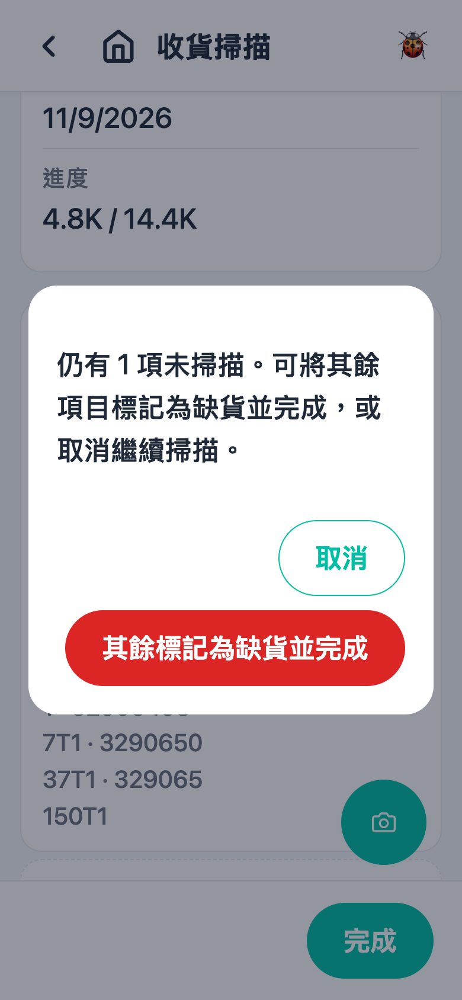

# 第 2 章 收货扫描（Receiving Scan CN）

## 用途

本功能用于在内地仓（CN 收货流程）核对「PDF 上傳」路径的收货单：管理员在后台上传客户收货 PDF、OCR 识别出预计项目并确认之后，该单会进入待扫描状态；操作员在 PDA 上逐件扫描实物标签，系统自动将扫到的数量计入对应料号，核对完成后才会正式收货并建立上架任务。（「手動收貨」路径本身已是扫描收货，不会出现在这里。）使用人：仓库操作员。

## 开始之前

- 已登录 PDA app（用你的账号密码登录）。
- 主页能看到「收貨掃描」磁贴 — 只有启用了客户收货（CN）流程的仓才会显示。
- 管理员已在后台上传收货 PDF 并确认了 OCR 结果，该单才会进入此列表。
- 如果该单有指派负责人，只有被指派人才看得到；看不到该单请询问主管。
- 准备好要核对的实物，以及每件货上的供应商标签。

## 逐步操作

### 第 1 步：由主页进入「收貨掃描」

在主页点击「收貨掃描」磁贴，进入待扫描收货单列表。画面顶部有提示「待掃描的收貨單 — 掃描實物標籤以核對項目。」，下面每张单显示：批次号、发票号、送货日期，以及进度（例如「2/5」代表 5 项中已处理 2 项）。

如果没有任何单，画面会显示「沒有待掃描的收貨單。」

### 第 2 步：选择要处理的收货单

点击要处理的那张单，进入扫描详情页。顶部的单据卡显示批次号、「發票號」、「送貨日期」和「進度」（总已扫描数量 / 预计数量，例如「150 / 500」）。

下面按料号分组，每款料一列，显示：

- 料号和状态徽章：「未掃描」、「已掃描 {數量}」、「已掃描 {已掃}/{預計}」（部分）、「數量不符 {已掃}/{預計}」（超收）、或者标记原因（缺货／损坏／错料／其他）。
- 「已掃描 X / Y」和日期码、COO、COW 等标签（只作参考，不影响配对）。
- 相关 PO 号码。

### 第 3 步：扫描实物标签

对着每件货的供应商标签，用 PDA 扫描按钮扫描；没有硬件扫描时可以点击右下角的相机按钮拍摄标签。每次扫描系统会：

- 成功配对：该料的「已掃描」数量即时增加，扫到的日期码、COO、COW 会更新到该行；扫够数量后徽章变成「已掃描 {數量}」。
- 扫描超出：徽章显示「數量不符 {已掃}/{預計}」，并弹出提示「超收 {數量} — 請檢查數量。」
- 同一张标签扫两次：提示「此標籤已掃描過。」，不会重复计数。
- 扫不出料号或数量、或者该单没有这款料：分别提示「無法從標籤讀取料號。」「標籤沒有數量。」「此標籤與此收貨單的任何項目不符。」

同一款料分几张 PO 也无需选行，系统会自动按先后次序扣数。

### 第 4 步：处理有问题的料（标记）

如果某款料实物有问题，点击该行的「標記」按钮，在弹窗中选择原因：

- 缺货
- 损坏
- 错料（必须填「實際料號」，否则会提示「請輸入實際料號。」）
- 其他

可以在「標記短缺數量」填短缺的件数（留空 = 标记整条未处理的行），并在「備註（可選）」写明情况，然后点击「標記」确认；取消就点击「取消」。

### 第 5 步：扫错了怎么办（移除扫描／重设）

- 点击该行的「▾」展开扫描记录，会看到每次扫描的数量、时间和原标签内容；点击该次扫描旁边的「移除」，再在确认弹窗点击「移除」，已计入的数量会扣回。
- 想让整款料重新开始，点击「重設」，会清除该料所有扫描和标记状态。

### 第 6 步：完成

全部核对好之后，点击画面底部的「完成」按钮：

- 如果全部项目已处理，弹窗问「確定完成此收貨掃描？已掃描的項目將會收貨並建立上架任務。」，点击「完成」确认。
- 如果还有未扫描／部分扫描的项目，弹窗会说明剩多少项，点击「其餘標記為缺貨並完成」会将剩余数量自动标记为缺货（已扫的数量会保留）；不想就点击「取消」继续扫。

完成后会看到提示「收貨掃描已完成 — 已建立上架任務。」，app 自动转到「上架」页，接着做上架即可。

## 常见问题

**Q：为什么列表里找不到我那张单？**
A：先询问管理员 PDF 上传和 OCR 确认了没有 — 未确认的单不会进入此列表。另外有指派负责人的单，只有被指派人才看得到。

**Q：扫了标签但提示「此標籤與此收貨單的任何項目不符」？**
A：该单没有这款料。先核对实物和单据是否同一批；是就送回给主管处理，不要勉强继续扫。

**Q：提示「此標籤已掃描過。」但我确定没有扫过？**
A：同一张标签在本次工作期间只计一次。可能之前已经扫过 — 点击该料的「▾」查看扫描记录确认；确实要重扫，先「移除」那笔记录或者「重設」整款料。

**Q：扫完数量多过单上的数，怎么办？**
A：徽章会变「數量不符」并弹出「超收」提示。先数清实物；多扫了就用「▾」→「移除」扣回，确实超收就照实完成，等管理员跟进。

**Q：点击「重設」会不会影响其他料？**
A：不会，只清除那一款料的扫描和标记。

**Q：有些货根本没到，怎么完成？**
A：可以直接点击「完成」，在确认弹窗选「其餘標記為缺貨並完成」，系统会自动将未扫的数量标记为缺货；或者先用「標記」逐款注明原因。
