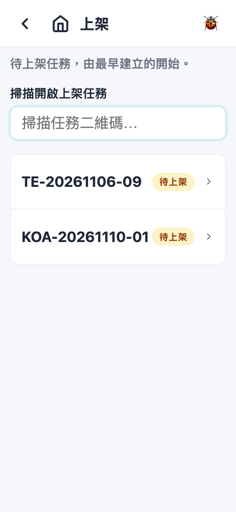
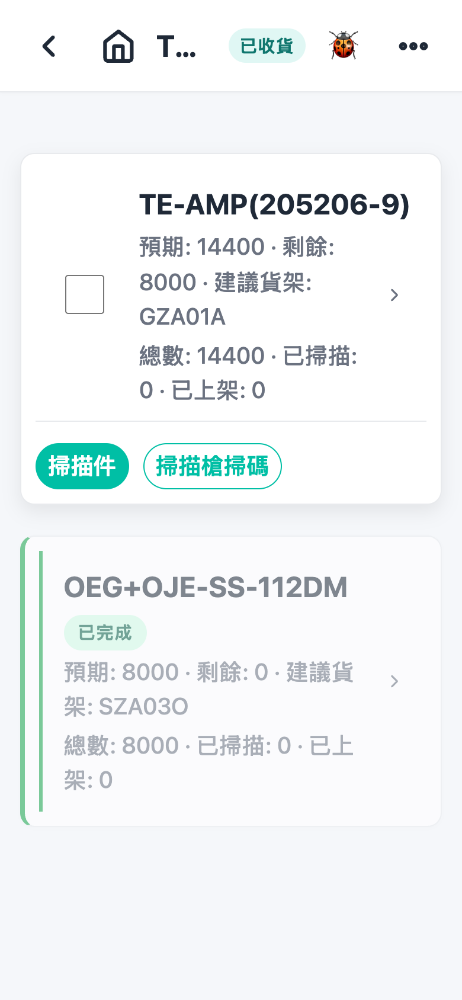
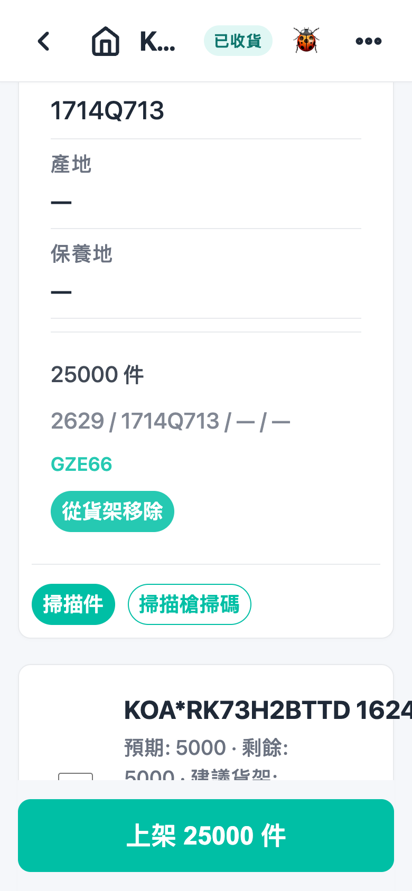
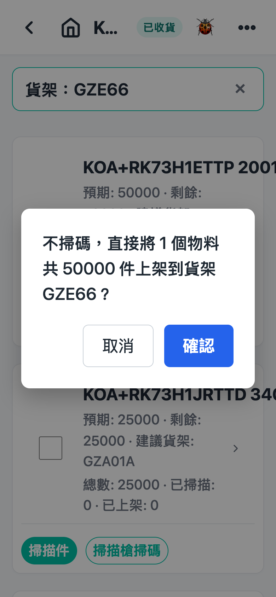
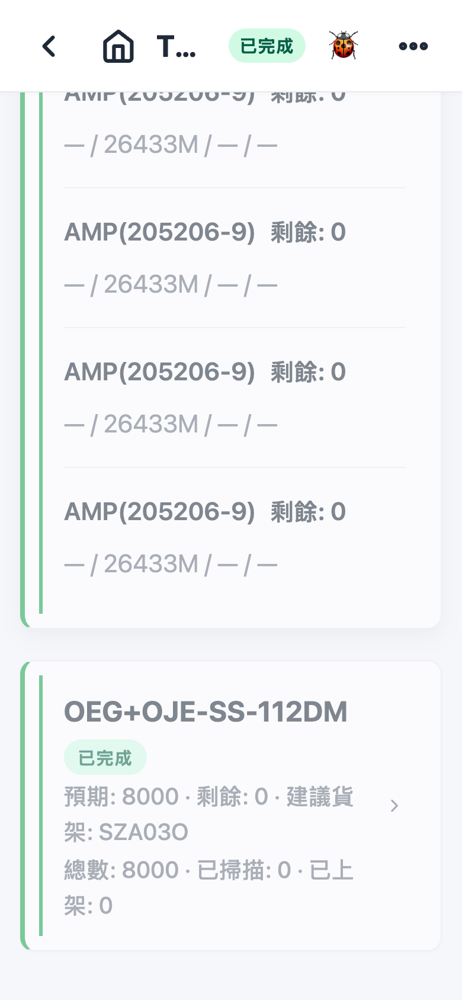

# 第 3 章 上架（Put Away）

## 用途

上架是将收货后放在收货区的货品，放上仓库货架的工序。收货完成之后，操作员用 PDA 扫描货品标签和货架条码，将每件货登记到实际位置；全部上架完成后，库存才可以供拣货使用。本章适用于仓库操作员日常上架工作。

## 开始之前

- 已登录 PDA（用你的账号密码登录）。
- 收货工序已经完成，货品在收货区（上架列表才会看到该单）。
- 如果仓库使用「任务模式」，只会看到指派给你（或未指派）的上架任务；看不到请联系主管确认指派。
- 准备好实物：要上架的货箱、货品上的供应商标签，以及目标货架上的条码。
- PDA 扫描功能正常（扫描枪或相机）。

## 逐步操作

### 第 1 步：进入上架列表

在主页点击「**上架**」方块。画面列出所有待上架的收货单／任务（提示文字：「仍有庫存留在收貨區的收貨單。」）。每行显示单号、待上架项数和状态标签。

### 第 2 步：选择一张单

点击要处理的那一行，进入「上架详情」页。页顶显示单号和状态，下面列出供应商、送货日期等资料。

注意：如果该单有「⚠ 過期」警告标签，表示之前有标签日期码过期，需要管理员处理，但上架工作可以照常进行。

### 第 3 步：看清要上架的物料

画面以「一个料号一张卡」显示所有物料，每张卡可以看到：

- 料号、批次等资料
- 「**總數** · **已掃描** · **已上架**」进度
- 有时会有「建议货架」提示

点击卡可以展开，查看每行明细和已扫描记录。已经上完架的卡会变灰，标示「**已完成**」。

### 第 4 步：扫描货品标签

对每件货做以下其中一种操作：

- **扫描枪（自由扫）**：直接扫货品标签，系统会自动匹配该单内的物料，成功会提示「掃描成功」。
- **扫描枪（指定物料）**：先在该物料卡点击「**掃描槍掃碼**」，卡会亮起「已啟用掃描槍」标记，之后只接受该物料的标签，防止扫错。再点击一次「**取消掃描槍**」解除。
- **相机**：点击卡上的「**掃描件**」，拍摄标签后会出现复核画面，检查／修正数量、料号等，再点击「**套用**」才会入账。

扫完未选货架的件会先进入「待上架」清单（展开物料卡可以看到）；扫错了可以在该行点击「**移除掃描**」删除。

小贴士（视仓库设置而定）：

- **整箱扫描**：扫供应商外箱条码，确认后可以一次将整箱所有行入账。
- **免扫上架**：卡上有勾选框的话，勾选物料后直接扫货架，就可以不用逐件扫标签。

### 第 5 步：扫描货架条码

对着货架用扫描枪扫货架条码。画面顶部会出现「**貨架：XXX**」横幅，表示已选择这个货架。

- 如果之前有未上货架的扫描，系统会问「**將 N 件放到貨架 XXX？**」，点击确认就一次放上去。
- 没有待上架件的话，横幅出现后之后扫的每件货都会直接落到这个货架，无需再确认。

想换货架，直接扫另一个货架条码；想取消已选的货架，点击横幅右边的「×」。

### 第 6 步：继续直到完成

重复第 4–5 步，直至每种物料的「已上架」等于「總數」。全部完成后该单会自动结束，无需点击任何按钮，会从列表中消失。

如果上错了货架，可以展开该物料卡，在已上货架的记录点击「**從貨架移除**」，确认后库存会退出货架，再重新扫正确货架。

## 常见问题

**Q：扫了标签，但提示「掃描料號與物品不匹配」？**
A：该件货不属于这张单，或者你启用了「掃描槍掃碼」指定了另一种物料。先点击「取消掃描槍」解除，再核对手上该件货的料号是否这张单的。

**Q：提示「此標籤已掃描過」？**
A：同一件货不可以扫两次。如果确实重复扫了，跳过即可；如果之前扫错了，先在物料卡上「移除掃描」或「從貨架移除」，再重新扫。

**Q：出现「掃描 COO／COW 與目標不匹配」？**
A：标签上的产地与收货时申报的不同。先停下来，核对是否拿错货，必要时通知主管后再继续。

**Q：为什么列表看不到我那张单？**
A：可能是收货未完成、该单已经上完架，或者任务指派给了另一位同事。请与主管确认指派和单的状态。

**Q：扫了货架但件货没有放上去？**
A：扫货架时如果系统弹出「將 N 件放到貨架 XXX？」，要点击「確認」才算完成。点了取消的话，该件货还在待上架清单，可以选好货架后在该行点击「**上架到貨架**」逐件放入。

**Q：弹出「日期碼過期」弹窗，怎么办？**
A：点击「知道了」后扫描仍然会入账，可以继续上架；但该单要等管理员处理了警告才会自动完成。照常工作，通知主管即可。
