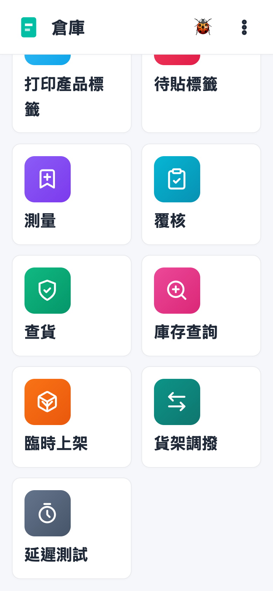
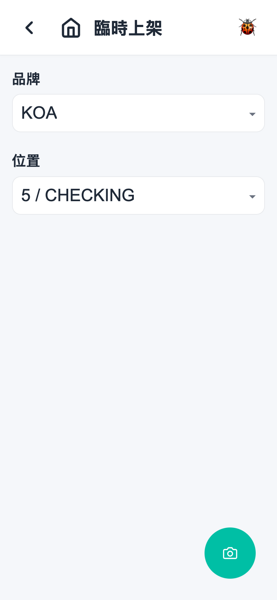
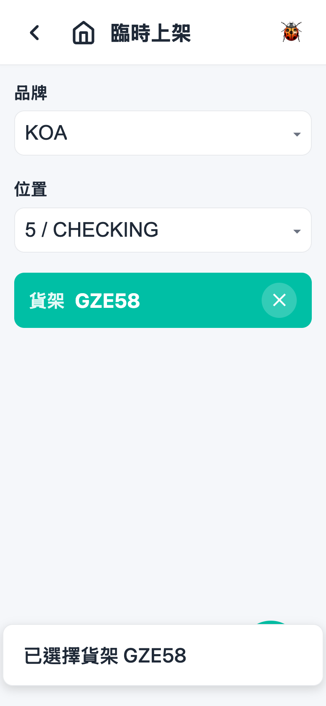
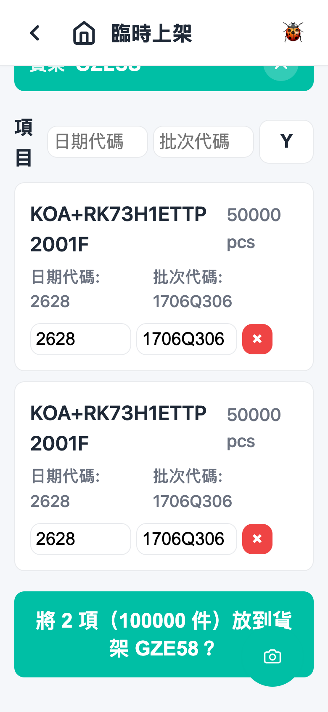

# 第 4 章 临时上架（Ad-hoc Put Away）

## 用途

临时上架用于将**没有收货单**的货品直接放上货架，例如旧仓存货、写出后退回的货、或者任何需要重新入库的散货。仓库操作员在 PDA 上扫描货品标签、选定位置和货架，一次确认入库。如果货品是跟收货单回来的，请使用「上架」（Put Away）流程，不要使用本功能。

## 开始之前

- 已登录 PDA app。
- 知道要上架货品的**品牌**（扫描解析会按品牌处理标签）。
- 知道货品要放入哪个**位置**（库位）和哪个**货架**。
- 货品上有可供扫描的标签（二维码／条码），货架上亦有货架二维码。
- 此功能无需任务指派，任何已登录的操作员都可以使用。

## 逐步操作

### 第 1 步：进入临时上架

在主页点击「**臨時上架**」tile。画面会载入品牌和位置清单，请稍等片刻。

### 第 2 步：选择品牌

点击「**品牌**」下拉框，在「選擇品牌」清单中选择货品的品牌（可以打字搜寻）。品牌决定了标签的解析方式，必须选对。

### 第 3 步：选择位置

点击「**位置**」下拉框，选择货品要入库的库位。此位置会套用到之后扫描的所有货品，没有逐件选择位置的功能。

### 第 4 步：扫描货架（可随时扫描）

用扫描器扫描货架上的二维码。扫到后画面顶部会出现蓝色货架横幅，显示「貨架 ＜貨架編號＞」，并提示「已選擇貨架 ＜編號＞」。扫错了可以点击横幅右边的「✕」清除再扫。

> 注意：货架**只可以扫描选择**，没有下拉框可以选择。

### 第 5 步：扫描货品标签

- **扫描枪**：直接扫描货品标签。
- **相机**：点击画面右下角的扫描按钮（相机图示），拍下标签，系统会解析内容。

扫描成功后，货品会加入「**項目**」清单，显示料号、数量、日期代码（Date Code）、批次代码（Lot Code）和 COO（如有）。重复扫描同一张标签会被拒绝，并提示「此標籤已掃描過」或「序號 ＜序號＞ 已掃描過」。

> 提示：如果标签本身没有日期代码，系统会自动填入今天的日期代码。

### 第 6 步：检查及修改项目

在「項目」清单里面可以：

- **逐项修改**：在该项目的「日期代碼」／「批次代碼」输入框直接修改。
- **批量修改**：在清单顶部两个输入框填日期代码／批次代码，点击「**Y**」按钮一次套用到全部项目，画面会提示「已應用到全部」。
- **删除错扫项目**：点击该项目右边红色「**×**」按钮。

### 第 7 步：确认上架

扫齐货品并选好货架后，画面底部会出现蓝色大按钮：「**將 N 項（M 件）放到貨架 ＜貨架編號＞？**」。核对数量无误后点击此按钮提交。

成功后会提示「已將 N 項放到 ＜貨架編號＞」，项目清单和货架会清空（品牌和位置保留），可以直接继续扫描下一批同品牌的货。

## 常见问题

**Q：扫完标签没有反应，提示「無法解析掃描」？**
A：多数是品牌选错，标签格式对不上。请检查「品牌」是否正确；如果相机拍的标签太模糊或者太多杂物入镜，可以改用扫描枪扫二维码，或者单独拍摄标签。

**Q：为什么没有货架可以选择？**
A：货架不是用下拉框选择的，一定要扫描货架上的二维码。扫到之后顶部会出现蓝色货架横幅。

**Q：提示「請為所有項目選擇位置」？**
A：即是尚未选择「位置」。返回顶部「位置」下拉框选择一个，再点击确认按钮。

**Q：同一卷货扫了两次会怎样？**
A：系统会拒绝第二次扫描，提示「此標籤已掃描過」或「序號已掃描過」，不会重复入库。

**Q：扫错了一件货怎么办？**
A：在该项目右边点击红色「×」删除，之后可以重新扫描。

**Q：提交时出现「錯誤：…」？**
A：请记下错误讯息（例如料号在系统找不到），通知主管或系统管理员处理；未成功提交的项目仍在清单中，问题解决后可以再次点击确认。
