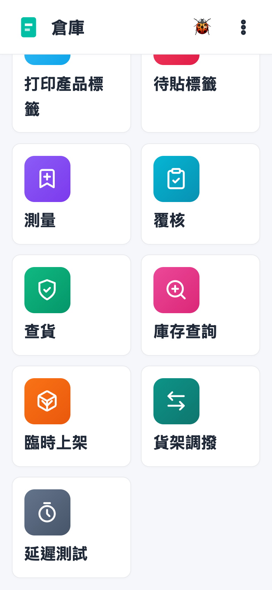
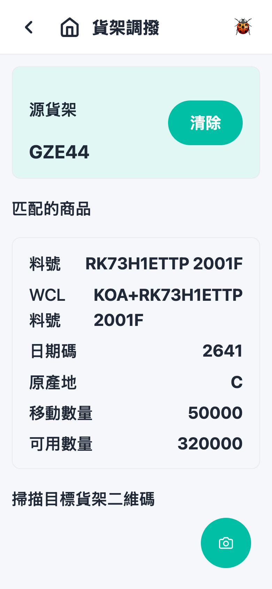
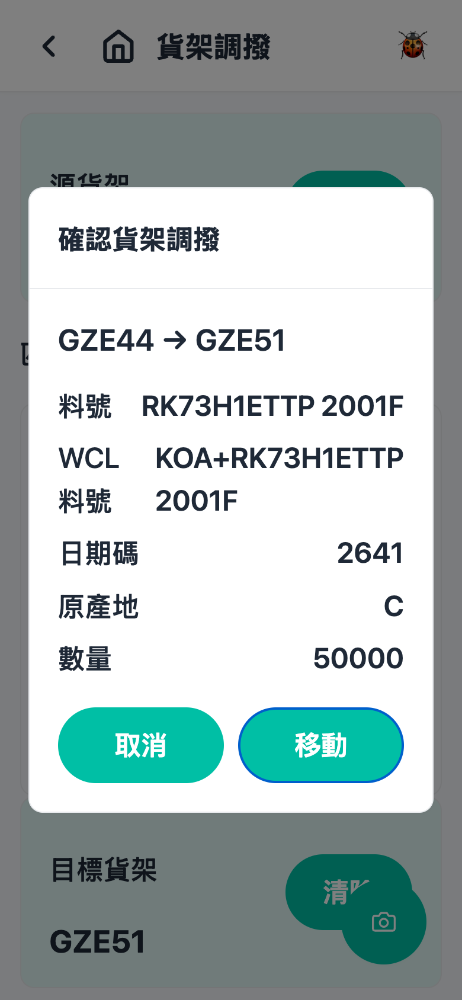

# 第 5 章 货架调拨（Shelf Exchange）

## 用途

货架调拨用于将货品从一个货架搬到另一个货架 — 例如整理货架、合并散货，或在没有收货单／拣货单的情况下移动库存。整个流程通过扫描完成：扫源货架 → 扫货品标签（数量直接取自标签，无需手动输入）→ 扫目标货架 → 确认。适合日常仓务操作员使用。

> 注意：主页的功能方块和页面标题在 app 内显示为「貨架調撥」，即本章所述的同一功能。

## 开始之前

- 已登录 PDA app，且主页能看到「貨架調撥」方块（如果管理员关闭了此工序，主页不会显示）。
- 货架上贴有货架二维码（QR code）标签。
- 要搬动的货品身上有产品标签（上面有料号和数量）。
- 已知货品要前往的目标货架，目标货架上同样要有货架二维码。
- 注意：已被拣货单分配（预留）的库存无法搬动，只有未分配的数量才可以调拨。

## 逐步操作

### 第 1 步：进入货架调拨

在主页点击「貨架調撥」方块，进入货架调拨页面。页面一开始会显示提示「掃描源貨架二維碼」。

### 第 2 步：扫描源货架（货品当前所在的货架）

用扫描枪对着源货架上的二维码扫描。成功后，页面顶部会出现一条「源貨架」横幅，显示货架编号（例如 A01-01），旁边有一个「清除」按钮；同时弹出提示「已選擇源貨架 xxx」。如果扫错了，可以再扫一次正确的货架码，系统会自动改选；或者点击「清除」重新开始。

### 第 3 步：扫描货品标签

用扫描枪扫描要搬动的货品身上的标签；如果扫不到，可以点击右下角圆形「掃描」按钮，用镜头拍摄标签。系统会以标签上的数量作为本次搬动的数量 — 无法人工修改数量。

成功匹配后，页面会显示「匹配的商品」卡片，包括：料号、WCL 料号、日期码、批次号、原产地／原产国、移动数量、可用数量。同时弹出提示「已在源貨架匹配 xxx」，下方提示改为「掃描目標貨架二維碼」。

如果该货架上没有此货品，或可用数量不足，会弹出红色错误提示，检查后重新扫描即可。

### 第 4 步：扫描目标货架

用扫描枪扫描目标货架的二维码。注意不能扫描源货架（会弹出「目標貨架不能與源貨架相同」）。扫描成功后会立即弹出「確認貨架調撥」窗口。

### 第 5 步：确认搬动

确认窗口最上方会显示搬动路线，例如「A01-01 → B02-03」，下面列明料号、批次资料和数量。

- 资料无误：点击「移動」按钮（点击后按钮会变为「移動中…」）。成功后弹出「已將 X 件 xxx 移動到 yyy」，本次调拨完成。
- 扫错目标货架：点击「取消」，窗口会关闭，但「匹配的商品」仍然保留，直接再扫正确的目标货架即可，无需重扫货品标签。

### 第 6 步：继续搬下一件（同一源货架）

确认完成后，源货架会保留在顶部，只有货品和目标货架被清空。从第 3 步开始扫描下一件货品标签即可继续。

如果要更换另一个源货架，点击源货架横幅上的「清除」按钮，从第 2 步重新开始。

## 常见问题

**Q：为什么扫描货品标签没有反应，还弹出「請先掃描源貨架」？**
A：必须先扫描源货架的二维码，才能扫描货品标签。查看页面顶部是否有「源貨架」横幅，没有的话先扫货架码。

**Q：扫完货品标签弹出「該貨架上沒有匹配的庫存」？**
A：表示系统在你扫描的源货架上找不到该货品（料号、日期码或批次对不上）。请检查：1) 你是否站在正确的货架前？2) 货品标签是否最新？3) 货品是否已在其他货架？可以使用「庫存查詢」功能查询该货品的实际位置。

**Q：弹出「該貨架上未分配庫存不足」是什么意思？**
A：货架上虽然有货，但部分已被拣货单预留，剩余的未分配数量少于标签上的数量。这些已预留的货品不能搬动，如有疑问请通知主管处理相关拣货单。

**Q：弹出「無法解析標籤」？**
A：扫到的内容不是系统能识别的货架码或产品标签。确认你扫描的是正确的标签（不是外箱运输标签），清洁镜头／对准后再扫；仍然不行就改用右下角「掃描」按钮用镜头拍摄一次。

**Q：扫描目标货架时弹出「目標貨架不能與源貨架相同」？**
A：你扫回了源货架。请扫描另一个货架的二维码；如果看到「貨架不存在」，表示扫到的码不是有效的货架码。

**Q：确认窗口点击了「取消」之后，是否需要从头再来？**
A：不需要。已匹配的货品卡片会保留，直接再扫描正确的目标货架即可再次确认。
