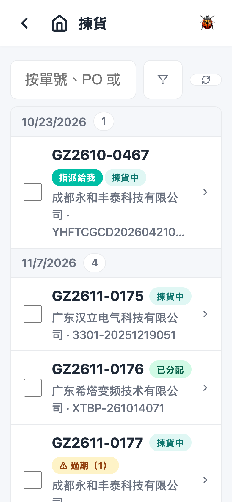
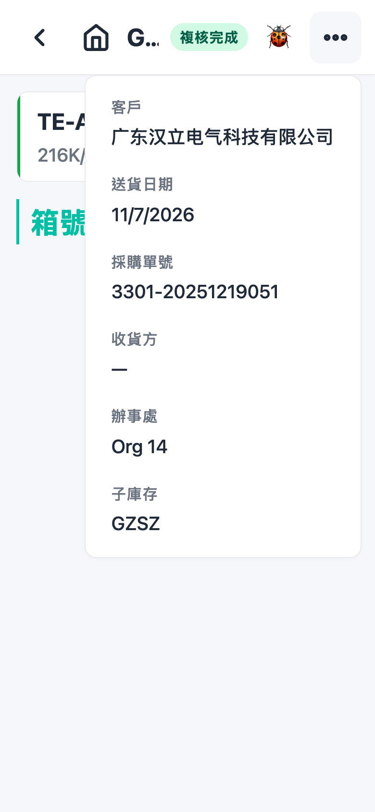
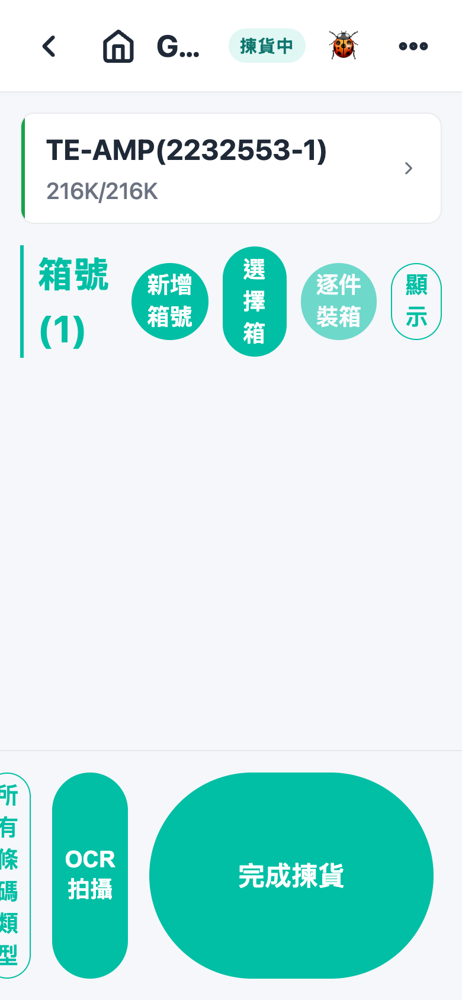
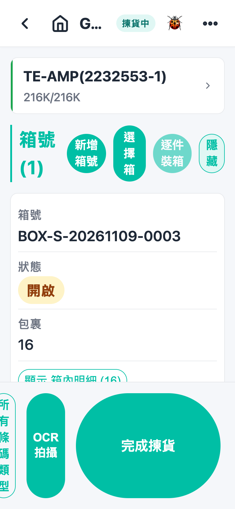
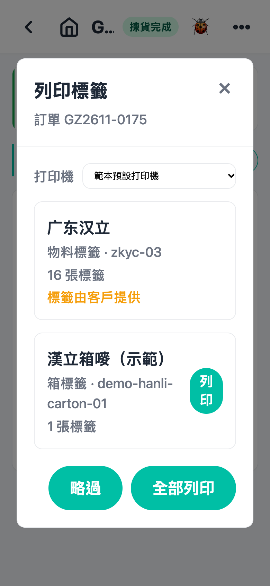

# 第 6 章 拣货（Picking）

## 用途

拣货是按照拣货单，将货品由货架／收货纸箱取出、扫码记录、装入出货箱的工序。当办公室已经将订单分配好库存（状态「已分配」），操作员就会在 PDA 上用到这个功能。拣货完成之后，订单才会进入下一步：打印标签／贴标签、测量（量箱）、复核——视仓库设定开启了哪些工序。

## 开始之前

- 已用你的账号登录 PDA。
- 拣货单已被办公室确认并分配（状态显示「已分配」或「揀貨中」）。如果该单有指派给特定操作员，只有该操作员才会看到。
- 准备好出货用的空纸箱（如需要）。
- 确认扫描枪正常运作；无硬件扫描时，可以用页面底部的「OCR 拍攝」拍摄标签代替。
- 如仓库设定了拣货时扫描货架，拣货前要先扫货架／箱号。

## 逐步操作

### 第 1 步：进入拣货列表

在主页点击「揀貨」图标。列表按送货日期分组（最早的单排最前），每行显示单号、状态徽章和摘要。

- 顶部搜索栏可以「按單號、PO 或客戶搜尋…」。
- 右上角的漏斗图标打开「篩選訂單」，可以按状态或分配状态筛选；完成了的单（拣货完成、复核完成）要在筛选里面勾选才能看到。
- 见到「未找到揀貨單。」即暂时没有单可做。

### 第 2 步：选择一张单

点击你要处理的那张单，进入拣货详情页。顶部显示单号和状态；右上角菜单可以查看客户、送货日期、采购单号、收货方等资料。

注意事项：

- 打开该单之后，系统会将它锁定给你——如果见到黄色横额「此訂單正由 xxx 揀貨——唯讀」，代表同事正在处理，请选择另一张单。
- 如果顶部出现绿色横额「此訂單與貨架箱 xxx 完全匹配——無需逐件掃描」，可以点击「整箱取用」直接将整箱变成出货箱，省去逐件扫描（之后仍要点击「完成揀貨」）。

### 第 3 步：确认要拣什么

页面列出每个料号一行：折叠时显示进度（例如 `2K/3K`）和剩余货在哪里取（货架、箱号或纸箱 CTN）。点击一行可以展开，看到：

- **待确认扫描**：正在提交或失败的扫描（失败的会显示原因，可点击「移除」）。
- **未装箱包裹**：已扫但未入箱的包裹，每个有箱号选择和「加入箱號」按钮，还有「移除掃描」（扫错时用来还原，库存会退回）。
- **计划（分配）**：剩余数量在哪个货架／箱取——照着去那个位置拣货。

### 第 4 步：扫码拣货

对准物料标签扫描。每次扫描**即时生效**，无需再点击确认：

- 扫**物料标签**：记录一件，包裹出现在该料的「未裝箱包裹」。
- 扫**收货纸箱条码**：一次将订单在该纸箱的需求全部加入，显示「紙箱 xxx：已加入 N 項，共 X 件」。
- 扫**货架箱／货架条码**：弹出「從 xxx 揀貨」窗口，继续扫箱里面的物料标签。
- 如仓库要求先扫货架：顶部横额会显示「請先掃描貨架或箱號」，扫完货架会显示「貨架：xxx」，之后扫的物料才会在该货架扣数；点击「清除貨架」可以重设。
- 扫不到的标签可以点击底部「OCR 拍攝」拍照，系统辨认后会弹出「確認掃描項目」清单供你核对修改，再点击加入。
- 如果扫描枪对某些条码完全无反应，点击底部「所有條碼類型」按钮开放解码，用完记得再点击关闭。

注意事项：

- 扫错了：在该包裹点击「移除掃描」，确认后库存退回，可以再扫。
- 扫到 Date Code 过期的货：会弹出「日期碼過期」提示，扫描仍然生效，订单会标上「⚠ 過期」警告，继续做即可，但完成前要等管理员处理。

### 第 5 步：装箱

拣好的包裹要装入出货箱。「箱號」区域在页面下方，点击「顯示」展开：

- 点击「新增箱號」开一个新箱。
- 每个包裹在「未裝箱包裹」选箱号再点击「加入箱號」；或者在箱卡点击「全部加入」一次将所有未装箱包裹入箱；「逐件裝箱」则每个包裹自动各开一箱。
- 点击箱卡上的「掃描物料入箱」启用后（顶部显示「正在掃描入箱 xxx」），之后扫的物料标签会直接入该箱——连其他订单的料都可以；点击「停止掃描」取消。要入其他单开的箱，点击「選擇箱」在清单中选一个。
- **一个箱只装同一产地（COO）的货**；产地不同会被拒绝并提示。
- 箱卡点击「顯示 箱內明細」可以查看里面有什么；未封箱前每件可点击「移出」取出来。
- 如果仓库无开测量工序，箱装满后可以直接点击「封箱」封箱；有测量工序则由测量页封箱。
- 空箱可以点击「取消箱號」删除。

### 第 6 步：完成拣货

当所有料都扫齐并全部入箱，页面底部会出现「完成揀貨」按钮。点击它确认：

- 订单状态变为「揀貨完成」。
- 如有符合的标签打印规则，会弹出「列印標籤」窗口——点击「列印」或「全部列印」，或者「略過」稍后在订单页右上角「列印標籤」再印。
- 接着系统会自动跳转到下一个工序（打印标签／贴标签／测量或复核页，视乎设定）。

### 第 7 步（如需要）：汇报问题

如果拣不齐、损坏、找不到货等：在拣货列表勾选有问题的单（可选多张），底部点击「匯報問題」，选择原因（找不到、损坏、数量不符、发错料、超发、质量拒收）、填写数量和备注，点击「確認」提交。完成后列表顶部会显示「已上報 N 個問題」。

## 常见问题

**Q：扫描枪扫完无反应？**
A：先确认标签条码类型——如果是纸箱条码，点击底部「所有條碼類型」开放解码再试。仍然不行就用「OCR 拍攝」拍摄标签代替。

**Q：扫完弹出「該標籤沒有匹配的項目/分配」？**
A：这个料不属于这张单，或者已经扫齐。核对料号；如果是跨单装箱，请先用「掃描物料入箱」武装目标箱再扫。

**Q：点击「完成揀貨」失败，提示「尚有已揀包裹未裝入出貨箱」？**
A：有包裹扫了但未入箱。去「箱號」区域用「全部加入」或「逐件裝箱」处理完毕，再点击完成。

**Q：提示「此訂單有 N 條未解決的日期碼過期警告」？**
A：之前扫过过期 Date Code 的货，管理员未处理。通知办公室解决警告后，再点击「完成揀貨」。

**Q：装箱时提示 COO 混箱错误？**
A：一个箱只可以装同一产地的货。将不同产地的包裹分开装另一箱。

**Q：该单显示「此訂單正由 xxx 揀貨——唯讀」，我无法操作？**
A：同事正在处理这张单。请选择另一张单，或者请同事离开该页；锁定最迟 10 分钟后自动解除。

**Q：扫错货怎么办？**
A：在该包裹点击「移除掃描」并确认，库存会退回、可以重新扫。已入箱的包裹要先在箱里面「移出」才可以移除扫描。
