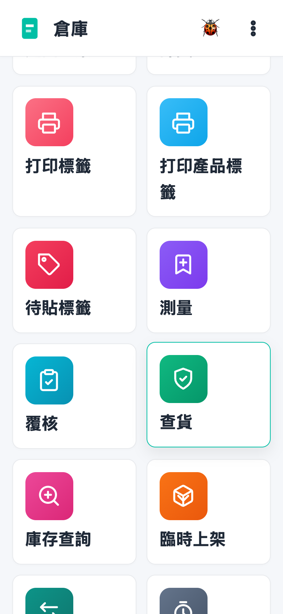
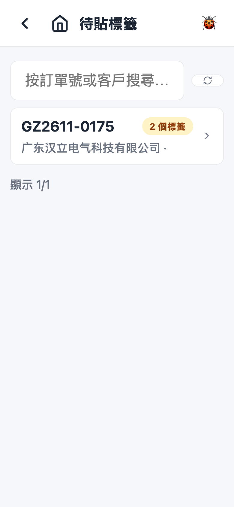
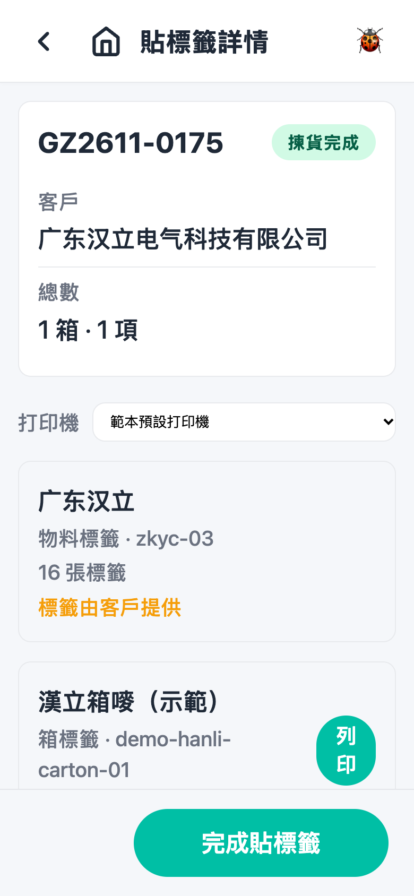
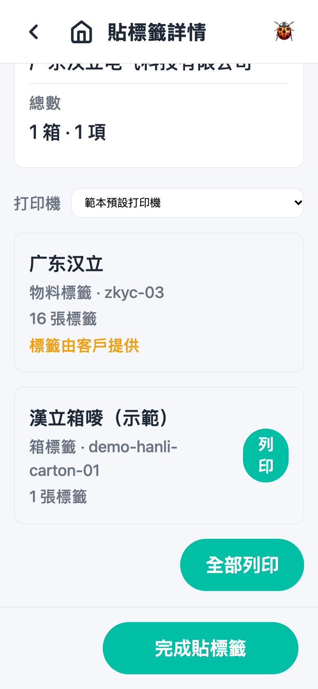
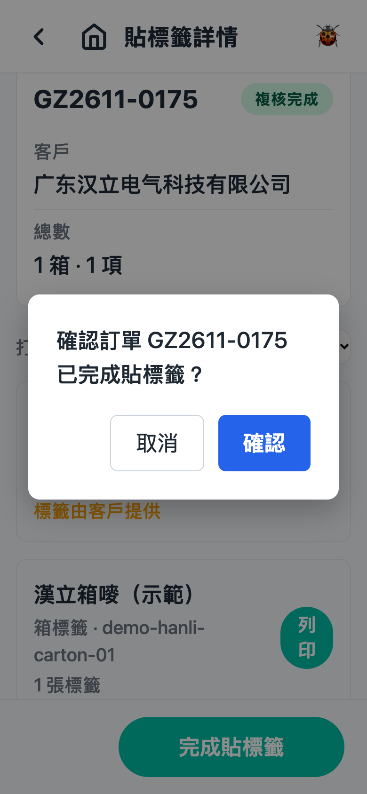

# 第 7 章 待贴标签（Labeling）

## 用途

贴标是拣货完成之后、测量／复核之前的一道工序：订单的标签已在「打印標籤」那一步印好，这一步是确认标签已经**贴到货上**。操作员在此画面可以重印标签（例如印坏了）、查看哪些标签由客户提供，贴好之后点击「完成貼標籤」，该单才会进入测量／复核。一般由包装台的操作员负责，任何操作员都可以执行。

## 开始之前

- 已登录 PDA app。
- 该拣货单已完成拣货（如启用了「打印標籤」工序，需该步骤完成后才会出现在这里）。
- 如果该单有指派负责人，只有被指派人才会在列表中看到（未指派的单所有人都能看到）。
- 手头上有已印好的标签及对应的货；如属客户提供的标签，须已收到客户标签。
- 需要重印时，确认标签打印机已连接打印服务。

## 逐步操作

### 第 1 步：进入「待貼標籤」

在主页点击「**待貼標籤**」tile。画面列出所有等待贴标的订单，最近更新的排最前。

### 第 2 步：找到要处理的单

- 每行显示订单号、客户等资料，右边有标签数量的标记（例如「3 個標籤」）；指派给你的单会显示「指派給我」。
- 可以用顶部搜寻框「按訂單號或客戶搜尋…」过滤；向下拉到底点击「載入更多」查看更早的单。
- 如果看到「沒有待貼標籤的訂單」，即表示现在没有单要处理。

### 第 3 步：打开该单

点击该行进入详情页。页顶显示订单号、状态、「客戶」及「總數」（例如「2 箱 · 5 項」）。

### 第 4 步：检查／重印标签

页面列出该单符合的标签打印规则，每条规则一行，显示规则名、标签类型（箱标签／物料盒标签／物料标签）、范本及「X 張標籤」。

- 标签正常应已在「打印標籤」工序印好，这里主要用于**重印**：
  - 点击某行的「**列印**」重印该款标签；打印中显示「列印中…」，成功变为「已列印」，失败变为「列印失敗——點擊重試」。
  - 或点击「**全部列印**」一次印齐所有内部标签（全部已列印后该按钮会锁定）。
  - 顶部「打印機」下拉可选择打印机；预设「範本預設打印機」一般无需更改。
- 看到「**標籤由客戶提供**」的行没有列印按钮——标签由客户供应，收到后直接贴上即可。
- 重印次数不限，每次打印系统都会记录，之后复核会用到。
- 如果页面显示「標籤打印規則已不再符合此訂單」，即表示规则在拣货完成后被修改过——无需理会，直接执行第 5 步。

### 第 5 步：贴好标签，完成

将标签逐款贴上对应的箱／盒／物料，核对无误后，点击画面底部的「**完成貼標籤**」，在弹出的确认框（「確認訂單 X 已完成貼標籤？」）中点击确定。看到「貼標籤已完成」提示后会自动返回列表，该单的箱便会进入测量／复核。

## 常见问题

**Q：列表找不到该单？**
A：可能（1）拣货尚未完成，或「打印標籤」步骤未完成；（2）该单指派了给其他同事，只有他能看到；（3）该单不符合任何标签规则，根本无需贴标；（4）已经有人完成了。可尝试用搜寻框查找订单号。

**Q：进入详情页，但弹回列表并显示「該訂單已完成貼標籤」？**
A：有另一位同事（或管理员）已完成该单，属正常情况，无需再处理。

**Q：点击「列印」之后变成「列印失敗——點擊重試」？**
A：通常是打印机问题（缺纸、离线、选错打印机）。检查打印机，有需要时在「打印機」下拉选回正确的机器，再点击该按钮重试。

**Q：「標籤由客戶提供」那款怎么办？**
A：系统不会打印此款。等客户的标签送到，贴上货即可；没有打印此款也一样可以点击「完成貼標籤」。

**Q：误点了「完成貼標籤」但标签未贴好？**
A：点击后会先出现确认对话框，未确认前可以取消。如果真的已完成但标签未贴，要立即通知主管／管理员处理，因为该单已进入测量／复核。

**Q：规则显示「已不再符合此訂單」，还需不需要贴标？**
A：一般是规则被修改过。按手上已有的标签贴好，然后点击「完成貼標籤」即可；如有疑问请咨询主管。
