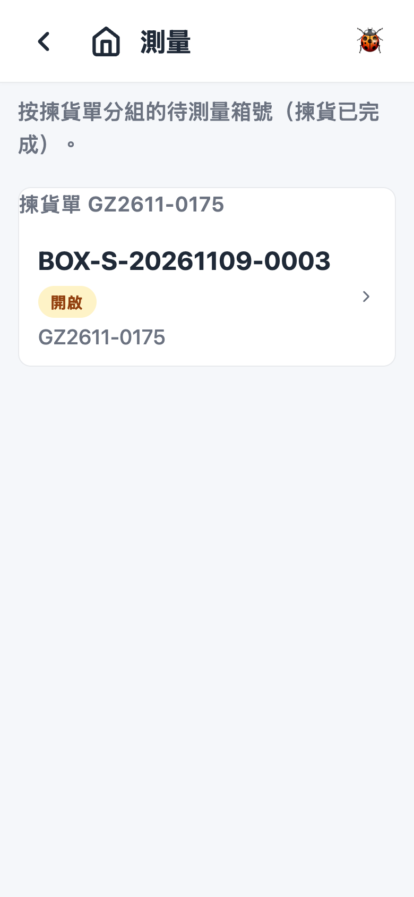
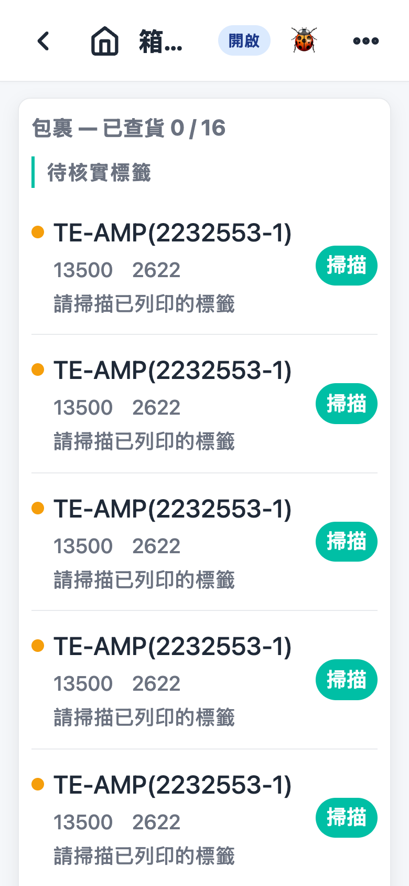
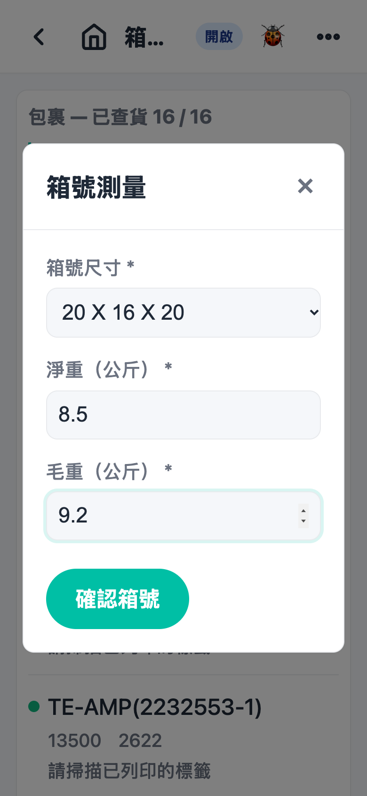

# 第 8 章 测量（Measuring）

## 用途

测量是拣货完成之后、出货之前的工序：操作员要逐箱核实箱内包裹（扫描每个包裹的 QR code），然后输入箱的尺寸和重量（净重、毛重），最后「確認箱號」将箱关闭。关闭箱号即代表测量完成；如果系统开启了覆核步骤，关箱后会自动产生一张覆核任务。这个功能由负责测量／包装核实的仓库操作员使用。

## 开始之前

- 已用你的账号登录 PDA app。
- 相关的拣货单已经完成拣货（操作员在拣货页点击了「完成揀貨」）— 拣货未完成的箱不会出现在测量列表。
- 如果流程设有「打印標籤」或「待貼標籤」步骤，要等这些步骤完成，箱才会进入测量列表。
- 箱如有指派负责人，只有被指派的组员才会看到（留意列表上的指派标示）。
- 准备好：实体箱和箱内货品、货品上的 QR 标签、磅（秤毛重）、测量尺寸用的工具。

## 逐步操作

### 第 1 步：进入测量列表

在主页点击「測量」图标。画面会显示所有待测量的箱，按拣货单分组（标题显示「揀貨單 {單號}」）。页面上方有提示「按揀貨單分組的待測量箱號（揀貨已完成）」。如果没有任何箱，会显示「暫無待測量的箱號。」

### 第 2 步：打开要测量的箱

两个方法，选一个：

- 直接点击列表上那一行箱号；或
- 用扫描枪扫箱上的 QR code（同时可以用键盘输入箱号）— 系统找到唯一相符的箱就会直接开箱页；找不到会弹出「列表中找不到與『…』相符的箱號。」

### 第 3 步：核实箱内包裹

箱页顶部显示「箱號 {箱號}」和状态标签，以及相关拣货单号。下面列出箱内包裹，标题是「包裹 — 已查貨 {已核實數} / {總數}」：

- 有些单需要扫「已列印的標籤」— 会看到「待核實標籤」一区，可能包括「箱標籤」（请扫描已列印的箱标签）和个别物料标签（请扫描已列印的标签）。
- 其余物料归入「待複核掃描物料」，同一物料同一批次会合并显示总数（例如 0/50）。

操作：用扫描枪逐个扫包裹上的 QR code。扫中后该行会即时更新（圆点由黄转绿，数量跟着增加），画面提示「掃描成功」。部分数量已扫时会显示「已掃/總數」（例如 30/50），可以继续扫到齐为止。

- 扫不到的标签：点击该行右边的「掃描」按钮，用相机拍摄标签，系统会弹出核对画面，检查无误后确认。
- 画面下方有提示「掃描包裹 QR code 以核實。」（需要扫标签时显示「掃描已列印的標籤或包裹 QR code。」）

### 第 4 步：输入箱号尺寸和重量

当所有包裹都核实完毕，系统会自动弹出「箱號測量」视窗（如果没有弹出，可以点击右上角菜单的「輸入測量資料」）。填写：

1. 「箱號尺寸」：在下拉清单选择箱的尺寸（必填）。
2. 「淨重（公斤）」：系统会根据料件重量自动计算并预填（下方有提示「已根據料件重量自動計算 — 可按需修改。」），如有出入请自行修改（必填，可以用小数）。
3. 「毛重（公斤）」：用磅秤好整箱货连箱的重量后输入（必填；毛重不可以小于净重，否则「確認箱號」按钮无法点击）。

### 第 5 步：确认箱号，完成测量

检查资料无误后点击「確認箱號」（点击之后会显示「確認中…」）。系统会一次保存测量资料并关闭箱号 — 关箱即是完成测量，无需再点击其他按钮。完成后自动返回测量列表，已关闭的箱会在列表消失。

- 想查看对应哪张拣货单，可以在箱页右上角菜单点击「檢視揀貨單」。

## 常见问题

**Q1：测量列表是空的，但我明明有货要测量？**
A：测量列表只显示「揀貨已完成」的箱。请先确认相关拣货单已完成拣货；如流程设有打印标签／待贴标签步骤，也要等这些步骤完成。另外，如果箱已指派给其他同事，你的列表会看不到 — 请向主管查询。

**Q2：扫箱号 QR code 弹出「列表中找不到與『…』相符的箱號。」怎么办？**
A：该箱可能未完成拣货、已关闭，或不是你负责。请核对箱号是否扫错，再在列表查看该箱是否存在。

**Q3：扫包裹 QR code 弹出「沒有與此標籤相符的未核實包裹。」**
A：代表扫的标签和箱内任何未核实包裹都对不上。检查是否扫错货、扫错箱，或者该货根本不属于这个箱；必要时通知主管。

**Q4：弹出「已全部複核掃描（X 件）。」是什么意思？**
A：这个物料已经扫够数量，重复扫描不会再计入。可以继续扫其他未齐的物料。

**Q5：「確認箱號」按钮是灰色无法点击？**
A：三个字段全部必填：箱号尺寸要已选择，净重和毛重要是大于 0 的数字，而且毛重不可以小于净重。检查每个字段再试。

**Q6：相机扫标签之后弹出的核对画面怎么用？**
A：画面会显示拍到的标签内容和系统辨认结果，检查无误后确认即可计入；如果拍得不清楚，可以选择重拍一次。
