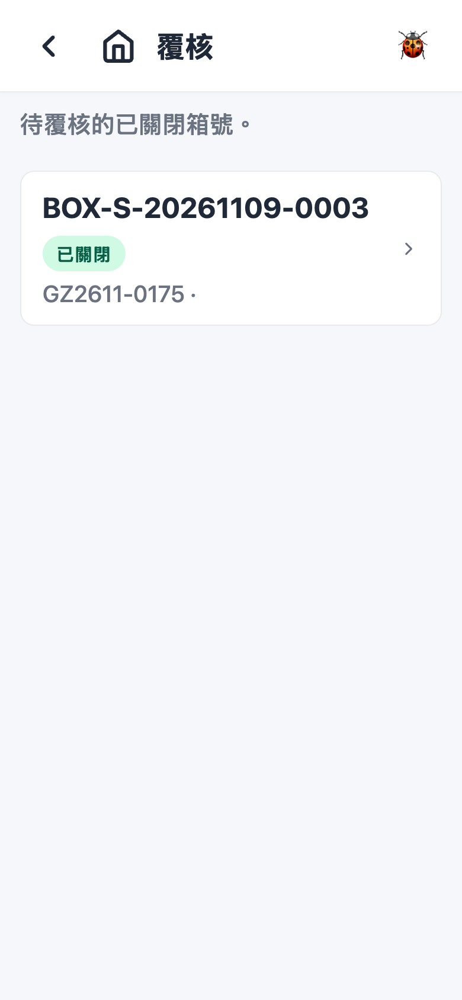
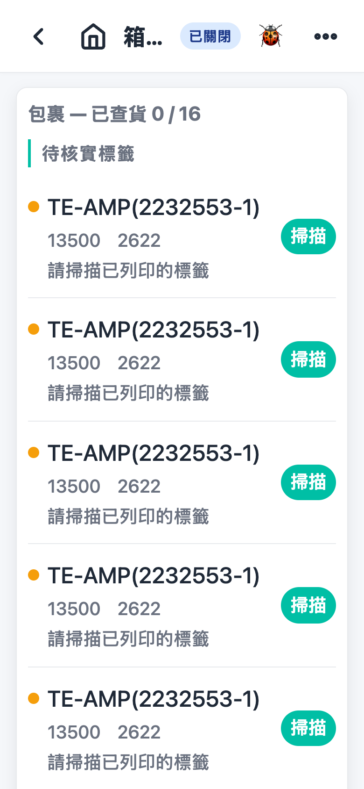
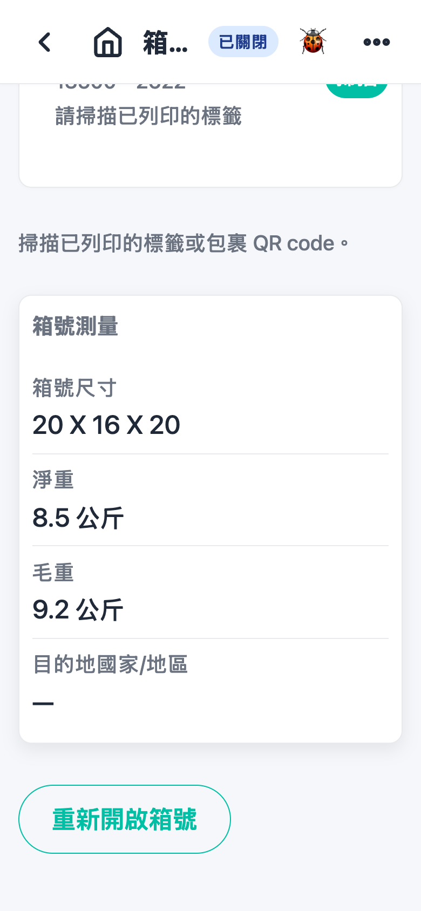
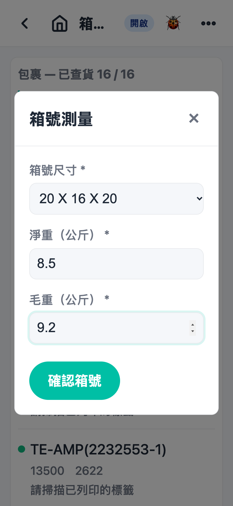
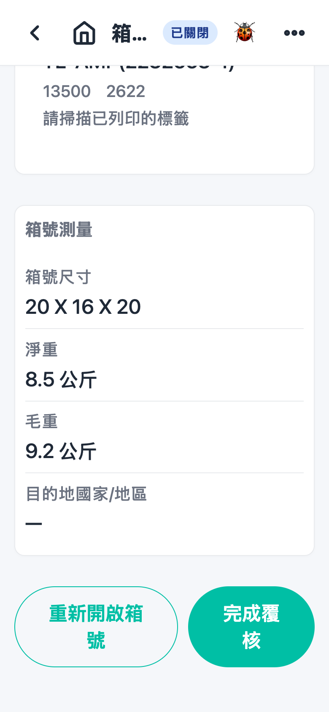

# 第 9 章 覆核（Verify）

## 用途

覆核是出货前的第二重检查：由另一位同事（或者同一位同事再次）将箱内每一件货重新扫描一次，确保箱内实物与系统记录一致，箱号才可以进入出货阶段。一个箱号一张覆核任务，在箱号关闭（或者没有开启测量步骤时在贴标签／拣货完成）之后自动产生。此功能由负责覆核的仓库操作员使用。

## 开始之前

- 已经用你的账号登录 PDA app。
- 任务有指派制度：如果该覆核任务指派给了某位同事，只有他才能看到；未指派的任务所有人都能看到。列表上有「指派給我」标记的即为你的任务。
- 前置工序须已完成：拣货完成，（如有开启）贴标签、打印标签和测量都已完成，箱号状态通常为「已關閉」。
- 准备好实物：要覆核的出货箱，以及箱内每件货／每张已打印标签（如有）。
- 如果箱有打印「箱標籤」，覆核前必须扫描它，请准备好该标签。

## 逐步操作

### 第 1 步：进入覆核列表

在主页点击「覆核」tile。画面显示所有待覆核的箱号（每个箱一张任务），每行显示箱号、相关拣货单和状态标签。列表顶部有提示「待覆核的已關閉箱號。」如果没有任务，画面会显示「暫無待覆核的箱號。」。

### 第 2 步：选择箱

有两个方法打开箱号页面：

- 直接点击列表上该行箱号；或
- 用扫描枪扫描箱上已打印的「箱標籤」或箱号 QR code——系统会自动打开对应箱号页面；扫箱标签会同时标记该标签已核实，画面弹出「箱標籤已核實」。
- 扫描后如果找不到对应箱号，会弹出「列表中找不到與『…』相符的箱號。」——即该箱没有待覆核任务，请核对是否扫错箱。

### 第 3 步：重新扫描每一件货

箱号页面会列出箱内所有包裹和扫描进度（顶部显示「包裹 — 已查貨 x / y」）。画面最多分两个区域：

- 「待核實標籤」（如箱内有已打印标签的单）：每行显示物料编号和「請掃描已列印的標籤」。先扫打印标签一次（行会变成「標籤已掃描——物料 x/y」），再扫实物；如果实物的零件编号、原产地或日期码与标签不符，系统会拒绝。如果箱有箱标签未扫，最顶部会有一行「箱標籤 — 請掃描已列印的箱標籤」。
- 「待複核掃描物料」（没有打印标签的单）：每行显示物料编号和「已掃/總數」（例如 0/10），用扫描枪逐件扫描，扫够数量该行圆点由黄变绿即完成。

注意事项：

- 扫描枪直接扫描即可，无需按按钮；QR 无法解析的标签可以点击该行的「掃描」按钮用相机拍摄。
- 箱已关闭也照样可以扫描——正常覆核就是不开箱、隔着封好的箱核对内容。
- 重复扫描已经扫齐的物料，会弹出「已全部複核掃描（x 件）。」；扫到不属于此箱的标签，会弹出「沒有與此標籤相符的未核實包裹。」。
- 未扫齐之前，页面底部有提示「掃描包裹 QR code 以核實。」或「掃描已列印的標籤或包裹 QR code。」。

### 第 4 步：（需要时）重新开箱改正

如果发现箱内资料（例如尺寸、重量）要修改，而箱状态是「已關閉」，页面下方会有「重新開啟箱號」按钮。点击之后箱会变回「開啟中」，所有包裹的已核实标记会清零，要重新扫完所有包裹才可以再次关箱。

### 第 5 步：（重新开箱后）输入测量资料并关箱

开启中的箱扫齐所有包裹后，会自动弹出「箱號測量」窗口（或者在页面右上角菜单点击「輸入測量資料」）。可以修改「箱號尺寸」、「淨重（公斤）」（系统会按料件重量自动预填）、「毛重（公斤）」；「目的地國家/地區」在 PDA 上是只读。填好点击「確認箱號」，箱会重新关闭。

### 第 6 步：完成覆核

当以下条件全部达成——所有包裹扫齐、所有已打印标签（包括箱标签）已扫、箱状态是「已關閉」（如果没有开启测量步骤，箱可以是开启中，完成时系统会顺手关箱）——页面下方会出现「完成覆核」按钮。点击它，任务完成，画面自动返回覆核列表，该箱进入出货阶段。

## 常见问题

**Q：列表找不到我们要覆核的那个箱？**
A：可能是任务指派给了另一位同事（只有他才能看到）；也可能箱还未完成前置工序（例如贴标签未做），或者已经覆核完。可以先点击列表右上角重新整理。

**Q：扫描枪扫完没有反应？**
A：先确认该箱还有待覆核项目（全部扫齐后扫描会停用）；试试扫清楚一点，或者改用该行的「掃描」按钮用相机拍摄标签。

**Q：扫描后弹出「沒有與此標籤相符的未核實包裹。」？**
A：即这张标签不属于此箱，或者对应包裹已经扫齐。核对一下是否放错了其他箱的货。

**Q：为什么没有「完成覆核」按钮？**
A：按钮只会在全部条件达成后才出现：还有包裹未扫齐（进度 x/y 未满）、有已打印标签未扫、或者箱未关闭。逐项检查页面上还有没有黄色圆点的行。

**Q：点击「完成覆核」弹出「完成覆核前必須掃描所有已列印的標籤（箱標籤及物料標籤）」？**
A：有已打印的标签未扫。回到「待核實標籤」区域，将显示「請掃描已列印的標籤」的行和最顶部的「箱標籤」行逐一扫完再点击。

**Q：按错「重新開啟箱號」怎么办？**
A：不用担心，箱只是变回「開啟中」。重新扫完所有包裹，再在「箱號測量」窗口点击「確認箱號」关箱，之后照常完成覆核。
