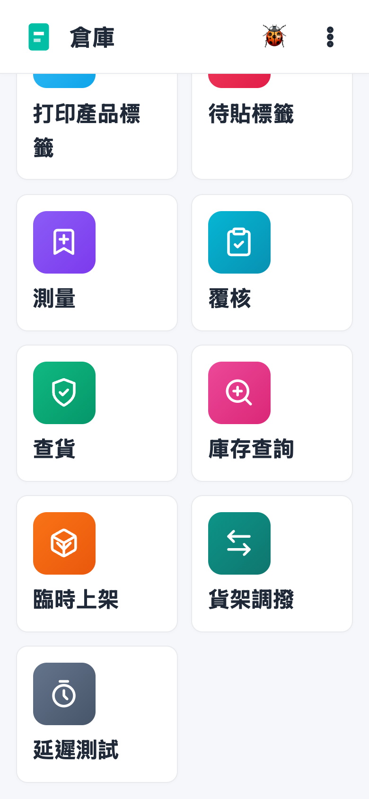
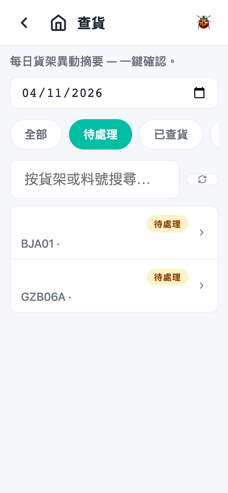
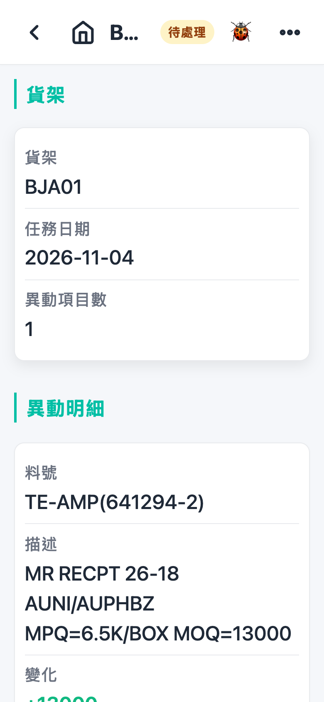
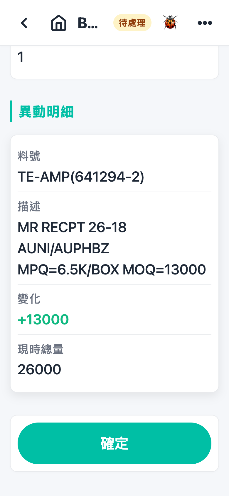
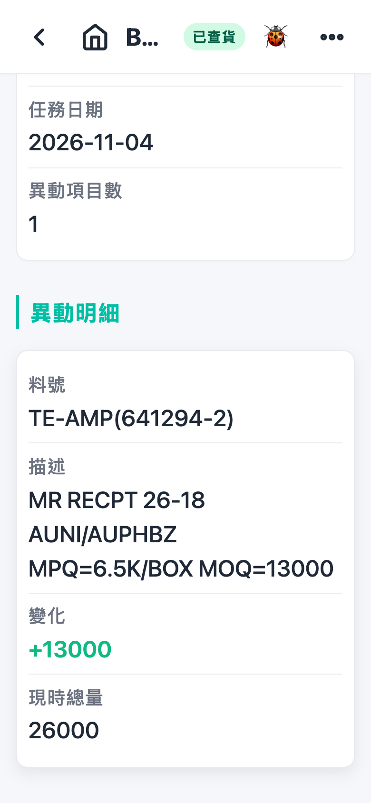

# 第 10 章 查货（Goods Verify）

## 用途

「查货」是每日收工前的货架对账工序。系统每日会自动为每个当日有库存异动（收货、上架、拣货、调整）的货架生成一张查货任务，列出该货架当日的异动摘要。操作员走到实际货架，核对架上货品及数量与系统记录是否一致，一致则一键确认。此工序只做「确认」，不会改动任何库存；如发现不对账，须使用正常的调整／上架／重扫流程处理。

## 开始之前

- 已用你的账号登录 PDA。
- 查货任务由系统自动生成（每日结束后，每个有异动的货架一张），无需人工开单；没有任务显示即表示当日没有货架发生异动。
- 确认你负责的货架范围，并预留时间走到实物货架核对。
- 查货是日终工序：建议在当日收货、拣货、上架等流程完成后再进行。

## 逐步操作

### 第 1 步：进入查货列表

在主页点击「**查貨**」图标。画面顶部会显示提示「每日貨架異動摘要 — 一鍵確認。」，下方为任务列表。

### 第 2 步：选择日期与状态筛选

- 列表默认显示**今日**的任务。要查其他日期，点击日期栏选择该日，列表会自动重新载入。
- 状态筛选可选「**全部**」、「**待處理**」、「**已查貨**」或「**已略過**」。默认为「待處理」。
- 每张任务卡会显示货架编号、异动项目数（例如「3 項物料有異動」）及状态标签。

### 第 3 步：打开一张任务

点击一张「待處理」的任务卡，进入查货详情页。顶部会显示货架编号及状态标签，下方有「任務日期」、「貨架」、「異動項目數」等资料。

一张任务＝**一个货架、一日**的异动总结，不是一种物料一张单。

### 第 4 步：核对异动明细

「**異動明細**」下方每种当日有异动的物料有一张卡，显示：

- **料号**：物料编号（有 WCL 料号会显示 WCL 料号）
- **描述**：物料描述
- **变化**：当日净异动数量，入库为绿色「+」、出库为红色「−」
- **现时总量**：生成任务时该货架上此种物料的总数

注意：这是生成任务时的快照，之后再有货物异动也不会更新此画面的数字。

### 第 5 步：走到货架实物核对

带着 PDA 走到画面显示的货架，逐种物料点算架上实物，与画面的「變化」及「現時總量」对照。

- 如果一致 → 继续第 6 步。
- 如果**不一致** → 不要点击「確定」。此页面无法改数，请通知主管，用正常的库存调整／重扫流程修正后再回来确认。

### 第 6 步：确认完成

核对无误后，点击页面底部的「**確定**」按钮（按钮会变为「確認中…」，请稍候）。成功后画面会弹出「任務已確認。」提示，任务状态变为「**已查貨**」，并记录「確認人」及「確認時間」。

### 第 7 步：处理其余任务

返回列表，重复第 3 至第 6 步，直至当日所有「待處理」任务全部完成。在列表将状态筛选设为「已查貨」，可随时检查哪些货架已确认、由谁确认。

## 常见问题

**Q：列表是空的，显示「此日期沒有查貨任務。」？**
A：即表示该日期没有货架发生库存异动，属正常。先检查日期栏是否选了今日；要查看之前的日期就点击日期栏更改日期。

**Q：为什么找不到某个货架的任务？**
A：查货任务按「日」生成，只有当日有异动的货架才会有任务。试试将状态筛选设为「全部」，再检查日期是否正确。

**Q：为什么没有「確定」按钮可点击？**
A：只有「待處理」状态的任务才会显示「確定」按钮。如果任务已经是「已查貨」或「已略過」，画面只会显示确认人及确认时间，无法再点击。

**Q：实物与画面数量不符，怎么办？**
A：不要点击「確定」。此画面不可以改数。记下是哪种物料、差多少，通知主管，用库存调整／重扫等正常流程修正，之后再回来确认。

**Q：点击了「確定」才发现不对账，可以还原吗？**
A：不可以在 PDA 还原。「確定」只是确认记录（不改库存），请立即通知主管处理。

**Q：为什么我输入关键字搜索找不到任务？**
A：搜索栏暂时对手动输入不生效（已知问题）。请改用日期及状态筛选查找任务，问题修复前不要依赖搜索栏。
